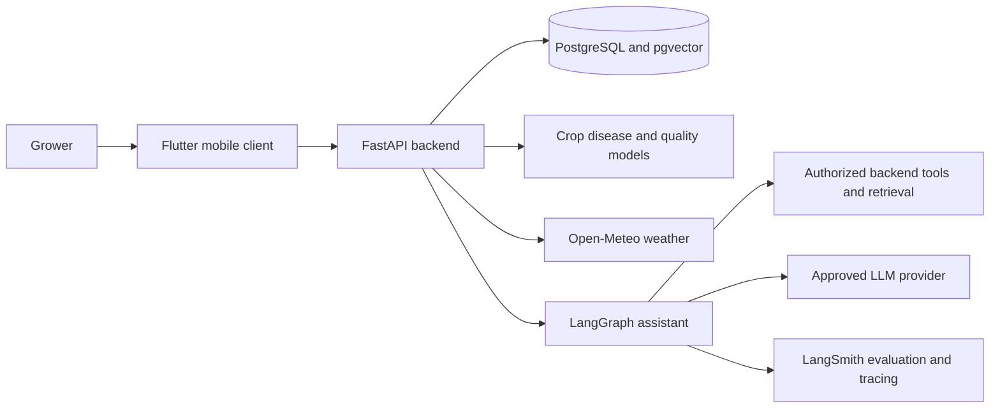
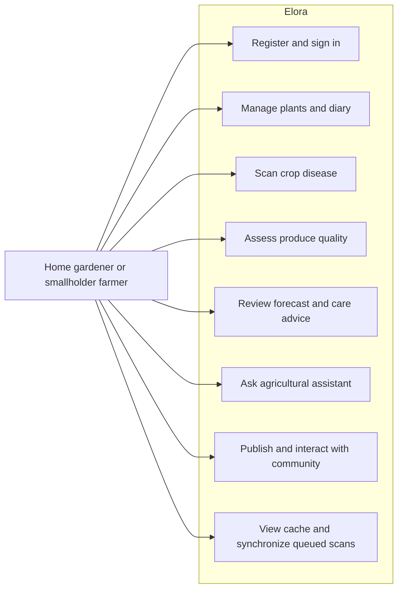
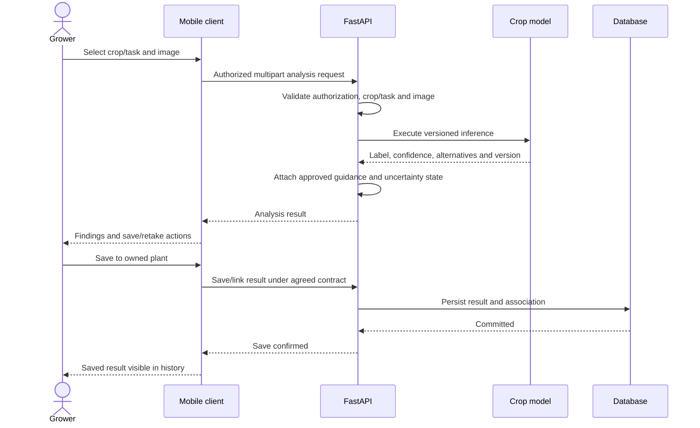

> Historical preparation material. Superseded by the [finalized SRS](../specifications/Elora_SRS.md). Preserved as evidence, not active implementation instructions.

# Software Requirements Specification

> Historical v0.2 preparation draft. Superseded by [Elora SRS v1.0](../specifications/Elora_SRS.md), its [implementation decisions](../specifications/Elora_Implementation_Decisions.md) and [dataset catalogue](../datasets/Elora_Dataset_Catalog.md). The v1.0 baseline includes newly confirmed minimal reporting/owner review and selected providers/data; use it for development.

## Elora: Crop Intelligence and Agricultural Decision Support System

Version: 0.2
**Date:** 15 November 2026
**Status:** Draft for stakeholder review
**Prepared for:** Elora project team
**Authors, group number, institution and approval signatures:** TBD

**Structure guide:** [Group 01_SRS Document.pdf — OptiWMS](https://drive.google.com/file/d/1bdhKukkHbEuTj9wk9NAtrga3zNkkvTXe/view), supplied by the user. This draft adapts its organization and feature specification format to Elora. Warehouse-specific requirements, technologies, numerical targets and team identities have not been transferred.

This specifies the intended production system, not completed functionality. Version 0.2 incorporates the stakeholder decisions in section 6.7. Unresolved engineering choices and release dependencies are in section 6.5. Conflicting earlier specifications require corresponding contract updates before implementation.

## Contents

1. Introduction
2. Overall Description
3. External Interface Requirements
4. System Features
5. Other Nonfunctional Requirements
6. Appendices

## Revision History

| Version | Date | Change | Approval |
|---|---|---|---|
| 0.1 | 15 November 2026 | Initial v0.1 draft; revised to v0.2 on 15 November 2026 with confirmed stakeholder decisions and production release gates. | Pending |

# 1. Introduction

## 1.1. Purpose

This Software Requirements Specification (SRS) defines the intended behavior, interfaces, constraints and quality requirements of Elora. It provides a common basis for implementation, verification and stakeholder acceptance across the mobile client, backend services, data store, crop models and external integrations.

Elora supports home gardeners and smallholder farmers through crop disease recognition, produce quality assessment, weather-informed care advice, a contextual agricultural assistant, and community participation. The specification covers all five development modules and their shared infrastructure.

## 1.2. Document Conventions

- **SHALL** identifies a required behavior in the proposed baseline. Draft status means these requirements still await approval.
- **SHOULD** identifies desirable behavior requiring a documented reason if omitted.
- **TBD** identifies information or a decision that has not been established.
- **High**, **Medium** and **Low** indicate proposed priorities: launch-critical, supporting, and optional/future respectively. Priority assignments in this draft require product-owner review.
- Functional IDs use `REQ-<feature>.<number>`; quality requirements use `PERF`, `SAFE`, `SEC`, `QUAL`, `DATA` and `OPS` prefixes.
- A statement marked **proposed** fills a discovered gap and is not an already approved product decision.
- Confidence is represented on a 0..1 scale; percentages are explicitly identified. Stored timestamps use UTC and ISO-8601 representations at API boundaries.

## 1.3. Intended Audience and Reading Suggestions

Product owners and academic/client reviewers should read sections 1, 2, 4 and 6.5 for scope and outstanding decisions. Mobile, backend, data and ML developers should read sections 3–5 with the referenced contracts. Testers should use the requirement IDs and section 6.4 to derive verification cases. Agronomy reviewers should focus on model coverage, uncertainty, advice grounding and safety requirements.

## 1.4. Product Scope

### 1.4.1. Core Goals

Elora aims to support earlier recognition of visible plant disease, more consistent produce grading, weather-aware care planning, grounded agricultural guidance and a continuous record of plant progress. These are intended benefits; crop-loss reduction, yield improvement and user-retention gains have not been measured.

### 1.4.2. Key Capabilities

| Capability | Intended result |
|---|---|
| Crop Health Analysis | Image-based disease findings, confidence and practical recovery guidance |
| Produce Quality Assessment | Dataset-backed condition/ripeness or bloom-stage classification; unsupported numerical estimates are excluded. |
| Predictive Farming Analytics | Current/forecast weather and explained crop-care advisories |
| Personalized Agricultural Agent | Multi-turn guidance informed by permitted plant records, diagnostics and reference knowledge |
| Community and User Accounts | Authentication, personal gardens/diaries, posts and social interactions |

Confirmed launch scope: six crops—tomato, chilli, citrus, banana, roses and chrysanthemum—with one disease model and one condition/ripeness/bloom-stage model per crop, twelve models total. This replaces earlier five-crop/ten-model summaries. Suitable permitted flower datasets and successful evaluation remain launch dependencies.

### 1.4.3. Benefits from the Project

Growers should be able to connect observations, scan results, weather and care history within one mobile experience. Explanations and uncertainty notices should support informed action. The shared contracts and module ownership structure should allow the five development slices to integrate consistently.

Excluded from the documented MVP are web/desktop clients, administrative portals, commerce/payments, drone multispectral processing, IoT sensor pairing and enterprise multi-tenancy. Dedicated extension-agent and community-coordinator workflows are post-MVP.

## 1.5. References

| Reference | Document |
|---|---|
| R1 | [User-supplied OptiWMS SRS structure guide](https://drive.google.com/file/d/1bdhKukkHbEuTj9wk9NAtrga3zNkkvTXe/view) |
| R2 | [Garden Product Requirements Document](../specifications/Garden_PRD.md) |
| R3 | [Garden Technical Requirements Document](../specifications/Garden_TRD.md) |
| R4 | [Garden UI/UX Design Specification](../specifications/Garden_UI_UX_Design_Specification.md) |
| R5 | [Backend Schema and Data Model](../specifications/Garden_Backend_Schema_and_Data_Model.md) |
| R6 | [App Flow and Screen State Specification](../specifications/Garden_App_Flow_and_Screen_State_Specification.md) |
| R7 | [API and Integration Contract](../specifications/Garden_API_and_Integration_Contract.md) |
| R8 | [Shared Model Contract](../../shared/schemas/model_contract.json) |
| R9 | [Work Distribution](../../WORK_DISTRIBUTION.md) |
| R10 | [SRS Preparation Findings](SRS_Preparation_Findings.md), including implementation evidence and conflict register |

The name Garden in reference filenames is retained for traceability. This document uses Elora, consistent with the repository. No compliance with an external SRS standard is claimed solely by following R1.

# 2. Overall Description

## 2.1. Product Perspective

Elora is a mobile-first, modular system. The Flutter client communicates with a FastAPI backend over versioned HTTP interfaces. The intended backend coordinates structured persistence, crop inference, weather data and an agricultural assistant. Modules share agreed contracts while retaining their own implementation ownership.

### 2.1.1. Mobile Client Layer

Flutter/Dart provides the first-release Android experience with the shared theme and Riverpod state management; iOS is deferred. The client supports garden, scan, chat and community workflows, cached viewing, queued scans and queued care diary entries.

### 2.1.2. Backend and Domain Layer

FastAPI exposes `/api/v1` application endpoints. The intended service layer validates inputs, authenticates users, enforces resource ownership, invokes crop/weather/agent services and persists permitted changes through asynchronous SQLAlchemy sessions.

### 2.1.3. Data and Intelligence Layer

PostgreSQL 16 stores accounts, plants, logs, assessments, schedules and community/chat records; pgvector supports authorized retrieval. All twelve crop models run on the backend. LangChain supplies typed tools, LangGraph coordinates assistant execution and LangSmith supports evaluation. Open-Meteo supplies weather. AI and hosting providers follow the agreed evaluation/budget/benchmark reviews.

## 2.2. Product Functions

### 2.2.1. Garden and Account Functions

Register/sign in, maintain user-owned plant profiles, record dated care/photo logs, display plant condition and upcoming care, and retain diagnostic history.

### 2.2.2. Diagnostic and Quality Functions

Capture/upload crop images, select a supported task, obtain versioned predictions, display confidence and alternatives, warn about uncertainty, and link saved results to plant records.

### 2.2.3. Predictive and Advisory Functions

Retrieve location-based forecasts, derive explained care advisories, and answer contextual questions using authorized records and agronomic references.

### 2.2.4. Community and Resilience Functions

Publish opted-in posts, follow users, browse interest/recent and following feeds, like/comment, bookmark/share and block users. View cached records and queue scans/care entries. Reporting, manual moderation, moderator roles and review tools are excluded.

## 2.3. User Classes and Characteristics

### 2.3.1. Home and Urban Gardener

Manages a small garden or potted plants and may have limited agronomic knowledge. Needs plain-language findings, clear photographs, simple actions and visible uncertainty.

### 2.3.2. Smallholder Farmer

Manages food/cash crops and needs disease monitoring, harvest guidance and weather-aware scheduling. May work in strong sunlight and areas with unreliable connectivity.

### 2.3.3. Supporting Stakeholders

Agronomy reviewers validate guidance and escalation rules. Developers, QA and product owners maintain and accept the system. Extension agents and community coordinators are future user classes. No administrator/moderator application role is defined in the current scope.

## 2.4. Operating Environment

### 2.4.1. Hardware Environment

The client requires an Android smartphone with camera/gallery and storage. Minimum Android version and tested-device support follow representative Sri Lankan compatibility tests for camera, offline storage, notifications and English/Sinhala/Tamil. Location can be requested from the device or manually selected; permission is not mandatory.

### 2.4.2. Software Environment

The first release targets Android in Sri Lanka with English, Sinhala and Tamil. iOS is deferred. The backend baseline remains Python 3.12/FastAPI/Pydantic/async SQLAlchemy, PostgreSQL 16/pgvector and versioned migrations. Final Android support and hosting follow testing and budget review.

### 2.4.3. Network Environment

All twelve crop models execute on the server. New crop analysis, forecasts and AI replies require internet. Offline support includes cached plants, logs, results and guides, queued photos and care diary entries, with authorized duplicate-safe synchronization.

## 2.5. Design and Implementation Constraints

### 2.5.1. Technology Constraints

Use the established Flutter/FastAPI/PostgreSQL architecture and shared contracts. Do not introduce a second client framework or a web frontend. Keep private feature implementations isolated. Version model artifacts and retain preprocessing, labels and evaluation metadata; store large datasets/weights outside ordinary Git history.

### 2.5.2. Security Constraints

User-owned records must be authorized at service boundaries. Credentials and provider secrets must not appear in source, logs or responses. Agent tool/retrieval operations inherit user permissions.

### 2.5.3. Performance Constraints

Performance acceptance requires benchmarking before separate inference and end-to-end targets are approved, as specified in section 5.1.

### 2.5.4. Safety Constraints

Predictions are advisory. Calibrated per-model thresholds and supported-domain checks may produce unable to assess reliably, with retake/specialist guidance. Care advice includes reviewed treatment references; chemical dosage is directed to approved labels/specialists. Assistant writes require explicit confirmation and ownership checks.

### 2.5.5. Business Constraints

Five developer-owned slices integrate through common contracts. Public production launch includes all selected extras and follows successful model, language/safety, security, capacity and recovery checks; announce the date afterward. Budget and named reviewers/sign-off authorities remain to be assigned.

### 2.5.6. Regulatory Constraints

The launch region is Sri Lanka. Applicable privacy/agricultural obligations and reviewed local guidance must be assessed before release. Public sharing and training use require separate explicit choices. This document does not itself establish legal compliance.

## 2.6. User Documentation

### 2.6.1. Documentation Types

Proposed deliverables are a grower quick-start guide; capture/retake and uncertainty guidance; plant diary and offline-sync guidance; assistant limitations and treatment notices; and privacy/community-sharing help. Developer API/model setup and operational deployment/recovery documentation are also proposed.

### 2.6.2. Documentation Delivery

Capture help and key safety notices should be available in-app in English, Sinhala and Tamil. Documentation delivery and offline coverage require specification. Agronomy and language approval are release requirements; reviewers and arrangements will be assigned before launch.

### 2.6.3. Documentation Standards

Instructions should use plain language, match the delivered three-language interface and preserve uncertainty. Agronomy/language approval is required before release; nominate reviewers and finalize delivery channels.

## 2.7. Assumptions and Dependencies

### 2.7.1. Assumptions

Users can supply photos and identify/select a supported crop. Weather guidance depends on suitable location and crop context. Development assumes access to representative, permitted training/evaluation data and reviewed agronomic sources. Offline functionality does not imply a deployed offline CNN or LLM.

### 2.7.2. Dependencies

Key dependencies are trained/versioned crop models, agreed labels/contracts, PostgreSQL/pgvector, image storage, Open-Meteo, an approved LLM/embedding provider, mobile OS permissions and domain review. Provider credentials, quotas, availability, cost and data-handling terms must be established before deployment.

# 3. External Interface Requirements

## 3.1. User Interfaces

### 3.1.1. Primary Mobile Interfaces

| Screen | Required interaction |
|---|---|
| Sign-in/sign-up | Enter credentials, receive validation/authentication feedback |
| My Garden | View crop blocks and access garden/community/scan/chat/more navigation |
| Selected crop block | View associated plants and recent checkup/condition summaries |
| Plant details | View plant photo, condition, history and upcoming care |
| Scan camera/gallery | Capture/select an image, receive framing guidance and recover from permission/capture failure |
| Scan results | View findings, uncertainty, symptoms and recovery actions; retake or save |
| Quality assessment | View crop-specific condition/ripeness/bloom-stage label, confidence, alternatives and uncertainty. |
| Farming analytics | View forecast, explained recommendations and care timing |
| Agricultural chat | Send text, view contextual responses and retry failed turns |
| Community | Browse/filter posts, create opted-in updates and interact |

### 3.1.2. UI/UX Design Principles

The approved visual system uses cream, leaf green and deep green with Material 3. Main actions must remain reachable and findings readable outdoors. Loading/error states must preserve context. The interface must distinguish estimated, low-confidence and illustrative outputs from confirmed stored state. No UI may report a successful save before persistence or an explicitly recorded pending state.

### 3.1.3. Screen References

The local reference set is `docs/screens/Mobile app.png`, `Block selected.png`, `Plant 1 details.png`, `Scan camera.png`, `Crop diagnosis results.png`, `Garden AI chat.png` and `Community.png`. R4/R6 define visual/state behavior. Route names and five-plot/six-crop representation still need reconciliation. This draft does not certify visual fidelity.

## 3.2. Hardware Interfaces

### 3.2.1. Input Devices

Use standard mobile OS camera/gallery and touch/keyboard interfaces. Explain denied permissions and allow recovery without losing unrelated app state. Flash/flip controls must reflect supported hardware behavior if included. Sensor pairing is excluded.

### 3.2.2. Output Devices

Present results, charts/cards, warnings and progress on the mobile display. Screen-reader support and text scaling are part of accessibility verification; no specialized output hardware is required.

### 3.2.3. Network Interfaces

Use device Wi-Fi/mobile data through OS networking. Connectivity changes must update offline/queued status. Exact background execution constraints must be defined for each supported OS.

## 3.3. Software Interfaces

### 3.3.1. Backend Services Communication

This existing route inventory needs extension for confirmed Google sign-in/linking, recovery, assistant actions, notifications, XP, follows/bookmarks/sharing, chat photos, blocking, offline diary synchronization, deletion and consent. Reporting/moderator interfaces are excluded.

| Group | Interface inventory |
|---|---|
| System | `GET /health`, `GET /api/v1` |
| Accounts | `POST /api/v1/auth/register`, `POST /api/v1/auth/login`, `GET /api/v1/profile` |
| Plants | `GET /api/v1/plants`, `POST /api/v1/plants`, `POST /api/v1/plants/{plant_id}/logs` |
| Health | `POST /api/v1/crop-health/analyze`, `GET /api/v1/crop-health/history` |
| Quality | `POST /api/v1/produce-quality/analyze` |
| Farming | `GET /api/v1/predictive-farming/weather`, `GET /api/v1/predictive-farming/recommendations`, `POST /api/v1/predictive-farming/banana/analyze` |
| Assistant | `POST /api/v1/agricultural-agent/chat`, `POST /api/v1/agricultural-agent/roses/analyze` |
| Community | `GET /api/v1/community/feed`, `POST /api/v1/community/posts`, `POST /api/v1/community/chrysanthemum/analyze` |

Save/link result, plant updates/deletion, additional history, comments/likes/follows, chat attachments/history and other UI operations need complete contracts. Multipart `image` versus `file`, result `label` versus `detected_label`, and remedy versus recovery-step representations are unresolved.

### 3.3.2. Database Interfaces

Clients access data only through authenticated backend services. Existing planned entities cover accounts, plants/logs, analysis results, forecasts/schedules, agent threads/messages/memories/tools and posts/comments/likes. Extend schemas/contracts for external sign-in identities, consent, notifications/preferences, XP/badges, follows, bookmarks, blocks, chat attachments, pending diary operations and deletion requests. Enforce ownership/public access rules and migrations; reporting/moderation entities are excluded.

### 3.3.3. External API Interfaces

Open-Meteo provides weather; backend rules derive care guidance. The assistant uses an approved generation provider and semantic retrieval. LangSmith supplies evaluation/tracing. Provider timeouts, stale-cache policy, quotas, redaction and failure behavior must be specified before interface acceptance.

### 3.3.4. Model and Mobile OS Interfaces

All crop models use R8's shared crop/task/output semantics. Responses include crop, task, label, confidence, alternatives, model version and creation time. Models require agreed input dimensions, normalization and label maps. The descriptive contract file must be complemented by enforceable validation. Mobile permissions are mediated through supported OS APIs.

## 3.4. Communications Interfaces

### 3.4.1. HTTP/HTTPS Communication

Production client/service communication shall use HTTPS. Application routes use `/api/v1`; `/health` is a diagnostic exception. JSON carries structured data and multipart carries image uploads. Exact transport deployment settings remain TBD.

### 3.4.2. Streaming and Asynchronous Communication

No approved WebSocket or server-sent-event contract is established. Chat may return a completed response under the current documented API. Any streamed response, background job or notification transport requires a defined contract before becoming a release dependency.

### 3.4.3. Data Formats and Errors

Use UTC ISO-8601 timestamps and standard units explicitly named in fields. API errors use `{ "error": { "code": string, "message": string, "details": any } }`. Defined codes cover unauthorized, forbidden, not found, invalid input, unsupported crop, model failure, rate limiting and internal failure. Idempotency keys support critical create/analyze retries; key lifetime/conflict semantics are TBD.

### 3.4.4. Security Protocols

Support email/password and Google sign-in, secure linking, verification and recovery. Source policy specifies HS256, seven-day JWTs and bcrypt with at least 12 rounds; finalize revocation, reset, verification and secure storage. Unverified email matching and agent tools must not bypass authentication.

# 4. System Features

## 4.1. Feature 1: Crop Health Analysis

### 4.1.1. Description and Priority

**Proposed priority: High. Owner: Dev 1.** Identify disease patterns in tomato/chilli images and present understandable, uncertainty-aware recovery guidance. Dev 1 also owns the corresponding quality models. Shared capture/results/history behavior supports the other approved crop modules.

### 4.1.2. Functional Requirements

| ID | Requirement |
|---|---|
| REQ-1.1 | The system SHALL allow a user to capture a crop image or select an existing image. |
| REQ-1.2 | The system SHALL accept only supported crop/task combinations and validate uploaded image content and size under the approved interface rules. |
| REQ-1.3 | The system SHALL invoke the versioned disease model assigned to tomato or chilli as selected. |
| REQ-1.4 | The system SHALL return the disease label, available pathogen information, confidence, top alternatives and model provenance. |
| REQ-1.5 | The system SHALL present severity, visible symptoms and an ordered recovery plan derived from approved guidance rather than model-generated treatment prose. |
| REQ-1.6 | The system SHALL use calibrated per-model confidence thresholds and supported-domain checks, abstain when assessment is unreliable, and offer retake or specialist guidance. |
| REQ-1.7 | The system SHALL support saving a result against an authorized plant record and retrieving the user's paginated, crop-filtered diagnosis history. |
| REQ-1.8 | The system SHALL provide retake/retry behavior for capture, network and inference failure without presenting a failed request as successful. |

### 4.1.3. Stimulus/Response Sequences

**Scenario A — Disease check:** The user selects tomato and captures a leaf. The system validates the image, invokes the tomato disease model and displays its versioned result with guidance. The user selects an owned plant and saves. The system persists the association and confirms completion; the result is available in history.

Scenario B — Uncertain/offline scan: Uncertain or unsupported input produces unable to assess reliably with retake/specialist guidance. Offline photos may be queued; reconnecting resumes authorized eligible work without duplicate analyses.

## 4.2. Feature 2: Produce Quality Assessment

### 4.2.1. Description and Priority

Priority: High. Dev 2 owns citrus; each crop owner supplies its disease and quality/maturity model. Outputs use dataset-supported condition, ripeness or bloom-stage labels. Six quality-model slots remain in scope; permitted flower data and independent local evaluation are required before public release.

### 4.2.2. Functional Requirements

| ID | Requirement |
|---|---|
| REQ-2.1 | The system SHALL accept a supported quality-task image using the shared image validation workflow. |
| REQ-2.2 | The system SHALL select the quality model assigned to the chosen crop and include its version in the response. |
| REQ-2.3 | For citrus, the system SHALL return the approved dataset-backed visual condition/quality class, model confidence, alternatives and uncertainty. |
| REQ-2.4 | The system SHALL use approved crop-specific dataset labels and SHALL NOT rename them as commercial A/B/C/Reject or export grades without matching validated ground truth. |
| REQ-2.5 | The first release SHALL omit unsupported shelf-life, harvest-date, physical-defect-percentage and numerical quality/ripeness estimates. Confidence SHALL NOT be presented as a quality or ripeness percentage. |
| REQ-2.6 | The system SHALL preserve the quality task and result when storing an assessment, without substituting disease-oriented treatment guidance. |
| REQ-2.7 | The system SHALL apply uncertainty and failure handling to quality outputs as defined by the approved quality evaluation policy. |

### 4.2.3. Stimulus/Response Sequences

Scenario A — Citrus assessment: The user submits a supported citrus image. The server validates and classifies it, returning an approved categorical label, confidence and uncertainty. The result can be saved to an owned plant/history.

Scenario B — Unsupported estimate: The app explains that the chosen model does not estimate days to harvest or remaining shelf life and does not fabricate a number.

## 4.3. Feature 3: Predictive Farming Analytics

### 4.3.1. Description and Priority

**Proposed priority: High. Owner: Dev 3.** Combine plant context and weather forecasts to explain irrigation/spray and care timing, with banana as the primary crop. Dev 3 owns banana disease and quality models.

### 4.3.2. Functional Requirements

| ID | Requirement |
|---|---|
| REQ-3.1 | The system SHALL retrieve current and seven-day weather forecasts for supplied valid coordinates. |
| REQ-3.2 | The system SHALL expose forecast temperature, humidity, precipitation and other approved fields with explicit units and retrieval time. |
| REQ-3.3 | The system SHALL generate banana-focused irrigation/spray recommendations using approved crop and forecast rules. |
| REQ-3.4 | Each recommendation SHALL identify its action, rationale and applicable next scheduled time. |
| REQ-3.5 | The system SHALL associate stored irrigation schedules with an authorized plant and track pending, completed or skipped status. |
| REQ-3.6 | The system SHALL distinguish estimated moisture from measured sensor data; IoT measurements are outside this MVP. |
| REQ-3.7 | The system SHALL expose banana disease/quality analysis through the shared model semantics. |
| REQ-3.8 | The system SHALL visibly identify unavailable/stale weather rather than presenting it as fresh; cache lifetime and fallback rules are TBD. |

### 4.3.3. Stimulus/Response Sequences

**Scenario A — Rain-aware care:** The user opens analytics for an owned banana plant and supplies location. The system retrieves the forecast, applies reviewed rules and explains whether to proceed with or delay irrigation, including the next recommended time.

**Scenario B — Provider unavailable:** Weather retrieval fails. The system displays the failure and any permitted cached forecast with its age. It does not label cached data as a fresh observation. Whether care advice can be calculated from that cache depends on the approved freshness policy.

## 4.4. Feature 4: Personalized Agricultural Agent

### 4.4.1. Description and Priority

**Proposed priority: High. Owner: Dev 4.** Provide multi-turn agricultural guidance grounded in authorized plant context, scan history, weather and approved references. Dev 4 also owns rose disease/bloom-quality models.

### 4.4.2. Functional Requirements

| ID | Requirement |
|---|---|
| REQ-4.1 | The system SHALL accept a user message with a conversation identifier and optional authorized plant context. |
| REQ-4.2 | The system SHALL preserve conversational state across turns using the approved LangGraph persistence design. |
| REQ-4.3 | The agent SHALL access plant history, diagnoses, forecasts and agronomic knowledge only through registered typed tools/retrieval services. |
| REQ-4.4 | The system SHALL restrict private records and semantic memories to the authenticated user while allowing approved public knowledge retrieval. |
| REQ-4.5 | The system SHALL ground recommendations in retrieved references and cite sources or identify general best-practice guidance. |
| REQ-4.6 | The system SHALL validate generated guidance for prohibited or ungrounded chemical prescriptions before displaying it. |
| REQ-4.7 | The agent SHALL NOT execute raw SQL or bypass backend authentication/authorization. |
| REQ-4.8 | The assistant SHALL propose and, after explicit user confirmation, create care logs, reminders or permitted plant updates. It SHALL enforce ownership, validate parameters and report actual completion. Destructive/account actions are not added by this permission. |
| REQ-4.9 | The system SHALL record tool execution metadata for evaluation subject to the approved privacy/redaction policy. |
| REQ-4.10 | The system SHALL show a recoverable chat error when tools or generation fail and preserve the user's submitted context. |
| REQ-4.11 | The system SHALL expose rose disease and dataset-supported bloom-stage inference using shared model semantics and data permitted for the intended public deployment. |

### 4.4.3. Stimulus/Response Sequences

**Scenario A — Contextual question:** The user asks about yellowing leaves in a plant-associated thread. The agent checks permitted recent history and relevant references, asks for missing observations where needed, and returns grounded guidance without asserting a diagnosis solely from an ambiguous description.

**Scenario B — Unsafe/unavailable guidance:** A question requires chemical advice but no approved source is available, or a provider fails. The system communicates the limitation, avoids inventing a recipe and offers a recoverable or specialist-review path. Trace collection follows the approved data policy.

## 4.5. Feature 5: Community and User Accounts

### 4.5.1. Description and Priority

Priority: High. Dev 5 owns accounts, gardens and community. Launch includes care notifications, XP/badges, following, bookmarks, post sharing, chat photos and blocking. XP rewards care logs/milestones with daily limits, not posts/comments. Reporting, manual moderation, moderator roles and review tools are excluded.

### 4.5.2. Functional Requirements

| ID | Requirement |
|---|---|
| REQ-5.1 | The system SHALL support email/password registration and Google sign-in, with verification, recovery and secure account-linking rules specified in the shared authentication contract. |
| REQ-5.2 | The system SHALL authenticate email/password credentials and return a bearer token with the user profile. |
| REQ-5.3 | The system SHALL allow authenticated users to retrieve their own profile and list/register supported plants. |
| REQ-5.4 | A plant record SHALL include owner, crop and growing area. Planting date, growth stage, pot/ground setting, soil type and care history are optional context. |
| REQ-5.5 | The system SHALL allow users to record photo, watering, fertilizer, pruning and note logs against owned plants. |
| REQ-5.6 | The system SHALL show plant condition/checkup information and available upcoming watering/fertilizer care. |
| REQ-5.7 | The system SHALL publish a community update only following the user's explicit sharing action. |
| REQ-5.8 | The system SHALL provide paginated For You and Following feeds. For You prioritizes recent posts matching garden crops or selected interests without a separate recommendation model; Following shows followed users. Blocking filters content and interactions. |
| REQ-5.9 | The system SHALL allow comments and enforce at most one like per user per post. |
| REQ-5.10 | The system SHALL separate private garden records from public community content. |
| REQ-5.11 | The system SHALL expose chrysanthemum disease/quality inference using the shared model semantics. |
| REQ-5.12 | The client SHALL allow offline browsing of cached plants, logs, past results and saved care guides while visibly indicating offline state. |
| REQ-5.13 | The client SHALL retain eligible queued scans and care diary entries offline, synchronize after reconnection, recheck authorization and prevent duplicate submissions. |
| REQ-5.14 | The client SHALL roll back a failed optimistic like/care-log update or clearly identify it as pending, consistent with the approved synchronization policy. |

### 4.5.3. Stimulus/Response Sequences

**Scenario A — Personal diary:** A user registers/signs in, creates a plant and records a watering/photo entry. The system validates ownership, saves the record and displays it in the plant's history. Another user's request for the private record is denied.

Scenario B — Community post: Explicit publication creates a public post. Unblocked users can browse, like/comment, follow, bookmark/share or block. Likes are unique. Blocking hides content and prevents interactions. No reporting/moderator workflow is provided.

**Scenario C — Offline continuity:** The client shows cached personal data and labels a newly queued scan as pending. On reconnection it checks session/resource validity and retries according to the approved policy. It confirms completion only after the server accepts the operation.

# 5. Other Nonfunctional Requirements

## 5.1. Performance Requirements

### 5.1.1. Response Time

| ID | Requirement / status |
|---|---|
| PERF-1 | Separate server-inference and end-to-end targets SHALL be approved after benchmarking all twelve models and representative Sri Lankan mobile connections under agreed load/image/network conditions. The old 2.5-second goal is not an accepted fixed launch threshold. |
| PERF-2 | All twelve models SHALL be benchmarked before inference targets are approved. The 1200-ms versus 1.5-second conflict is resolved through measurement and acceptance, not by assuming either threshold. |
| PERF-3 | API startup SHALL target less than 5 seconds under the agreed deployment conditions. Source: R3. |
| PERF-4 | The health endpoint SHALL target less than 50 ms under the agreed benchmark conditions. Source: R2/R3. |

### 5.1.2. Throughput

The system SHALL support 100 concurrent active users under an approved representative workload. Concurrent scans, request rates, queues, database work and provider quotas require separate measurement; this does not mean 100 simultaneous inferences.

### 5.1.3. Scalability

Initial capacity is 100 concurrent active users. Hosting/scaling follow budget and benchmark review against this capacity, 99.5% monthly availability, daily backups and 24-hour recovery objectives.

## 5.2. Safety Requirements

### 5.2.1. Agricultural and User Safety

| ID | Requirement |
|---|---|
| SAFE-1 | The system SHALL present image-based findings as advisory and preserve uncertainty notices. |
| SAFE-2 | Results SHALL use calibrated per-model thresholds and supported-domain checks, abstain where necessary and offer retake/specialist guidance. A universal fixed 0.60 cutoff is superseded. |
| SAFE-3 | Chemical guidance SHALL use approved sources and include documented protective-equipment, local-rule and specialist notices. |
| SAFE-4 | The agent SHALL use reviewed treatment references applicable to Sri Lanka, direct chemical dosage to approved labels or specialists, and avoid prohibited or unsupported recommendations. Named reviewers and maintained source governance remain release dependencies. |
| SAFE-5 | The system SHALL NOT represent an image classification as a guarantee that produce is safe for consumption. |

### 5.2.2. Operational Safety

| ID | Requirement |
|---|---|
| SAFE-6 | The system SHALL prevent unsupported model-domain requests and report inability to infer rather than fabricate a successful result. |
| SAFE-7 | The system SHALL preserve completed historical assessments as append-only evidence under the approved retention/deletion policy. |
| SAFE-8 | Retried create/analyze requests SHALL follow agreed idempotency semantics to avoid duplicate processing/records. |
| SAFE-9 | Simulated/demo outputs SHALL remain identifiable and SHALL NOT constitute release model-validation evidence. |

## 5.3. Security and Privacy Requirements

| ID | Requirement |
|---|---|
| SEC-1 | Protected service operations SHALL authenticate bearer tokens and reject missing/invalid/expired credentials. |
| SEC-2 | Every private-resource operation SHALL enforce ownership, including nested records and agent retrieval. |
| SEC-3 | Passwords SHALL be stored as bcrypt hashes with at least 12 rounds under the source security policy. |
| SEC-4 | Secrets/raw passwords SHALL NOT be exposed in source, logs, model prompts, traces or API responses. |
| SEC-5 | Uploaded images SHALL be validated for JPEG/PNG content and limited to 10 MB, subject to resolution of the implementation/contract mismatch. |
| SEC-6 | Photos/location SHALL be used only for disclosed purposes. Public sharing requires explicit intent. Training use requires separate optional opt-in; refusal SHALL NOT prevent scanning. |
| SEC-7 | Production communication SHALL use HTTPS and production configuration SHALL reject documented unsafe default secrets/settings. |
| SEC-8 | External AI receives only necessary question/plant/weather/scan context without account identifiers; photos are sent only when needed for the requested feature. Saved scans remain until deleted; unsaved photos expire after 30 days. Trace/cache redaction and retention require final settings. |

## 5.4. Software Quality Attributes

| ID | Attribute and requirement |
|---|---|
| QUAL-1 | Accessibility: the UI SHALL meet documented WCAG 2.1 AA contrast intent, including 4.5:1 normal text and 3:1 large text/key components, and undergo mobile accessibility checks. |
| QUAL-2 | Usability: findings SHALL use understandable terminology and visible recovery actions for low confidence, network and permission failures. |
| QUAL-3 | Reliability: interrupted capture/chat work and eligible pending uploads SHALL be recoverable according to the approved state policy. |
| QUAL-4 | Maintainability: modules SHALL use shared API/model contracts; schema changes SHALL use reviewed initialization changes or migrations. |
| QUAL-5 | Each model SHALL pass independent evaluation on unseen Sri Lankan phone photos and per-class error review. Model-specific acceptance thresholds require agronomy approval; aggregate dataset accuracy alone is insufficient. |
| QUAL-6 | Agent evaluation SHALL include ten standard multi-turn scenarios and zero severe chemical/dosage hallucinations in that reviewed test set. This is a bounded test criterion, not a universal safety guarantee. |
| QUAL-7 | First-release Android support SHALL follow representative Sri Lankan device testing for camera, offline storage, notifications and three-language rendering. Publish the minimum Android version/tested-device list afterward. iOS is deferred. |

## 5.5. Data, Availability and Operations

| ID | Requirement / open measurement |
|---|---|
| DATA-1 | Persisted user records SHALL preserve foreign-key integrity and enforce agreed domain constraints. |
| DATA-2 | Analysis records SHALL identify crop, task, model version and creation time; session ownership and optional plant linkage SHALL be retained. |
| DATA-3 | Private/public embeddings SHALL be separated by enforced retrieval permissions. |
| DATA-4 | Account deletion SHALL disable access immediately, remove active account/private garden/photos/chat/public posts/comments within 30 days and expire backup copies within a further 30 days. Document narrowly required exceptions and preserve deletion intent after restores. |
| OPS-1 | Agent tool runs SHALL provide approved trace/evaluation metadata without violating privacy policy. |
| OPS-2 | The system SHALL target 99.5% monthly availability, use daily backups with maximum RPO 24 hours, and restore service within RTO 24 hours. Test backup/restore procedures; monitoring, maintenance accounting and backup retention settings require definition. |

# 6. Appendices

## 6.1. Glossary of Terms

| Term | Meaning |
|---|---|
| SRS | Software Requirements Specification |
| MVP | Minimum viable product release |
| CNN | Convolutional neural network used for image classification/assessment |
| Inference | Executing a trained model on an input to obtain a prediction |
| Confidence | Reported prediction score; calibration/uncertainty policy must define its interpretation |
| Crop slug | Stable identifier such as `tomato`, `chilli` or `citrus` |
| Analysis session | Record of a crop/task image-analysis operation and its provenance |
| Grounding | Basing an answer on retrieved authorized context and approved knowledge |
| JWT | JSON Web Token used for bearer authentication |
| pgvector | PostgreSQL extension for vector storage and similarity retrieval |
| Idempotency | Preventing a retried logical operation from creating duplicate effects |
| RPO / RTO | Recovery point objective / recovery time objective |
| TBD | Unresolved information requiring an explicit decision |

## 6.2. Analysis Models

### 6.2.1. High-Level System Architecture

This diagram represents the intended architecture. All twelve crop models run on the backend at launch; on-device inference is excluded from the first release.

### 6.2.2. System Use Case View

### 6.2.3. Diagnostic Sequence

The save/link endpoint and whether inference first creates a durable unlinked session remain TBD; this sequence expresses required user-visible behavior without fixing that storage decision.

### 6.2.4. Principal Data Relationships

A user owns plants, analyses, conversations and posts. A plant has diary entries, optional linked analyses and schedules. An analysis produces a disease or quality result. A conversation contains messages and tool runs. A post receives comments and likes. Detailed planned entities/constraints are in R5; the existing initialization script implements only a subset.

## 6.3. Confirmed Model Slots and Dataset Dependencies

| Crop | Disease model | Quality model | Owner |
|---|---|---|---|
| Tomato | CNN-TOM-DIS | CNN-TOM-QLT | Dev 1 |
| Chilli | CNN-CHL-DIS | CNN-CHL-QLT | Dev 1 |
| Citrus | CNN-CTR-DIS | CNN-CTR-QLT | Dev 2 |
| Banana | CNN-BAN-DIS | CNN-BAN-QLT | Dev 3 |
| Roses | CNN-ROS-DIS | CNN-ROS-QLT | Dev 4 |
| Chrysanthemum | CNN-CHR-DIS | CNN-CHR-QLT | Dev 5 |

The six-crop/twelve-model slots are confirmed. Quality/maturity outputs use dataset-supported crop-specific labels. Dataset rights, final mappings, artifacts, local field evaluation and calibrated thresholds remain dependencies. Research-only rose data cannot be assumed usable for production; chrysanthemum stage annotations must be obtained.

## 6.4. Requirement Sources and Acceptance Outline

| Requirement group | Primary sources | Acceptance evidence |
|---|---|---|
| REQ-1.* | R2 health requirements; R4/R6 scan flows; R7/R8 | Real-model scan, boundary/low-confidence tests, persisted save/history and owned-resource tests |
| REQ-2.* | R2 quality requirements; R5 quality data; R7/R8 | Crop/task-specific output validation, quality evaluation and reviewed estimate limits |
| REQ-3.* | R2 farming requirements; R5 schedules; R7/R8 | Forecast fixtures, reviewed recommendation rules and outage/staleness handling |
| REQ-4.* | R2 agent requirements; R3 authority; R5/R7/R8 | Multi-turn scenarios, correct tools, grounding, user isolation and unsafe-output checks |
| REQ-5.* | R2 core/community; R4/R5/R6/R7/R8 | Registration/ownership, diary/feed persistence, one-like constraint and offline/retry tests |
| PERF-* | R2/R3 | Approved reproducible timing/load benchmarks |
| SAFE-*/SEC-* | R2/R3/R6/R7; proposed clarifications identified above | Agronomy/security review, validation, authorization and duplicate-prevention tests |
| QUAL-*/DATA-*/OPS-* | R2–R8; proposed policies where TBD | Field/model evaluation, accessibility/device checks, migration/restore and privacy evidence |

Before approval, trace each atomic requirement to a specific test/evaluation case, responsible owner and acceptance result. Existing tests and mock outputs do not establish full-system acceptance.

## 6.5. Remaining Engineering Decisions and Release Dependencies

| ID | Decision required |
|---|---|
| TBD-01 | Finalize consistent Elora naming, author/institution details and named sign-off authorities. |
| TBD-02 | Resolved: six crops and twelve models. Align older specifications and represent all six crops in the garden. |
| TBD-03 | Confirmed: public Android launch in Sri Lanka, three languages, all selected extras and readiness-gated date. Budget, exact crop labels and tested Android support remain open. |
| TBD-04 | Reconcile upload `image`/`file`, output `label`/`detected_label`, recovery/remedy fields, model validation and plant association. |
| TBD-05 | Complete contracts for save/history, plant update/delete, citrus disease routing, task selection, comments/likes and chat history. |
| TBD-06 | Extras confirmed: care notifications, XP/badges, following, bookmarks, sharing, chat photos and blocking. Finalize routes/contracts; omit reporting/moderator tools. |
| TBD-07 | Server inference confirmed. Evaluate LLM/embedding and hosting options before selection; define storage, timeouts, cache and fallback rules. |
| TBD-08 | Acquire permitted datasets, audit labels/splits, obtain flower-stage data, test unseen Sri Lankan phone photos and approve per-class acceptance/uncertainty thresholds. Unsupported numerical estimates are excluded. |
| TBD-09 | Crop and growing area are required; additional care context is optional. Device/manual location is supported. Validate care rules and missing-context explanations. |
| TBD-10 | Benchmark before latency targets. Confirmed: 100 active concurrent users, 99.5% availability, daily backups, RPO 24 hours and RTO 24 hours. Define load, monitoring and restore tests. |
| TBD-11 | Maintain reviewed Sri Lankan treatment sources and require agronomy/language approval; nominate reviewers later but before public launch. |
| TBD-12 | Finalize secure email/password plus Google linking/recovery and sessions. Implement optional training consent, minimized AI context and agreed retention/deletion. Blocking only; no reporting/manual moderation. |
| TBD-13 | Specify offline limits, encryption, queue eviction, token expiry, retry/idempotency and conflict handling. |
| TBD-14 | Finalize documentation, notification/XP limits and supporting technical contracts. Announce public launch after all required acceptance checks pass. |

## 6.6. Current Implementation and Approval Status

Local source review found a Flutter shell with placeholder community/chat/more tabs, camera/gallery image selection, and a tomato/chilli analysis API supporting disease/quality task inputs. The scan UI currently fixes crop selection to tomato. The classifier derives mock predictions from image-byte sums rather than trained neural inference. The save button displays a snackbar without persisting a result. Only users/plants tables and the vector extension appear in database initialization. Authentication, history, weather, agent and community feature routes are not registered in the inspected backend.

The intended full system described above must therefore be distinguished from this prototype. The earlier investigation did not run app builds, tests, real models, database migrations or external integrations. This draft introduces documentation only and does not certify runtime behavior or alter canonical contracts.

Scope and release approach are confirmed in v0.2. Public access/date announcement depend on passing technical, model/data, language/agronomy, security, capacity and recovery checks. Budget, named reviewers and measured implementation settings remain open.

## 6.7. Confirmed Stakeholder Decisions and Additional Requirements

Version 0.2 records the project owner's decisions from the requirements interview. These choices define intended launch behavior and replace conflicting draft assumptions; they do not certify implementation or release acceptance.

Launch baseline: public production in Sri Lanka, Android first and iOS later, all six crops/twelve server-side models, English/Sinhala/Tamil, all selected extras and blocking only. No reporting, manual moderation, moderator roles or review interfaces are included.

Production acceptance: 100 concurrent active users; 99.5% monthly availability; daily backups; maximum 24-hour data-loss window and restoration within 24 hours. Latency thresholds follow twelve-model/mobile-network benchmarks. All models need unseen Sri Lankan phone-photo testing, per-class review and calibrated abstention thresholds.

Quality outputs use permitted dataset-backed condition/ripeness/bloom-stage labels. Unsupported numerical estimates and commercial grades are excluded. Flower-data acquisition/rights and local validation remain launch dependencies. Care advice includes reviewed treatment references with dosage referred to approved labels/specialists. The assistant may propose actions and execute confirmed care logs, reminders and permitted plant updates within ownership boundaries.

External AI receives minimized necessary context without account identifiers; photos are transferred only when needed for the requested feature. Providers follow multilingual/safety/tool/privacy/latency/cost evaluation. Hosting follows budget and benchmark review. The review arrangement is assigned later; required agronomy/language, model/data, security, capacity and recovery approvals must pass before announcing public launch.

The following additions complement the amended requirements in sections 3–5. Exact API fields, points/caps, Android devices, trace/cache settings and named reviewers remain engineering or release dependencies; no measurements are claimed complete.

| ID | Additional requirement | Acceptance check |
|---|---|---|
| REQ-4.12 | The chat interface SHALL accept a user-selected plant photo, associate it with the authorized thread and route supported disease/quality tasks through approved server models. External photo transfer follows the minimized-context policy; uncertain outputs remain uncertain. | Attach a supported photo to an owned thread; verify authorized analysis, correct uncertainty and no cross-user access. |
| REQ-5.15 | The system SHALL provide care notifications linked to owned plants and confirmed schedules/reminders, with user notification preferences. | Confirm a reminder and receive its notification under permitted Android settings; verify owner and schedule. |
| REQ-5.16 | The system SHALL award XP/badges for accepted care logs and plant-tracking milestones, subject to daily limits and duplicate-event prevention. Community posts/comments do not earn XP. | Replay a care event and exceed the configured cap; no duplicate or excess XP is awarded. Exact points/caps/badge criteria require a shared rule. |
| REQ-5.17 | Users SHALL be able to follow/unfollow users and view followed users' posts in Following, subject to blocking. | Follow/unfollow and verify feed inclusion/removal and block restrictions. |
| REQ-5.18 | Users SHALL be able to bookmark/unbookmark community posts and retrieve their own bookmarks, subject to visibility/block rules. | Verify bookmarking, removal, owned retrieval and changed visibility. |
| REQ-5.19 | Users SHALL be able to initiate sharing of a public community post. Sharing SHALL NOT expose private garden, chat or scan records. | Share a public post and verify that its destination exposes only permitted public content. |
| REQ-5.20 | Users SHALL be able to block/unblock another user. Blocking SHALL hide that user's posts/comments and prevent their interactions with the blocker. Reporting and moderator roles/review tools are excluded. | Test feeds, comments and interaction endpoints for both blocked users; specify edge-case directionality in the contract. |
| REQ-5.21 | The Android app SHALL support English, Sinhala and Tamil at launch, including interface text and understandable agricultural guidance. Agronomy and language approvals are release prerequisites; reviewers will be assigned later. | Complete core workflows in all three languages and record domain/language review approval. |
| REQ-5.22 | Training use of user-uploaded photos SHALL require separate optional opt-in. Refusal SHALL NOT prevent crop scanning. Preserve the applicable consent choice when handling images. | Scan with training opt-in declined; verify the photo is excluded from training selection while scanning works. |
| REQ-3.9 | Weather location SHALL support device permission or manual area selection. Personalized care requires crop/growing area, optionally using planting date, growth stage, pot/ground setting, soil type and history; explain limits when context is missing. | Deny location permission and select an area manually; generate bounded advice with optional inputs absent. |
| REQ-5.23 | The system SHALL keep saved private scans until user deletion and automatically remove unsaved scan photos after 30 days. | Verify saved/unsaved lifecycle at the configured boundary and a user's explicit deletion. |
| REQ-5.24 | Account deletion SHALL disable access immediately; delete active account/private garden/photos/chat/public posts/comments within 30 days and expire backup copies within a further 30 days, documenting narrowly required exceptions. | Verify immediate lockout, active-store deletion, backup expiry policy and restore suppression for deleted data. |
