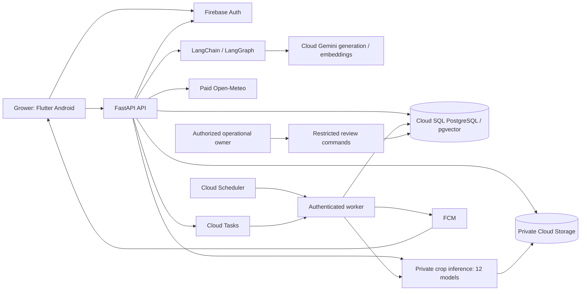
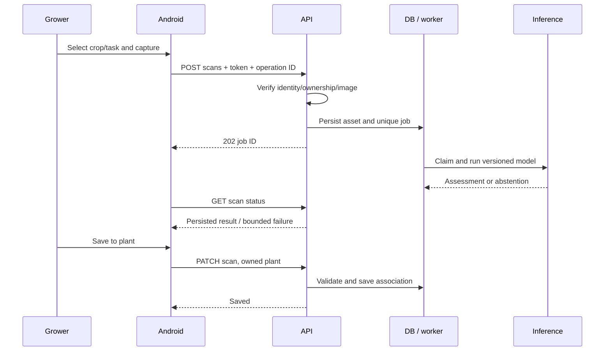

> Historical preparation material. Superseded by the [finalized SRS](../specifications/Elora_SRS.md). Preserved as evidence, not active implementation instructions.

# Software Requirements Specification

## Elora — Crop Intelligence and Agricultural Decision Support System

| Document control | Value |
|---|---|
| Version | 1.0 — implementation baseline |
| Date | 15 November 2026 |
| Prepared for | Elora product owner and five-developer team |
| Status | Specification baseline for development; production acceptance not yet demonstrated |
| Authoring | Prepared with the product owner; named institutional authors/signatures belong on the submitted cover sheet |
| Repository | [Tenzrr/Elora](https://github.com/Tenzrr/Elora) |
| Structure guide | [User-supplied Group 01 SRS PDF](https://drive.google.com/file/d/1bdhKukkHbEuTj9wk9NAtrga3zNkkvTXe/view) |

This document follows the guide's six main sections, their principal subsections, and the description/priority, functional requirement and stimulus/response pattern for each of five features. It specifies Elora, not the guide's warehouse system. Template identities, warehouse hardware, technologies, numerical targets and claims of implemented functionality are not copied.

The product owner has authorized choosing the implementation baseline before development. This SRS and its two normative companions—[implementation decisions](../specifications/Elora_Implementation_Decisions.md) and [dataset catalogue](../datasets/Elora_Dataset_Catalog.md)—take precedence over conflicting Garden-era documents, the earlier SRS v0.2 and prototype behaviour. Existing code and schema files are not evidence that the specified system already works. Contract/schema reconciliation is the first implementation task.

## Revision history

| Version | Date | Change |
|---|---|---|
| 0.2 | 15 November 2026 | Stakeholder decisions captured in preparation draft; many tools and datasets unselected. |
| 1.0 | 15 November 2026 | Repository baseline, selected stack/providers, twelve-model dataset plan, explicit interfaces and policies, verification/release gates. Owner confirmed minimal reporting and owner review, superseding blocking-only scope. |

## Contents

1. [Introduction](#1-introduction)
2. [Overall Description](#2-overall-description)
3. [External Interface Requirements](#3-external-interface-requirements)
4. [System Features](#4-system-features)
5. [Other Nonfunctional Requirements](#5-other-nonfunctional-requirements)
6. [Appendices](#6-appendices)

# 1. Introduction

## 1.1 Purpose

This SRS defines required user behaviour, system boundaries, interfaces, data rules and acceptance obligations for Elora. Developers implement these decisions; testers verify them; the product owner accepts scope and release evidence. It covers the Android application, backend, twelve crop models, assistant, databases, object storage, external services and operating processes.

## 1.2 Document conventions

- **SHALL** denotes a required, testable obligation. **SHOULD** denotes a preference whose omission needs a recorded reason. All listed launch features are required; priorities determine implementation order, not permission to omit them.
- `REQ-1.*`–`REQ-5.*` identify functional requirements; `PERF`, `SAFE`, `SEC`, `QUAL`, `DATA` and `OPS` identify nonfunctional requirements. IDs are frozen from version 1.0; earlier draft wording is historical.
- A **baseline** is a chosen development direction. A **release gate** is evidence or an approval required before launch. Neither means that training, testing, billing setup or deployment has happened.
- Timestamps are UTC ISO 8601 at interfaces; displayed local times use `Asia/Colombo`. Model confidence is 0–1 and is not a quality, disease severity or ripeness measurement.
- Crop slugs are `tomato`, `chilli`, `citrus`, `banana`, `roses`, `chrysanthemum`; model tasks are `disease` and `quality`. “Quality” includes dataset-backed visual condition or growth stage.

## 1.3 Intended audience and reading suggestions

The owner/reviewers read sections 1, 2, 4 and 6.5. All developers read sections 3–5 and the two normative companions; then their owned module in section 4. ML owners also use the dataset intake procedure. Testers derive cases from requirement IDs and the acceptance matrix. Operations uses sections 5.5–5.6 and the deployment companion. Agricultural/language reviewers assess labels, advice, uncertainty and the three-language interface.

## 1.4 Product scope

### 1.4.1 Core goals

Help Sri Lankan growers recognize supported visible crop conditions, assess categorical produce/bloom stages, plan weather-aware care, ask contextual agricultural questions and record/share plant progress. Yield improvement or loss reduction is an intended benefit, not an established result.

### 1.4.2 Key capabilities

| Module | Launch capability | Owner |
|---|---|---|
| Crop Health Analysis | Common capture/inference/history workflow; tomato/chilli disease and quality models | Dev 1 |
| Produce Quality Assessment | Dataset-supported quality results; citrus disease and quality models | Dev 2 |
| Predictive Farming Analytics | Weather, reviewed care rules, schedules; banana models | Dev 3 |
| Personalized Agricultural Agent | Grounded multilingual assistant and confirmed actions; rose models | Dev 4 |
| Community and User Accounts | Accounts, gardens/diary, feeds, social actions, blocking/reporting/review, rewards; chrysanthemum models | Dev 5 |

Six crops and twelve separately versioned models are required, including both flower models. The six quality tasks use supported labels in the dataset catalogue. Launch includes notifications, XP/badges, following, bookmarks, public post sharing and chat photo attachments. Android launches first; English, Sinhala and Tamil are all launch languages. iOS is subsequent scope.

### 1.4.3 Project benefits and exclusions

Elora connects observations, models, care history, weather and reference material in one experience. It provides decision support with uncertainty, not a laboratory diagnosis or a food-safety certificate. Excluded: commerce/payments, IoT/soil sensors, drones, precise yield/irrigation-volume/shelf-life estimates, unsupported commercial grades, on-device inference, direct user-to-user messaging, a separate web/desktop client and an admin portal. A minimal read-only public post page and operational review commands are permitted supporting interfaces.

## 1.5 References

| ID | Reference and role |
|---|---|
| R1 | [Supplied SRS guide](https://drive.google.com/file/d/1bdhKukkHbEuTj9wk9NAtrga3zNkkvTXe/view): structure and presentation pattern. |
| R2 | [Implementation decisions](../specifications/Elora_Implementation_Decisions.md): normative tools, providers, deployment, auth, weather, agent and offline policies, with official documentation links. |
| R3 | [Dataset catalogue](../datasets/Elora_Dataset_Catalog.md): normative selected sources, labels, rights checks and model intake/evaluation process. |
| R4 | [Team ownership](../../WORK_DISTRIBUTION.md) and [agent instructions](../../AGENTS.md). |
| R5 | [Local screen references](../screens/) and [Figma](https://www.figma.com/design/i3Jq3mO3o724r7J8JjkKLv/My-Garden?m=dev): visual reference, subject to explicit scope changes here. |
| R6 | [Legacy API contract](../specifications/Garden_API_and_Integration_Contract.md), [data model](../specifications/Garden_Backend_Schema_and_Data_Model.md), [TRD](../specifications/Garden_TRD.md), [UI spec](../specifications/Garden_UI_UX_Design_Specification.md), [flows](../specifications/Garden_App_Flow_and_Screen_State_Specification.md), [PRD](../specifications/Garden_PRD.md): subordinate detail pending reconciliation. |
| R7 | [Shared model contract file](../../shared/schemas/model_contract.json): existing descriptive artifact to be upgraded to section 3.3.4 before implementation. |
| R8 | [Google Play UGC policy](https://support.google.com/googleplay/android-developer/answer/9876937?hl=en-GB): public community reporting/blocking and operational response obligations. |

Following the guide is not a claim of certification to an external SRS standard.

# 2. Overall Description

## 2.1 Product perspective

### 2.1.1 Mobile client layer

Flutter presents the three-language Android experience, camera/gallery, location choices, permission prompts, private cached records and a durable offline outbox. The mobile app contains no provider secrets or private database connection. It does not run the crop models locally.

### 2.1.2 Backend and intelligence layer

A modular FastAPI API authenticates requests, enforces ownership, persists records and calls a private crop-inference service. LangChain typed tools and LangGraph state support the assistant. Reviewed rule logic produces weather advice. Each crop owner implements both assigned models; shared capture/results contracts apply to all crops.

### 2.1.3 Persistence and external services

Cloud SQL PostgreSQL/pgvector stores structured state and approved knowledge embeddings. Private Cloud Storage stores images/model artifacts. Firebase provides identity and FCM; Google Cloud provides generation/embeddings; Open-Meteo provides weather/geocoding. Detailed choices and official references are in R2. A provider failure must have a visible bounded outcome rather than a fabricated result.

## 2.2 Product functions

Users authenticate, set language/interests, register plants, scan supported organs, review/save categorical results, log care, view forecasts/schedules, receive optional reminders, ask grounded questions, confirm permitted assistant actions, share posts and interact with other growers. Users control training consent, blocks and account deletion. Owners review reports through a restricted operational process.

## 2.3 User classes and characteristics

| User class | Needs and authority |
|---|---|
| Grower | Varied technical/agricultural literacy; manages own plants/history/chat, scans, community and preferences. No access to another grower's private records. |
| Public post recipient | May open the shared read-only post page; sees only intentionally public content. No private history or mutation authority. |
| Authorized operational owner | Restricted authenticated report review/removal/suspension and operational recovery. This authority is not granted to ordinary grower tokens or LLM tools. No admin portal. |
| Agronomy/language reviewer | Approves labels, guidance, terminology and evaluation artifacts. Does not automatically gain production private-data access. |
| Developer/integration coordinator | Uses development/staging and reviewed deployment tooling; production access follows least privilege. |

## 2.4 Operating environment

### 2.4.1 Hardware

Android phones with camera and local storage; optional GPS. No external sensor is required. Cloud CPU inference is the initial baseline; GPU hosting is not a prerequisite. Minimum RAM/Android version and the tested-device list are established through representative compatibility tests before release, covering lower/midrange Sri Lankan devices, camera, local persistence, notifications and all three scripts.

### 2.4.2 Software

Flutter stable, FastAPI/Python, PostgreSQL/pgvector, TensorFlow/Keras, Firebase and Google Cloud managed services as specified in R2. Pin compatible exact versions in lockfiles/build configuration at bootstrap and record them in each release manifest. Android target SDK and Play packaging must satisfy the policies applicable at submission; do not freeze a stale target number in this SRS.

### 2.4.3 Network

Wi-Fi/mobile data is required for authentication refresh, inference, new weather, AI and social synchronization. Cached viewing, scan capture/queueing and care diary creation work offline after an authenticated session has established local state. Background synchronization is best effort; foreground resume is a required recovery path.

## 2.5 Design and implementation constraints

### 2.5.1 Technology and integration constraints

Keep the Flutter/FastAPI modular repository and twelve-model division. No separate mobile framework, vector database or twelve independent model services. All public application routes use `/api/v1`; all model inputs/outputs use one enforceable shared contract. Shared changes require reviewed PRs and migrations. Existing mocks and illustrative Figma values must not reach production as genuine results.

### 2.5.2 Security and privacy constraints

Use managed Firebase identity and server authorization. Private records remain private unless explicitly shared. Training use needs separate optional consent. External AI receives only necessary context. R2's authenticated quotas and data minimization apply. Permission refusal must preserve manual location/gallery or other relevant alternatives where feasible.

### 2.5.3 Performance and safety constraints

Target 100 concurrent active users and 99.5% monthly application availability. Response-time targets for scans must come from measured representative workloads, not contradictory legacy numbers. Disease/quality labels are bounded by actual validated data. Independent Sri Lankan evaluation, abstention and reviewed advice are mandatory public-release gates.

### 2.5.4 Business, distribution and regulatory constraints

Launch is public production after acceptance gates, not a demo with a fixed academic deadline. No paid infrastructure is provisioned without approved spend and account ownership. Privacy notices, consent, agricultural advice and cross-border processing require appropriate prelaunch review; this document does not assert legal compliance. Public community content includes report/block controls and a designated owner response process in line with R8; a Play listing still requires submission review.

## 2.6 User documentation

### 2.6.1 Documentation types

Provide quick start/sign-in, capture/retake help, supported labels/limitations, offline queue/conflict help, weather freshness explanations, assistant confirmation/limitations, care/reminder preferences, community rules/report/block help, training consent and account deletion guidance. Provide developer setup, generated OpenAPI/model metadata and an operational deploy/rollback/backup/review runbook.

### 2.6.2 Delivery

Essential capture, uncertainty, consent, offline and safety help is bundled in the app in all three languages and available offline. The privacy policy, terms/community rules and detailed support information are accessible before account creation and linked from Settings. Their published URLs are release artifacts; do not invent hosted links before publication.

### 2.6.3 Standards

Use plain language, readable scripts and reviewed agricultural terms. Do not ask developers to write screen-state essays: requirements here prescribe outcomes; generated schemas, test results and short PR evidence document implementation. Agronomy and three-language approvals are required before release.

## 2.7 Assumptions and dependencies

### 2.7.1 Assumptions

Users select the crop and supported organ; a photo may still be invalid or outside model scope. Model confidence alone does not establish an in-domain input. Weather is a location-based forecast, not measured soil state. A user can decline training consent without losing scanning access.

### 2.7.2 Dependencies

Permitted original image data, additional local field photos, reviewers, provider accounts/quotas, model artifacts, validated devices and operations staffing are needed. Chrysanthemum stage data needs additional collection. R3 distinguishes available candidates from verified rights or successful models. These are implementation/release dependencies, not requests for developers to decide product scope.

# 3. External Interface Requirements

## 3.1 User interfaces

### 3.1.1 Primary screens and required outcomes

| Interface | Required content/action |
|---|---|
| Onboarding/auth/settings | Three-language selection, email/Google sign-in, verification/recovery, consent and preferences; account deletion with recent reauthentication. |
| My Garden / crop block | Dynamic crop blocks for all six crops, selected plants and condition summaries; empty-garden add-plant action. The five illustrated blocks are not a five-crop limit. |
| Plant detail / diary | Photo, crop/area, optional context, saved scans, care history, next scheduled tasks and offline pending markers. |
| Scan camera / gallery | Crop/task/required organ selection, framing guidance, permission alternatives, capture, upload or explicit queue action. |
| Scan/quality result | Supported categorical label or abstention, uncertainty, model version, approved relevant guidance, save/retake action. Never show invented severity/quality numbers. |
| Weather / care | Current/seven-day forecast, units, location and freshness, rule explanation and schedule management. |
| Assistant | Text/photo turns, relevant context, source links, action preview/confirmation and actual completion/error state. |
| Community | For You/Following, explicit post creation, crop tags, likes/comments/follows/bookmarks/share, report/block actions. |
| Pending work / notifications | Queued items, retry/discard/conflict actions, reminder preferences and in-app due tasks. |

### 3.1.2 UI/UX principles

Use approved cream/leaf-green/deep-green design and Material 3. Loading, empty, invalid-input, denied-permission, offline and failure/retry outcomes must be understandable and preserve entered work. The SRS requires the observable behaviours; it does not require a separate full mockup of every state. Provide screen-reader labels, scalable text, accessible contrast, non-colour status indicators and adequate touch targets. Never indicate “saved” or “posted” until server persistence, or explicitly label a locally persisted item “pending”.

### 3.1.3 Screen references

Inspect R5's seven PNGs before implementing mobile screens. Preserve their composition unless this SRS requires additional content (six crops, language controls, uncertainty, reporting, offline state). Do not treat sample XP, labels, recovery steps or number of blocks as runtime truth. New screens extend the shared theme. Detailed widget layout belongs in the UI specification/implementation, not duplicated in every requirement.

## 3.2 Hardware interfaces

### 3.2.1 Input

Use OS camera, gallery, touch/keyboard and optional foreground device location. Request permissions when needed with purpose text. Support hardware-dependent flash/flip only when available. Do not require continuous/background location.

### 3.2.2 Output

Use the phone display, assistive technology and optional Android notifications. Notifications must not expose exact location, private scan diagnoses or chat text on a lock screen by default.

### 3.2.3 Network

Use OS HTTPS networking, detect/recover from connectivity loss, and preserve stable operation IDs across retries. Connectivity indicators are hints; the actual request outcome determines queue/retry state.

## 3.3 Software interfaces

### 3.3.1 API contract

The following is the normative route inventory; derive exact OpenAPI request/response schemas and fixtures before each slice is implemented. IDs are opaque UUIDs; list routes support cursor pagination with default 20/max 100. All listed routes require authentication except health, provider-driven verification/recovery, supported public model metadata and the read-only public share page. Authorize resources independently of knowing their UUID.

| Route group | Required operations under `/api/v1` |
|---|---|
| Profile/identity | `POST /session` verifies Firebase token and upserts profile; `GET/PATCH /profile`; `PUT /profile/consents`; `POST /profile/exports` creates export job and `GET /profile/exports/{id}` retrieves its status; `DELETE /profile` returns deletion request ID; Firebase SDK owns sign-in/register/reset/linking. |
| Plants | `GET/POST /plants`; `GET/PATCH/DELETE /plants/{id}`; `GET/POST /plants/{id}/logs`; `PATCH/DELETE /plants/{id}/logs/{log_id}` with revision checks where applicable. |
| Models/scans | `GET /models`; `POST /scans` multipart upload; `GET /scans/{id}` status/result; `GET /scans`; `PATCH /scans/{id}` saves/links/unlinks an owned plant; `DELETE /scans/{id}`. One shared entry point dispatches all twelve models. |
| Weather/care | `GET /locations/search`; `GET /weather`; `GET /plants/{id}/recommendations`; `GET/POST /plants/{id}/care-tasks`; `PATCH/DELETE /care-tasks/{id}`. |
| Assistant | `GET/POST /threads`; `GET/DELETE /threads/{id}`; `GET/POST /threads/{id}/messages`; `POST /threads/{id}/attachments`; `POST /agent-actions/{id}/confirm`; `POST /agent-actions/{id}/cancel`. |
| Community | `GET /community/feed?tab=for-you\|following`; `GET/POST /community/posts`; `GET/PATCH/DELETE /community/posts/{id}`; `GET/POST /community/posts/{id}/comments`; `PATCH/DELETE /community/comments/{id}`; `PUT/DELETE /community/posts/{id}/like`; `PUT/DELETE /community/posts/{id}/bookmark`; `GET /community/bookmarks`. |
| Social/safety | `PUT/DELETE /community/users/{id}/follow`; `PUT/DELETE /community/users/{id}/block`; `GET /community/blocks`; `POST /community/reports` targeting a user/post/comment; `GET /community/rules`. No ordinary user endpoint grants review/removal of others' content. |
| Devices/rewards | `PUT/DELETE /devices/{id}` for FCM token; `GET/PATCH /notification-preferences`; `GET /rewards` for XP/level/badges. |
| Public sharing | Outside API prefix: `GET /p/{share_token}` minimal read-only HTML; missing/removed content returns unavailable. Share token is not a private-record access token. |

The consolidated `/scans` API replaces conflicting module-specific upload/analyze routes in older documentation. Crop owners retain internal ownership; mobile code must not implement six divergent upload contracts. Legacy routes are not required for a not-yet-launched product. API schema changes update the subordinate contract, shared schemas and generated clients together.

### 3.3.2 Database interface and entities

Only backend services connect to PostgreSQL. Use migrations, foreign keys, owner indexes and uniqueness constraints. Minimum entities: users/Firebase identities, plants, plant logs, scan jobs/results, assets, training consents, weather cache, recommendations/care tasks, notification preferences/devices/deliveries, threads/messages/attachments/agent actions, knowledge sources/chunks/embeddings, posts/comments/likes/follows/bookmarks/blocks/reports/review actions, XP events/badges, idempotency records, worker jobs and deletion requests/tombstones. Do not store passwords. R2 defines 768-dimensional embeddings. Use a private schema for operational review; audit who took action and why.

### 3.3.3 External APIs

Use Firebase Auth/FCM, paid Cloud Gemini generation/embeddings, paid Open-Meteo weather/geocoding, Cloud object storage and redacted LangSmith evaluation as selected in R2. Calls originate on the backend except Firebase's supported mobile SDK flows. Provider secrets stay in Secret Manager. Publish relevant attributions and processing disclosures. Weather failure must not disable diary/community; AI failure must not disable scanning with a healthy crop service.

### 3.3.4 Model, image and mobile OS interfaces

- `POST /scans` accepts multipart field `image`, `crop_slug`, `task`, optional `plant_id` and supported subtype where required. Accept decoded JPEG/PNG/WebP, maximum 10 MiB and 20 megapixels; verify magic bytes, decode safely, correct orientation, strip metadata and reject malformed/decompression-bomb inputs. Android may convert other camera formats before upload.
- Create a durable scan job and return `202` with job ID/status URL. Status is `queued`, `running`, `completed` or `failed`. “Completed” means a result exists and may be `assessed` or `unable_to_assess`; abstention is not a transport failure. Retries reference the same idempotent job. Poll with bounded backoff from 2 to 10 seconds; support foreground resume.
- An assessed result contains `scan_id`, `crop_slug`, `task`, `model_id`, `model_version`, `label_id`, localized display label, calibrated `confidence`, up to three `top_predictions`, `assessed_at`, uncertainty/warnings, and relevant `guidance` with source references. `unable_to_assess` uses a null primary label/confidence and a reason such as unsupported organ/domain, poor image or insufficient calibrated certainty. Do not turn top alternatives into asserted diagnoses.
- Quality returns the exact R3-supported category. Disease returns a visual condition plus reviewed symptom/care references where available. No numeric severity, defect percentage or exact pathogen confirmation is inferred from a categorical CNN.
- A model manifest specifies crop/task, organ/subtypes, labels and mappings, source/version/rights, input resolution/colour/resize/normalization, output interpretation, calibration/thresholds/domain rejection, file checksum, framework version and evaluation card. Training and serving preprocessing must match exactly. For Keras EfficientNet, document built-in rescaling and avoid double normalization.
- Use an enforceable JSON Schema/Pydantic contract and contract fixtures for twelve models plus abstention/failure. The old descriptive JSON must be upgraded before production integration; its current existence is not schema-validation evidence.

## 3.4 Communications interfaces

### 3.4.1 HTTP/HTTPS

Production uses TLS 1.2+ through managed endpoints and HTTPS object access. JSON is UTF-8. Mobile APIs accept `Authorization: Bearer <Firebase ID token>`, locale, request ID and idempotency key where relevant. Public `/health` reveals no secrets; private readiness confirms DB and required model/service configuration.

### 3.4.2 Asynchronous communications

Scan jobs and offline operations are asynchronous. Cloud Tasks dispatches accepted scan jobs promptly to an authenticated worker; PostgreSQL records job state/leases and Scheduler reconciles missed dispatch. Chat uses a complete-response HTTP contract initially; no WebSocket or SSE implementation is required. FCM carries opaque reminder identifiers, and the app fetches authorized details. Process restarts must not lose accepted jobs. Worker routes are authenticated internal operations, not grower APIs.

### 3.4.3 Data formats and errors

Use `{ "error": { "code": "...", "message": "...", "details": {} }, "request_id": "..." }`. Map invalid input to 400/422, unauthorized to 401, forbidden to 403, missing to 404, revision/idempotency conflict to 409, oversized upload to 413, unsupported media to 415, quota to 429 and temporary dependency failure to 503. Do not return stack traces. Use explicit units. A stable idempotency key is scoped to user/operation for seven days; same key/payload returns the existing outcome, different payload returns 409. Domain constraints also prevent duplicate likes/XP/care occurrences after expiry.

### 3.4.4 Security protocols

Firebase manages credentials and linking; backend checks revocation/inactive status, resource ownership and scope for every request. Use IAM service identities between cloud components, least privilege and encrypted database transport. No custom seven-day bearer token scheme, provider key in Flutter, model-supplied SQL or unconfirmed agent mutation is permitted.

# 4. System Features

## 4.1 Feature 1 — Crop Health Analysis

### 4.1.1 Description and priority

**High; Dev 1.** Shared capture/analysis/save/history behaviour and tomato/chilli models. Each other crop owner supplies compatible model artifacts and guidance. The disease task classifies supported visible conditions, including non-pathogen categories where the dataset uses them.

### 4.1.2 Functional requirements

| ID | Required behaviour |
|---|---|
| REQ-1.1 | The app SHALL capture a photo or select one from the gallery, request permissions in context, and allow retry without losing unrelated work. |
| REQ-1.2 | The system SHALL require crop/task selection, show required organ/framing and supported subtype information, and reject invalid upload content/size under section 3.3.4. |
| REQ-1.3 | The server SHALL dispatch to the selected crop's versioned model and return a durable job/result under the shared contract. |
| REQ-1.4 | The system SHALL display label, calibrated confidence, uncertainty, model version and only supported condition information; it SHALL distinguish a visual prediction from confirmed diagnosis. |
| REQ-1.5 | Disease guidance SHALL use reviewed, attributed care/treatment references. Severity or a named pathogen SHALL NOT be invented from an unlabelled image property. |
| REQ-1.6 | The system SHALL apply validated input/domain and calibrated certainty checks, abstain when unreliable, and provide retake or specialist guidance. A confidence threshold alone SHALL NOT be claimed to detect all unsupported inputs. |
| REQ-1.7 | Users SHALL save/link results only to owned plants, view paginated filtered history, and delete their results. Unsaved photos expire under DATA-1. |
| REQ-1.8 | Offline users SHALL explicitly queue photos with persistent status; retries/restarts SHALL not create duplicate jobs or imply analysis has already occurred. |
| REQ-1.9 | Production SHALL expose all six approved disease models and six quality models only after their intake/evaluation/review gates pass. No dummy probability, placeholder label or random classifier is permitted. |

### 4.1.3 Stimulus/response sequences

**Normal:** grower selects tomato/disease → captures a leaf → backend validates and accepts one job → app shows progress → completed assessment presents supported label/uncertainty/guidance → grower saves to owned plant → persisted result appears in history.

**Uncertain/offline:** photo is unsupported or uncertain → result says unable to assess reliably with retake guidance. With no network, grower chooses queue → photo/operation persist locally → reconnection revalidates session and submits once. A failed job remains retryable and never appears as a successful diagnosis.

## 4.2 Feature 2 — Produce Quality Assessment

### 4.2.1 Description and priority

**High; Dev 2 owns the common quality presentation and citrus models.** Other crop owners supply their quality models. Categories follow R3; flower quality is growth-stage classification. All twelve remain release scope even where more data must be collected.

### 4.2.2 Functional requirements

| ID | Required behaviour |
|---|---|
| REQ-2.1 | The system SHALL classify quality using the selected crop-specific model with the same validation/job/provenance/abstention contract as disease scans. |
| REQ-2.2 | Tomato and chilli quality SHALL use validated mappings of Unripe/Ripe/Old/Dried/Damaged; banana SHALL use Unripe/Half-ripe/Ripe/Overripe. |
| REQ-2.3 | Citrus quality SHALL initially support orange and lemon fresh/spoiled categories, with explicit fruit subtype; unsupported citrus varieties SHALL not be advertised as validated. |
| REQ-2.4 | Rose quality SHALL use the source's reviewed Early/Middle/Final stage definitions; chrysanthemum SHALL use Bud/Open flower after additional data and validation. The UI SHALL not silently rename these to unsupported freshness/commercial scales. |
| REQ-2.5 | Confidence SHALL be labelled prediction confidence. The system SHALL omit unsupported quality/ripeness percentages, exact defect area, harvest dates, remaining shelf life, sugar/firmness and A/B/export grades. |
| REQ-2.6 | Quality results SHALL save with their own task/label/version and relevant handling/growth-stage advice, not disease-specific treatment by default. |
| REQ-2.7 | The interface SHALL state that appearance is not a food-safety guarantee, and that intended green-chilli use or cultivar differences can affect interpretation. |

### 4.2.3 Stimulus/response sequences

**Normal:** grower chooses citrus/quality/orange → submits fruit photo → system returns fresh/spoiled or abstains → result shows uncertainty and save action. A lime photo is not accepted as validated orange input.

**Unsupported estimate:** grower requests days of remaining shelf life → system explains that this model supplies a categorical appearance label and provides no fabricated number.

## 4.3 Feature 3 — Predictive Farming Analytics

### 4.3.1 Description and priority

**High; Dev 3.** Provide weather-informed, reviewed care advice and schedules, initially banana-focused, plus banana disease/quality models. “Predictive” refers to forecast-informed planning, not a yield-prediction model.

### 4.3.2 Functional requirements

| ID | Required behaviour |
|---|---|
| REQ-3.1 | Growers SHALL use device location with permission or select an area manually; the app SHALL not require continuous location or deny weather solely because GPS permission is refused. |
| REQ-3.2 | The system SHALL show current/seven-day forecast, explicit units, selected location, forecast/retrieval times, source attribution and freshness. |
| REQ-3.3 | Crop and growing area SHALL be required plant context. Planting date, stage, pot/ground, soil and care history SHALL be optional; recommendations SHALL explain limits of missing context. |
| REQ-3.4 | Banana-focused care recommendations SHALL use approved versioned rules and explain relevant forecast/context, suggested action and timing. No fabricated soil reading, exact irrigation quantity or yield estimate is permitted. |
| REQ-3.5 | The system SHALL create/update/complete/skip/cancel plant care tasks under ownership checks and retain actual care logs separately from recommendations. |
| REQ-3.6 | Weather caching, stale-display limits and the prohibition on new weather-dependent advice from data older than two hours SHALL follow R2. Unavailable weather SHALL remain visibly unavailable. |
| REQ-3.7 | Care reminders SHALL require user permission/preferences, respect quiet hours and deduplicate occurrences. The in-app schedule SHALL remain usable when pushes are denied or delayed. |
| REQ-3.8 | Banana disease and quality SHALL use their approved four-class models and shared scan workflow; unsupported Fusarium/bunchy-top or shelf-life outputs SHALL not be added without data/scope review. |

### 4.3.3 Stimulus/response sequences

**Normal:** grower opens a banana plant → manually selects an area → forecast loads → reviewed rule explains rain-aware care → grower accepts/edits a task → optional reminder is scheduled. Completing the task creates an actual log once.

**Provider failure:** weather refresh fails → show cache age if within 24 hours → prohibit newly generated weather-dependent advice if older than two hours → retain diary/tasks and offer retry.

## 4.4 Feature 4 — Personalized Agricultural Agent

### 4.4.1 Description and priority

**High; Dev 4.** A three-language multi-turn assistant uses permitted plant/scan/weather context and reviewed sources. It can propose and, after explicit confirmation, execute limited non-destructive care actions. Dev 4 owns both rose models.

### 4.4.2 Functional requirements

| ID | Required behaviour |
|---|---|
| REQ-4.1 | Users SHALL create/view/delete private threads and submit text with optional owned plant context or photo attachment. The system SHALL preserve conversational state under ownership checks. |
| REQ-4.2 | The assistant SHALL retrieve plant/scan/weather data only via typed authorized tools and agricultural text only from approved attributed sources. It SHALL not execute arbitrary SQL or follow instructions embedded in retrieved content as tool authority. |
| REQ-4.3 | Agricultural treatment recommendations SHALL cite supporting approved references. Missing/conflicting evidence SHALL produce limitations or follow-up questions, not invented citations or chemical recipes. |
| REQ-4.4 | The assistant SHALL provide practical care and reviewed treatment references, directing chemical dosage/use to approved labels or specialists. It SHALL not invent dosage, mixtures or guaranteed cures. |
| REQ-4.5 | External generation SHALL receive only relevant minimized context; account identifiers/full gardens SHALL not be sent by default. Photos SHALL be sent only when needed for the requested feature. |
| REQ-4.6 | The assistant SHALL preview the precise plant/parameters of a proposed care log/reminder/allowed plant update and execute only after explicit single-use user confirmation. Ownership, revision and idempotency checks SHALL apply at execution. |
| REQ-4.7 | Cancelled, expired or changed proposals SHALL not execute. The assistant SHALL report actual persistence outcomes and SHALL not claim success for a failed/unknown action. Destructive/account/social publishing actions are excluded. |
| REQ-4.8 | Tool/provider failure SHALL preserve the submitted turn and completed action state, provide a bounded retry, and follow R2's timeout/tool limits. Cross-user thread leakage is prohibited. |
| REQ-4.9 | Model/provider versions and redacted tool outcome metadata SHALL support evaluation without default production recording of private prompt/photo content in LangSmith. |
| REQ-4.10 | Rose disease/stage inference SHALL use the shared CNN workflow; an attached photo SHALL not become an unsupported LLM-only diagnostic confidence score. |
| REQ-4.11 | The selected provider SHALL pass the reviewed three-language comparison/regression suite before public release; changing provider/model SHALL require equivalent privacy and quality review. |

### 4.4.3 Stimulus/response sequences

**Grounded question:** grower asks about yellow leaves for an owned plant → tools retrieve relevant history/weather → retrieval supplies approved references → assistant explains possibilities/limits in the selected language and may request a better scan.

**Confirmed action:** assistant proposes watering reminder with plant/date/time → grower reviews and confirms → backend validates and commits once → assistant shows the stored task. A retry returns the same outcome; a different user cannot confirm the action.

**Insufficient evidence:** source/provider is unavailable or dosage request lacks an approved label → explain the limit and specialist/label path; no invented answer or hidden action.

## 4.5 Feature 5 — Community and User Accounts

### 4.5.1 Description and priority

**High; Dev 5.** Manage identity, private gardens/diary, sharing/social actions, safety controls, consent/deletion and rewards. Includes chrysanthemum models. Minimal reporting and designated owner review were confirmed after identifying the public-UGC distribution requirement; the earlier blocking-only choice is superseded. No web admin portal or separate moderator dashboard is in scope.

### 4.5.2 Functional requirements

| ID | Required behaviour |
|---|---|
| REQ-5.1 | Users SHALL register/sign in with email/password or Google through Firebase, verify email, recover access and explicitly link identities securely. Matching email alone SHALL not merge accounts. |
| REQ-5.2 | The backend SHALL authorize private records by verified identity and active account state. Users SHALL view/edit their profile/language/interests and manage all six supported crop types. |
| REQ-5.3 | Users SHALL create/view/edit/delete owned plants with required crop/growing area and optional care context, and record notes/photos/watering/fertilizer/pruning logs. |
| REQ-5.4 | Offline users SHALL view cached records and create persistent diary entries/scan queues. Synchronization SHALL be idempotent, account-isolated and explicit about conflicts or rejected operations. Limits/retry behaviour SHALL follow R2. |
| REQ-5.5 | Public posts SHALL require an explicit publish action and preview. Saving a private scan/log SHALL not publish it. Posts support text, crop tags and validated photos with metadata stripped. |
| REQ-5.6 | For You SHALL rank recent posts matching selected interests/garden crops, then other recent posts; Following SHALL show followed authors in reverse chronological order. Both SHALL use stable cursor pagination and filter blocked/unavailable content; no recommendation model is required. |
| REQ-5.7 | Users SHALL create/edit/delete their posts/comments, like/unlike once per post, follow/unfollow, bookmark/unbookmark and retrieve private bookmarks. Uniqueness constraints SHALL prevent duplicates. |
| REQ-5.8 | Sharing SHALL use a public-post link/read-only page without exposing private records. Deleted/removed posts SHALL become unavailable. The UI SHALL explain that public content can be copied or viewed without a signed-in identity. |
| REQ-5.9 | Blocking SHALL hide each party's posts/comments from the other authenticated party, remove follows in both directions and prevent new comments/likes/follows between them. Unblocking SHALL not restore follows. Blocks SHALL not be represented as preventing anonymous access to an otherwise public post. |
| REQ-5.10 | Users SHALL report a post, comment or user in-app with a reason and optional details, and receive an acknowledgement. The system SHALL protect reporter identity from the reported user and prevent duplicate/spam report submissions. |
| REQ-5.11 | A designated operational owner SHALL review reports, record outcome/reason, remove content or suspend an account where appropriate, and provide a published support/appeal route. Restricted reviewed CLI/runbook operations are sufficient; ordinary API users and the LLM SHALL have no review authority. Acknowledge reports immediately, target owner triage within 24 hours, and escalate urgent safety issues promptly under the runbook. |
| REQ-5.12 | Users SHALL accept published community rules before posting. Removed/suspended content and access SHALL be consistently excluded from feeds, comments, bookmarks and public share routes. Operations SHALL retain minimal action audit records under the retention policy. |
| REQ-5.13 | XP/badges SHALL reward accepted care events and plant milestones using R2's exact points/caps/level rules. Replays/duplicates SHALL not award twice. Posts/comments/likes SHALL not earn XP. |
| REQ-5.14 | Users SHALL configure notifications and see pending care in-app regardless of push permission. Server jobs SHALL suppress cancelled/completed/duplicate reminders. |
| REQ-5.15 | English, Sinhala and Tamil SHALL cover core workflows, validation/errors, notifications, supported-label descriptions, help and understandable agricultural guidance, with reviewer approval. |
| REQ-5.16 | Optional training consent SHALL be separate from operational scanning/public sharing. Refusing or withdrawing consent SHALL not block scanning; withdrawal SHALL stop future training selection and follow DATA-3. |
| REQ-5.17 | Saved scans SHALL remain until deleted; unsaved photo assets SHALL expire after 30 days. Users SHALL request account/data export and account deletion under DATA-1–DATA-4. |
| REQ-5.18 | Account deletion SHALL immediately disable access/jobs and remove active private/public content within 30 days, with backup expiry within a further 30 days and restoration suppression. |
| REQ-5.19 | Chrysanthemum disease and Bud/Open flower models SHALL use approved data, added local stage annotations and the common inference/evaluation workflow. Insufficient data SHALL not be disguised as a completed model. |

### 4.5.3 Stimulus/response sequences

**Account/diary:** verified grower adds a banana plant and records watering offline → app labels it pending → reconnecting persists one log and one eligible XP event → server result reconciles local state.

**Community:** grower previews/publishes a post → another user follows/comments/bookmarks → author edits/deletes under ownership checks. A block hides reciprocal authenticated content and prevents interactions; a report enters the owner's restricted queue with no reporter exposure.

**Deletion:** reauthenticated grower confirms account deletion → access is disabled immediately and jobs cancelled → worker deletes active/private/public data within 30 days → backup expiry occurs within a further 30 days → restore procedures suppress deleted data before reopening service.

# 5. Other Nonfunctional Requirements

## 5.1 Performance requirements

| ID | Requirement and verification |
|---|---|
| PERF-1 | The system SHALL support 100 concurrent active users under a published realistic workload, not assume 100 simultaneous model executions. Initial load test: 30 minutes, 100 sessions, 5 aggregate ordinary API requests/second, 10 scans/minute and 6 assistant turns/minute; use a representative class/crop mix and record quotas/resource configuration. |
| PERF-2 | Under PERF-1, ordinary non-provider CRUD endpoints SHALL achieve server p95 ≤1 second and <1% unexpected 5xx, excluding intentional 4xx and client network time. Record DB saturation and queue growth. These are acceptance targets, not measured achievements. |
| PERF-3 | Scan response targets SHALL be established from benchmarks of all twelve models, warm/cold inference, upload size, queue time and representative Sri Lankan mobile connections. Publish p50/p95/p99 server inference and end-to-end job completion with agreed release limits before acceptance. No legacy 1,200 ms/2.5 s promise applies without this evidence. |
| PERF-4 | Chat SHALL follow the 60-second backend work limit and show bounded failure rather than indefinite loading. Record p95 end-to-end latency/tool breakdown and multilingual output cost in provider evaluation; quota exhaustion SHALL return a recoverable response. |
| PERF-5 | Resource, concurrency and user quotas SHALL be explicit and load-tested. Accepted scan jobs SHALL remain durable across process restarts; sustained overload SHALL produce bounded queueing/rejection rather than unbounded memory growth. A failed benchmark requires resizing/optimization/retest. |

## 5.2 Safety requirements

### 5.2.1 Physical/agricultural safety

| ID | Requirement and verification |
|---|---|
| SAFE-1 | Advice SHALL state relevant uncertainty, avoid guaranteed diagnosis/cure and distinguish visual predictions, forecast estimates and measured facts. Reviewer checks cover every supported label and three-language safety notices. |
| SAFE-2 | Chemical dosage/mixing instructions SHALL not be generated without approved label authority; the launch flow SHALL refer to approved labels/specialists. Unsafe or unsupported advice test cases must be rejected/limited. |
| SAFE-3 | Freshness/ripeness/bloom categories SHALL not be presented as food-safety certification or unsupported numerical quality/shelf-life outputs. |

### 5.2.2 Operational safety

| ID | Requirement and verification |
|---|---|
| SAFE-4 | Model thresholds/domain rejection SHALL be calibrated and tested on unseen local field photos plus unsupported inputs. Per-class errors, confidence calibration and abstention coverage SHALL be visible to reviewers; accuracy alone is insufficient. |
| SAFE-5 | Unconfirmed assistant actions, repeated requests, worker retries and offline replay SHALL not cause duplicate care actions, posts, XP or notifications. Verify concurrent/replayed requests and interrupted responses. |

## 5.3 Security requirements

| ID | Requirement and verification |
|---|---|
| SEC-1 | Verify Firebase identity and active/revoked state, enforce ownership/public visibility on every resource, and use least-privilege service/operational access. Test two-user isolation across objects, chat, scans, export, shares, blocks and confirmation actions. |
| SEC-2 | Use encrypted transport/storage, Secret Manager, no committed credentials and no provider keys in mobile builds. Test log/trace redaction, private buckets and upload/download authorization. |
| SEC-3 | Validate input/media, enforce quotas, reject arbitrary object URLs and prompt-injected tool authority, and use parameterized database access. Run dependency/secret scans and relevant security tests; no unresolved exploitable critical/high finding may remain at launch without remediation. |
| SEC-4 | Sensitive account actions SHALL require recent reauthentication. Report review/deployment access SHALL be separately authorized and audited. Deleted/suspended users SHALL be blocked even if a previously issued token has not expired. |

## 5.4 Software quality attributes

| ID | Requirement and verification |
|---|---|
| QUAL-1 | All twelve models SHALL pass R3's intake, original-group splits, independent Sri Lankan field tests and agronomy-approved numeric per-model/per-class release matrix. Choose thresholds from validation, freeze before test, and publish confusion/calibration/coverage results. Failure blocks release or requires a documented owner-approved scope revision. |
| QUAL-2 | Core flows SHALL pass end-to-end checks in all three languages and on the approved device matrix, with accessible text/contrast/navigation and no clipped Sinhala/Tamil. Record minimum supported OS/device characteristics from these tests before publishing compatibility. |
| QUAL-3 | API/model contracts SHALL be machine-validated, documented in generated OpenAPI/JSON Schema and exercised by consumer fixtures. Shared schema/database changes require review/migration and compatible integration. |
| QUAL-4 | Every accepted item SHALL show accurate server/local-pending status and recover after network loss/process restart. Tests SHALL cover empty data, invalid input, denied permissions, offline mode, failures and retry/conflict outcomes; separate mockups for every state are not required. |

## 5.5 Data requirements and privacy

| ID | Requirement and verification |
|---|---|
| DATA-1 | Saved scans/photos and associated owned records SHALL persist until user deletion. Unsaved scan photos SHALL be removed after 30 days; unsaved result metadata SHALL expire with them. Saved means an explicit retained record, not merely a completed temporary job. |
| DATA-2 | Account deletion SHALL disable access immediately, remove active account/private garden/photos/chat/public posts/comments and linked social relationships within 30 days, and expire remaining backup copies within a further 30 days. Deletion status/receipt SHALL be available through the support process without reactivating the account. Narrow required exceptions must be documented/disclosed. |
| DATA-3 | Training consent SHALL record purpose/version/time/withdrawal. Nonconsenting photos SHALL not enter training exports. Withdrawal/deletion SHALL remove identifiable source copies from future training pools within the active-data deadline. Model weights do not automatically unlearn prior examples; disclose this limit and assess a retraining/removal request where warranted rather than promising impossible instant unlearning. |
| DATA-4 | Account export SHALL provide an authorized JSON archive/index and short-lived links for owned stored photos, with no other users' private data. The asynchronous export job SHALL expire downloads after 24 hours. Training consent/public sharing/operational processing SHALL remain distinct. |
| DATA-5 | R2's log/trace/backup limits and data minimization SHALL apply. Store exact location only when needed for the chosen plant/weather function, do not expose it in posts by default, and avoid retaining image EXIF. Knowledge reuse and dataset attribution/rights must be recorded. |
| DATA-6 | Deleted content SHALL be suppressed before any backup restore returns to service. Keep restricted minimal deletion tombstones until all applicable backups expire, then remove identifying linkage unless a disclosed exception applies. Test active-store, object-version and restored-store deletion. |

## 5.6 Reliability and operational requirements

| ID | Requirement and verification |
|---|---|
| OPS-1 | Monthly availability objective SHALL be 99.5% over a 30-day measurement period, approximately 3 h 36 min allowed unavailability. Probe signed-in API/profile/scan-acceptance paths and measure dependency-caused failures as user-visible failures. Planned downtime counts. Report generation/weather degradation separately; do not equate Cloud Run uptime with full product availability. |
| OPS-2 | Recovery point objective SHALL be ≤24 hours and recovery time objective ≤24 hours after a serious incident. Daily backup and a prelaunch restore drill SHALL demonstrate database/object recovery and deletion suppression, with quarterly repetition. |
| OPS-3 | Before launch, operations SHALL have approved budget/accounts, secrets, monitoring, alerts, named response/report-review contacts, runbooks, support/appeal contact, deployment/rollback procedure and tested production-like configuration. No requirement implies a purchased provider plan or a provider SLA. |
| OPS-4 | Release artifacts SHALL identify app/API versions, dependencies, migrations, all twelve model checksums/labels/thresholds, knowledge/rule versions, provider/model configuration and evaluation approvals. Rollback SHALL preserve compatible data/contracts or include a tested recovery migration. |
| OPS-5 | Public release date SHALL be announced only after section 6.5 gates pass. Unavailable data, failed local models, unresolved policy/privacy issues, absent reviewers or unapproved spending SHALL not be concealed as “100% complete”. |

# 6. Appendices

## 6.1 Glossary

| Term | Meaning |
|---|---|
| SRS | Software Requirements Specification: required system behaviour and constraints. |
| CNN | Crop image classifier; twelve separately versioned disease/quality models. |
| Grounding | Relating advice to approved evidence and authorized user context. |
| Abstention | Explicit decision not to provide a reliable primary label. |
| Calibration | Aligning prediction confidence with measured empirical correctness. |
| OOD | Outside the supported input/data domain; high softmax confidence does not rule it out. |
| RPO / RTO | Maximum recoverable data age / target service restoration time. |
| Idempotency | Repeated submission of the same operation produces one logical result. |
| UGC | User-generated content, including public posts/comments/photos. |
| Release gate | Required evidence/approval before public launch. |

## 6.2 System context and architecture

This is a logical view; IAM, database access controls and privacy checks apply to every path. LangSmith evaluates approved/redacted cases and does not receive production content by default.

## 6.3 Primary use cases and sequences

| Use case | Actor | Requirements |
|---|---|---|
| Authenticate/recover/link | Grower | REQ-5.1–5.2, SEC-1, SEC-4 |
| Scan/save/retry/abstain | Grower | REQ-1.1–1.9, REQ-2.1–2.7, SAFE-4 |
| Plan and record care | Grower | REQ-3.1–3.8, REQ-5.3–5.4, REQ-5.13–5.14 |
| Grounded chat and confirmed action | Grower | REQ-4.1–4.11, SAFE-2, SAFE-5 |
| Publish/interact/share/block/report | Grower / public recipient | REQ-5.5–5.12, SEC-1 |
| Review/remove/suspend | Operational owner | REQ-5.10–5.12, SEC-4, OPS-3 |
| Consent/export/delete | Grower / operations | REQ-5.16–5.18, DATA-1–DATA-6 |

## 6.4 Verification and traceability

| Requirement family | Required evidence | Accountable owner |
|---|---|---|
| REQ-1, REQ-2 | Twelve contract fixtures, real inference integration, capture/save/abstain/retry/quality checks | All crop owners; Dev 1 common workflow, Dev 2 quality presentation |
| REQ-3 | Forecast fixtures, stale/provider-failure tests, manual location, reviewed rule outputs and reminder lifecycle | Dev 3 |
| REQ-4 | Three-language provider suite, source checks, two-user isolation, injection and confirmed-action replay cases | Dev 4 + domain/language reviewers |
| REQ-5 | Identity/link/recovery, diary/offline, social/report/block/share, rewards, consent/export/deletion end-to-end checks | Dev 5 + integration coordinator |
| PERF | Reproducible load report, resource settings and approved scan timing table | Integration coordinator + crop owners |
| SAFE / QUAL-1 | Dataset manifests, model cards, independent field metrics, approved per-class numeric acceptance matrix | Crop owners + agronomy reviewer |
| SEC / DATA | Ownership/media/security checks, retention/consent/deletion/restore evidence and privacy review | Integration coordinator + Dev 5 |
| QUAL-2 / QUAL-4 | Language/device/accessibility and required state/recovery checklist | Each UI owner + reviewers |
| OPS | Provisioning/runbook/monitoring, budget approval, restore/rollback drill and response contacts | Integration coordinator + product owner |

Tests must be linked to actual requirement IDs in PRs/release evidence. Table ranges are grouping shorthand, not replacement for tracing an individual changed behaviour. No test result is claimed by this specification.

## 6.5 Release dependencies and acceptance checklist

These are explicitly deferred measurements/approvals, not unidentified product features. Do not label the production system or SRS acceptance “100% done” while these remain unverified.

- [ ] Download, rights-audit and deduplicate selected dataset versions; collect missing local/chrysanthemum images; approve all label definitions.
- [ ] Train/package all twelve models and pass frozen independent field evaluations with agronomy-approved numeric per-model/class thresholds and useful abstention coverage.
- [ ] Publish and approve measured inference/end-to-end timing limits and meet the 100-session load workload.
- [ ] Demonstrate reviewed guidance and English/Sinhala/Tamil core flows, including the assistant provider comparison.
- [ ] Publish tested Android compatibility/minimum version and pass camera/offline/notification/accessibility checks.
- [ ] Reconcile OpenAPI, enforceable model schemas, migrations and legacy documents; complete all functional requirements.
- [ ] Pass ownership/security/privacy, consent/export/deletion, backup/restore/rollback and failure-recovery checks.
- [ ] Approve actual cloud/weather/AI budget, accounts, quota/location/processing terms, privacy/terms/help URLs and distribution requirements.
- [ ] Nominate agricultural/language reviewers and operational/report-review contacts; test reports/removal/appeal route and publish community rules.
- [ ] Product owner reviews traceability and accepts release evidence before announcing launch.

## 6.6 Template alignment

| Supplied guide section | Elora location |
|---|---|
| Cover, revision, contents | Document control, revision history, contents above |
| Introduction: purpose/conventions/audience/scope/references | 1.1–1.5 |
| Overall: perspective/functions/users/environment/constraints/documentation/assumptions | 2.1–2.7 |
| Interfaces: UI/hardware/software/communications | 3.1–3.4 |
| Five features: description/priority, requirements, stimulus-response | 4.1–4.5, each with three corresponding subsections |
| Nonfunctional: performance and safety; supporting qualities | 5.1–5.6 |
| Appendices and supporting analysis | 6.1–6.8; dataset and implementation companions |

## 6.7 Ownership and documentation burden

| Developer | Assigned implementation and supplied starting material |
|---|---|
| Dev 1 | Common scan/capture/history plus tomato/chilli four models; catalogue T1/C1/Q1. |
| Dev 2 | Quality presentation plus citrus two models; L1/Q2, explicit variety/organ limits. |
| Dev 3 | Weather/rules/care scheduling plus banana two models; B1/B2 and selected provider docs. |
| Dev 4 | Assistant/retrieval/confirmed tools plus roses two models; R1/R2 and source corpus plan. |
| Dev 5 | Accounts/gardens/diary/community/block/report/review/rewards/consent/deletion plus chrysanthemum two models; H1/H2 and local annotation plan. |

The rotating coordinator handles reviewed shared infrastructure and cross-module contracts, with work distributed explicitly in PRs. Developers are not expected to invent requirements or write lengthy documentation. Minimum evidence is generated manifests/class maps/metrics/OpenAPI, migrations and a short PR recording requirement IDs, verification and blockers. Product choices remain with the owner; technical infeasibility triggers an explicit revision.

## 6.8 Change control and historical conflicts

This baseline supersedes older five-crop/ten-model summaries, custom HS256/password storage, 1,536-dimensional embeddings, undefined upload fields/module-specific scan contracts, unsupported quality/severity/shelf-life outputs, fixed unmeasured scan latency, vague offline behaviour and blocking-only community safety scope. The owner specifically confirmed minimal reporting/owner review on 15 November 2026; no admin portal is added.

Changes to scope, labels, provider, privacy or release gates require a focused reviewed PR with reason, affected requirement IDs, contract/data impact and verification. Existing shared schemas and legacy design documents must be reconciled before dependent implementation. Do not silently implement a conflicting older requirement or claim the docs have already migrated the code.
