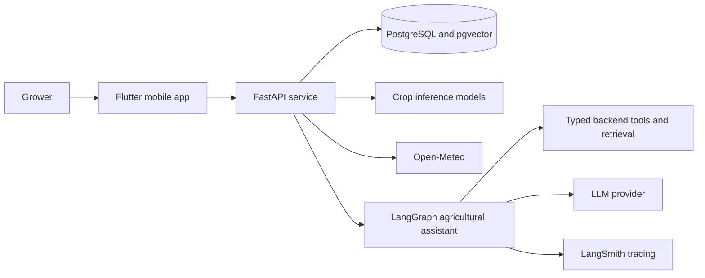

> Historical preparation material. Superseded by the [finalized SRS](../specifications/Elora_SRS.md). Preserved as evidence, not active implementation instructions.

# Elora — System-wide SRS preparation findings

> Historical discovery evidence, not the current requirements baseline. Use [Elora SRS v1.0](../specifications/Elora_SRS.md), its [implementation decisions](../specifications/Elora_Implementation_Decisions.md) and [dataset catalogue](../datasets/Elora_Dataset_Catalog.md). Earlier open decisions and conflicts below may now be resolved or superseded.

Prepared: 15 November 2026
Status: Requirements discovery baseline; stakeholder confirmation pending
Scope: The complete Elora mobile application, backend, data store, crop models, weather integration, agricultural assistant, and community features.

This document gathers material for a Software Requirements Specification (SRS). It is not an approved SRS or a claim that the planned system is operational. Findings come from local specifications and source inspection. Requirements below describe intended behavior unless explicitly marked as implemented. No external product, agronomic, or regulatory claims were researched.

## 1. Evidence and authority

Repository documentation assigns precedence to the PRD, TRD, reference screens, UI specification, database specification, app-flow specification, API contract, shared model contract, then current code. Conflicts are recorded here rather than silently resolved.

| Ref | Source | Material for the SRS |
|---|---|---|
| S1 | [Product requirements](../specifications/Garden_PRD.md) | Problem, users, scope, functional requirements, safety, launch gates |
| S2 | [Technical requirements](../specifications/Garden_TRD.md) | Architecture, runtime constraints, AI boundaries, security, performance |
| S3 | [UI/UX specification](../specifications/Garden_UI_UX_Design_Specification.md) | Screens, navigation controls, accessibility, visual design |
| S4 | [Database specification](../specifications/Garden_Backend_Schema_and_Data_Model.md) | Entities, relationships, constraints, historical records |
| S5 | [App flows and screen states](../specifications/Garden_App_Flow_and_Screen_State_Specification.md) | Navigation, scan/chat states, offline behavior, recovery |
| S6 | [API contract](../specifications/Garden_API_and_Integration_Contract.md) | Endpoints, payloads, errors, authentication, retry behavior |
| S7 | [Shared model contract](../../shared/schemas/model_contract.json) | Crop/task identifiers and model output fields |
| S8 | [Work distribution](../../WORK_DISTRIBUTION.md) | Module ownership and integration responsibilities |
| S9 | [Backend entry point](../../backend/app/main.py), [router](../../backend/app/modules/crop_health/router.py), [service](../../backend/app/modules/crop_health/service.py), [schemas](../../backend/app/modules/crop_health/schemas.py) | Actual backend behavior |
| S10 | [Classifier](../../ai/models/crop_health_classifier.py), [database initialization](../../backend/app/db/init.sql) | Actual model and persistence baseline |
| S11 | [Mobile entry point](../../mobile/lib/main.dart), [scan screen](../../mobile/lib/features/crop_health/screens/scan_camera_screen.dart), [result screen](../../mobile/lib/features/crop_health/screens/crop_diagnosis_results_screen.dart), [provider](../../mobile/lib/features/crop_health/providers/crop_health_provider.dart) | Actual mobile workflows |
| S12 | [Compose](../../docker-compose.yml), [backend dependencies](../../backend/requirements.txt), [mobile dependencies](../../mobile/pubspec.yaml) | Local environment and declared technologies |
| S13 | [Backend tests](../../backend/tests/test_crop_health.py), [mobile tests](../../mobile/test/) | Existing test intent; not evidence of execution in this review |
| S14 | [Class descriptions](../diagrams/class-descriptions.md), [design report](member5_detailed_system_and_ui_design.md) | Supporting design explanations; proposed classes are not implementation evidence |

The seven local PNG references exist under `docs/screens/`. Their existence and textual specifications were checked; visual conformance was not assessed. The repository and application use **Elora**, while canonical specifications use **Garden**. Final naming requires confirmation.

## 2. Purpose and problem statement

Elora is a mobile crop intelligence and agricultural decision-support system for home gardeners and smallholder farmers. It combines crop image analysis, produce quality assessment, weather-informed care advice, a contextual agricultural assistant, and a community plant journal.

The documented problems are delayed recognition of plant disease, subjective harvest grading, weather information disconnected from care decisions, ungrounded chatbot guidance, and fragmented records of plant progress. The intended outcome is understandable advice connected to the user's own plants, photos, history, and local forecast. Image-based outputs are advisory and require uncertainty and safety notices.

## 3. Users, stakeholders, and system boundary

| Actor or stakeholder | Intended interaction or responsibility | Status |
|---|---|---|
| Home/urban gardener | Register plants, scan leaves/produce, maintain diaries, review care plans, chat, share updates | Primary user in S1 |
| Smallholder farmer | Monitor crop condition, assess harvest readiness, use weather-based irrigation/spray guidance | Primary user in S1 |
| Agricultural extension specialist | Domain review and escalation for uncertain or risky advice | Advisory stakeholder; a dedicated app role is not specified |
| Extension agent/community coordinator | Regional or collective-garden functions | Post-MVP users in S1 |
| Product owner and five development owners | Resolve scope, maintain modules/contracts, accept release | S1/S8 |
| Agronomy/ML reviewers and QA | Validate guidance, model evidence, acceptance scenarios | Required validation responsibilities; named approvers TBD |
| Open-Meteo | Supply weather observations and forecasts | External service |
| LLM/embedding provider | Generate grounded responses and embeddings | Gemini or OpenAI mentioned; final provider selection TBD |
| LangSmith | Agent tracing and evaluation | External operational dependency |

No administrator/moderator login, permission hierarchy, or admin portal is defined. Do not add these as approved user roles without a scope decision.

This is the intended context, not the current deployment. The cloud/on-device inference split remains unresolved.

## 4. Scope and ownership

| Module | Owner | Crop responsibilities | Intended capabilities |
|---|---|---|---|
| Crop Health Analysis | Dev 1 | Tomato and chilli: disease and quality, four models | Capture/upload, disease findings, guidance, scan history |
| Produce Quality Assessment | Dev 2 | Citrus: disease and quality, two models | Quality/ripeness grading, defects, harvest and shelf-life estimates |
| Predictive Farming Analytics | Dev 3 | Banana: disease and quality, two models | Weather ingestion, irrigation/spray advisories, care scheduling |
| Personalized Agricultural Agent | Dev 4 | Roses: disease and quality, two models | Multi-turn chat, plant/history/weather tools, semantic retrieval |
| Community and User Accounts | Dev 5 | Chrysanthemum: disease and quality, two models | Authentication, profiles, plant diaries, feed and interactions |

The detailed inventory totals **six crops and twelve models**. Multiple summary passages instead state five crops and ten models. Use six/twelve only as a provisional interpretation of the explicit inventory until the product owner resolves the conflict.

Documented exclusions: web/desktop client and admin portal; e-commerce/payments; drone multispectral processing; IoT sensor pairing; enterprise multi-tenancy; multi-region active-active database operation. Extension/coordinator features are post-MVP.

## 5. Functional requirement inventory for drafting

The `SRS-*` identifiers below are preparation identifiers. They group requirements for later decomposition into atomic, testable statements. They do not replace the PRD's existing FR identifiers. All are documented intent; implementation status appears in section 11.

| ID | Required behavior to capture in the SRS | Source |
|---|---|---|
| SRS-ACC-01 | Register with email/password/display name and sign in using JWT bearer authentication | S1 FR-CORE-01; S6 auth |
| SRS-ACC-02 | Retrieve the authenticated user's profile; protect user-owned data against access by another user or agent session | S2 security/AI boundaries; S6 profile |
| SRS-PLT-01 | Register and list plants with crop, nickname, variety, planting date, and location description; clarify edit/delete details | S1 FR-CORE-02; S4; S6 |
| SRS-PLT-02 | Record dated photo, watering, fertilizer, pruning, and note entries against a plant | S4 plant_logs; S6 logs |
| SRS-PLT-03 | Show garden crop blocks, plant condition/checkup summaries, plant details, and upcoming watering/fertilizer cards | S3; S5 |
| SRS-SCN-01 | Capture a plant/produce photo or select one from the gallery, submit a supported crop/task, and allow retry/retake | S1; S3; S5 |
| SRS-SCN-02 | Validate supported crop/task, image content and upload size; reject invalid or empty inputs with a consistent error | S2; S6 |
| SRS-HLT-01 | Classify tomato/chilli disease and show label, pathogen where applicable, confidence, alternatives, severity, symptoms, and practical recovery guidance | S1 FR-HEALTH-01/02; S3; S6; response reconciliation needed |
| SRS-HLT-02 | Display a low-confidence warning below 0.60 and recommend a better image; do not present that result as authoritative | S1 guardrails; S2; S5 |
| SRS-HLT-03 | Save/link a result to a plant and retrieve the authenticated user's scan history, including crop filtering and pagination | S1 FR-HEALTH-03; S5; S6 |
| SRS-QLT-01 | Grade citrus quality using A/B/C/Reject, ripeness index, visible defects, confidence, and alternatives | S1 FR-QUAL-01/02; S4; S6 |
| SRS-QLT-02 | Provide a harvest recommendation and estimated shelf life with explicit estimation limits | S1 FR-QUAL-03; S6; estimation method TBD |
| SRS-CNN-01 | Provide disease and quality inference for all approved crops using versioned outputs under the shared model contract | S1 model inventory; S2; S7; crop/model count unresolved |
| SRS-WEA-01 | Retrieve current and seven-day weather for latitude/longitude; include temperature, humidity, precipitation and relevant forecast fields | S1 FR-PRED-01; S6 |
| SRS-WEA-02 | Generate banana-focused irrigation/spray advisories and care schedules using crop context and forecast data, explaining each action | S1 FR-PRED-02; S4; S6 |
| SRS-AGT-01 | Maintain multi-turn chat threads, optionally associated with a plant, and preserve conversational state | S1 FR-AGNT-01/02; S4; S5 |
| SRS-AGT-02 | Retrieve only permitted plant profiles, diagnosis history, weather and agronomic knowledge through typed tools | S1 FR-AGNT-03/04; S2 |
| SRS-AGT-03 | Ground recommendations in retrieved guidance, cite sources or identify general practice, and validate outputs for unsafe claims | S1 principles/safety; S2 agent workflow |
| SRS-AGT-04 | Prevent direct SQL execution, access to other users' records, and destructive/account mutations without explicit user confirmation | S2 AI authority |
| SRS-COM-01 | Publish posts with crop/title/content/photo; retrieve a paginated feed filtered by crop | S1 FR-COMM-01/02; S6 |
| SRS-COM-02 | Support comments and one like per user/post; clarify follow/following, sharing and bookmarking contracts | S1; S3; S4 |
| SRS-OFF-01 | Browse cached plants, diary entries, prior results and saved guidance while clearly showing offline status | S2; S5 |
| SRS-OFF-02 | Queue captured scans and synchronize when connectivity returns; preserve interrupted work and prevent duplicate submissions | S5; S6 idempotency |
| SRS-UX-01 | Preserve independent main-tab state and provide loading, empty, permission-denied, failure, retry, and uncertainty behavior | S3/S5; exact empty/permission states need elaboration |
| SRS-INT-01 | Use versioned API routes, bearer authorization, UTC timestamps, standard errors and idempotency for critical retries | S6 |

Features shown in UI specifications but lacking complete business rules: XP/levels/badges; notifications; follow/following ranking; bookmarks; sharing; image attachments in chat; account/settings management; detailed fertilizer reminders. Treat them as clarification items, not fully specified requirements.

## 6. Core use cases and exception paths

| Use case | Preconditions and normal flow | Exceptions and acceptance focus |
|---|---|---|
| UC-01 Register/sign in | User enters credentials; server validates; client receives token and profile; private garden becomes accessible | Duplicate email, bad credentials, expiry, offline login, recovery/reset rules TBD |
| UC-02 Maintain a garden | Authenticated user registers a supported plant; views crop block and details; records a care/photo log | Invalid crop/date, missing plant, another user's plant, offline write/retry |
| UC-03 Diagnose disease | Select crop/plant; capture or upload; validate; run disease model; show confidence/guidance; save to diary | Denied camera/gallery access, cancellation, corrupt/oversized file, unsupported crop, low confidence, timeout, model failure, duplicate retry |
| UC-04 Assess quality | Select crop and quality task; upload image; obtain grade/ripeness/defects and harvest estimate; retain history | Wrong image domain, no suitable model, uncertain grade, unsupported estimate |
| UC-05 Plan care | User supplies permitted location/plant context; retrieve forecast; generate and explain care action and next schedule | Location unavailable/denied, stale forecast, weather outage, missing plant context |
| UC-06 Ask assistant | User sends query in own thread; agent retrieves relevant tools/knowledge; validates and returns contextual answer | Unsafe request, insufficient evidence, tool/provider timeout, other user's thread, retry without duplicated turns |
| UC-07 Participate in community | User publishes an opted-in update; others browse/filter, like or comment | Invalid media/content, duplicate like, failed optimistic update, report/moderation behavior TBD |
| UC-08 Recover offline work | User views cached data/captures queued scan; connectivity returns; queue syncs with explicit status | App restart, expired token, removed plant, storage exhaustion, retry/conflict policy TBD |

Final use cases should specify actor, trigger, preconditions, main steps, alternate steps, postconditions, and acceptance tests separately.

## 7. Data requirements and relationships

| Entity | Main data and relationships | Constraints / clarification |
|---|---|---|
| User | UUID, unique email, password hash, display name, avatar, timestamps | Hash required by design but absent from current bootstrap table |
| Plant | Owner, crop, nickname, variety, location description, planting date | Owner FK; six-crop check in planned schema |
| Plant log | Plant, activity type, content/image reference, timestamp | Five documented log types; access derives from plant owner |
| Analysis session | User, optional plant, crop/task, image reference, model version, execution time | Historical/append-only; crop/task consistency must be defined |
| Disease detection | Unique session, label/pathogen, confidence, severity, alternatives, guidance | Confidence 0..1; planned severity healthy/low/moderate/severe |
| Quality assessment | Unique session, grade, ripeness, defect percentage, confidence, shelf-life/harvest guidance | Grade A/B/C/Reject does not express every crop-specific class; mapping TBD |
| Weather snapshot | Coordinates, readings, seven-day forecast, fetched time | Coordinate/time index; cache TTL and stale-data policy TBD |
| Irrigation schedule | Plant, time/volume, moisture estimate, rationale, status | Pending/completed/skipped; estimate inputs and unit rules TBD |
| Agent thread/message | Owner, optional plant context, ordered messages and roles | Thread/message retention and attachment storage TBD |
| Agent memory | Optional user, category/crop, content, 1536-dimension embedding, metadata | Public knowledge vs private memories must be isolated during retrieval |
| Agent tool run | Thread, tool name, inputs/outputs, duration | Redaction and trace retention TBD |
| Post/comment/like | Author, crop/content/media, timestamps, post relationships, counts | Like composite key prevents duplicates; follow/bookmark tables unspecified |

A user owns many plants, analyses, threads and posts. A plant has many logs/schedules/analyses. An analysis yields a disease or quality result; a thread has messages/tool runs; a post has comments/likes. The design also mentions `crops` and `crop_diseases` without full DDL. Current `init.sql` creates only `users`, `plants`, and the vector extension.

Specify image/object storage, file lifecycle, retention/deletion, backups, privacy consent, knowledge provenance, and local cache encryption before finalizing the SRS. These are gaps, not established policies.

## 8. External interfaces and environment

Intended client: Flutter/Dart, Material 3, Riverpod and GoRouter, Android and iOS. Current repository has Android and Windows scaffolding; no iOS project was found in the inspected file inventory. Windows scaffolding does not establish desktop product scope.

Intended backend: FastAPI/Python 3.12, Pydantic, asynchronous SQLAlchemy, PostgreSQL 16/pgvector, Alembic, TensorFlow/Keras/TFLite/OpenCV, HTTP weather calls, LangChain/LangGraph/LangSmith. Declared dependencies do not prove integration. Compose currently provisions the database only.

| Interface group | Documented API routes (prefix `/api/v1` except `/health`) | Current registration |
|---|---|---|
| System | `GET /health`, `GET /api/v1` | Present |
| Accounts | `POST /auth/register`, `POST /auth/login`, `GET /profile` | Not registered |
| Plants | `GET /plants`, `POST /plants`, `POST /plants/{plant_id}/logs` | Not registered |
| Crop health | `POST /crop-health/analyze`, `GET /crop-health/history` | Analyze present; history absent; extra module health route present |
| Produce | `POST /produce-quality/analyze` | Not registered |
| Farming | `GET /predictive-farming/weather`, `GET /predictive-farming/recommendations`, `POST /predictive-farming/banana/analyze` | Not registered |
| Assistant | `POST /agricultural-agent/chat`, `POST /agricultural-agent/roses/analyze` | Not registered |
| Community | `GET /community/feed`, `POST /community/posts`, `POST /community/chrysanthemum/analyze` | Not registered |

Missing complete contracts include plant detail/edit/delete, save/link analysis, diary/history retrieval beyond health, citrus disease routing, task selection on several crop endpoints, like/comment/follow/bookmark actions, chat history/attachments, notifications and account recovery.

Shared inference request fields are image URI, crop, model task and version; output fields are crop, task, label, confidence, alternatives, version and creation time. `model_contract.json` is a descriptive JSON object, not an executable JSON Schema defining types/required fields. Machine validation remains to be defined.

## 9. Non-functional requirements and measurable targets

All figures here are documented targets, not measurements of the current system.

| Area | Existing target or constraint | Definition still needed |
|---|---|---|
| End-to-end diagnosis | Less than 2.5 seconds (S1) | Network, image size, device, server, concurrent load and percentile |
| Model inference | Less than 1200 ms (S2); less than 1.5 s in PRD launch gate | Resolve target and benchmark environment; warm/cold behavior |
| Startup and health | API initialization below 5 s; health response below 50 ms | Dependency readiness, load and measurement boundary |
| Disease model performance | At least 90% Top-1 validation accuracy (S1) | Per crop/class criteria, held-out field data, calibration, precision/recall/F1, quality-model targets |
| Uncertainty | Warn below confidence 0.60 | Threshold calibration, out-of-domain rejection and safe UI language |
| AI safety | Zero severe chemical/dosage hallucinations in evaluation; ten standard multi-turn launch scenarios | Test corpus, reviewers, prohibited-content/source policy; an evaluation target is not a universal safety guarantee |
| Authentication | JWT HS256, seven-day expiry; passwords bcrypt at least 12 rounds | Logout/revocation, recovery, token storage and expiry while offline |
| Image validation | JPEG/PNG, file-content validation, maximum 10 MB | Compression, dimensions, orientation, retention and overflow response |
| Privacy | Photos/location limited to stated purposes; public sharing opt-in | Jurisdiction, consent text, provider data handling, deletion and retention |
| Accessibility | WCAG 2.1 AA intent: 4.5:1 body text, 3:1 large text/key UI | Screen-reader labels, text scaling, touch targets and real-device checks |
| Offline behavior | Cached viewing, queued scans, reconnect sync | Maximum queue, eviction, encrypted cache, conflicts and expiry |
| Maintainability | Five modules, shared contracts, versioned API and migrations | Supported runtime versions, upgrade policy and CI gates |
| Observability | LangSmith traces and tool latency/token telemetry | Sensitive-data redaction, alerting, access and retention |
| Availability and scale | No numeric baseline found | Availability SLO, concurrent users, throughput and capacity |
| Recovery | No numeric baseline found | Backup frequency, restore test, RPO and RTO |

## 10. Business rules and constraints

1. Only approved crop/task combinations may invoke a model; models must not diagnose outside their assigned domain.
2. CNNs return classifications/probabilities; backend knowledge services provide guidance. Models do not directly mutate records or generate treatment prose.
3. Confidence below 0.60 must visibly trigger uncertainty. A best-guess view must preserve that uncertainty.
4. Chemical advice requires grounding and the documented protective-equipment, local-rule and specialist notices. Agronomic examples in source documents have not been independently validated in this preparation.
5. Agent tools must enforce the same user authorization as direct API calls. Private retrieval must not leak another user's records.
6. Historical assessments are append-only by design; deletion/retention rights and cascade behavior still need reconciliation.
7. Community publication requires explicit sharing intent; private plant diaries are not automatically public posts.
8. One user may like a given post once. Retried create/analyze operations should not duplicate work under the agreed idempotency policy.
9. Forecasts inform recommendations; estimated moisture/volume must not be presented as hardware sensor readings. IoT pairing is out of scope.
10. Cross-module work uses shared contracts/services rather than importing another module's private implementation.

## 11. Current implementation baseline

| Capability | What local source shows | Consequence for SRS wording |
|---|---|---|
| App shell/home | Flutter shell, grid of crop cards, hard-coded XP, placeholder community/chat/more tabs | Describe planned garden workflows separately from prototype |
| Image selection | ImagePicker camera/gallery; decorative preview; selected crop is fixed to tomato | Chilli API support does not prove a selectable chilli mobile workflow |
| Camera controls | Flash state changes locally; flip displays a snackbar | Hardware flash/flip behavior is not established |
| Analysis API | Tomato/chilli, disease/quality, multipart `file` and `task`; no authentication dependency | Present as unauthenticated prototype behavior, not security compliance |
| Image checks | Checks content-type and non-empty bytes; accepts JPEG/PNG/WebP/octet-stream | No content decoding/magic-number validation or 10 MB limit in inspected route |
| Predictions | Class chosen from byte sum; confidence fabricated in 0.88..0.97 range | Simulated results, not trained CNN inference or demonstrated accuracy |
| Guidance | Static disease dictionary and generic fallback; quality labels share disease-oriented response handling | Separate quality response/guidance rules still needed |
| Save/history | Save button only shows a success snackbar; no persistence call or history route | Do not claim results are saved |
| Database | Bootstrap users/plants tables and vector extension; no route/service persistence | Planned schema and vector retrieval are not deployed by this code |
| Other modules | No registered account, produce, weather, agent or community feature routers | Requirements exist; functional implementations were not found |
| Offline/security | No implemented cache/queue, JWT middleware or agent authorization in inspected paths | Planned requirements remain unverified/unimplemented here |
| Tests | Backend and mobile test files exist | Not executed during this documentation-only investigation |

## 12. Conflicts and decisions required

| ID | Issue | Required decision / owner |
|---|---|---|
| D01 | Elora in code/README versus Garden in canonical documents and health payload | Product owner: final product/service names and terminology |
| D02 | Five crops/ten models in summaries versus six crops/twelve models in inventory | Product owner + crop owners: approve exact launch inventory |
| D03 | UI home describes five plots and conflates chilli/chrysanthemum in one description | Product/design owner: represent all approved crops consistently |
| D04 | API contract uploads `image`; actual client/server use `file`; optional `plant_id` absent in code | Shared API owners: settle payload and plant association |
| D05 | Contract returns `label`/remedy fields; code returns `detected_label`/symptoms/recovery steps | Shared API/UI owners: approve one public response and adapter mapping |
| D06 | JPEG/PNG-only and 10 MB rules differ from actual accepted inputs | Backend owner: define exact validation and errors |
| D07 | PRD 1.5 s launch gate vs TRD 1.2 s inference target | Product/ML owner: choose benchmark and acceptance threshold |
| D08 | UI routes differ between UI specification and app-flow specification; actual code uses Navigator | Mobile owner: approve canonical routes/deep links |
| D09 | Cloud/on-device inference both described, but no real inference runtime implemented | ML/backend/mobile owners: choose launch execution and offline guarantees |
| D10 | TRD mentions generic assessments; detailed schema uses analysis_sessions plus result tables | Database owner: settle shared persistence names/contracts |
| D11 | Append-only records coexist with cascading deletion; no privacy retention policy | Product/data owner: define retention, removal and audit behavior |
| D12 | Many UI actions lack endpoints/data models or explicit MVP designation | Product owner: scope XP, reminders, following, bookmarks, sharing, attachments and settings |
| D13 | Harvest chemistry/readiness, shelf-life and soil-moisture claims lack methods/evidence | Agronomy/ML owners: define validated inputs, models and limitation wording |
| D14 | LLM, embeddings, image storage and knowledge-source governance incomplete | Technical/domain owners: approve providers, provenance and data handling |
| D15 | Android/iOS are intended; iOS scaffolding not present in inspected inventory | Mobile owner: confirm launch platforms and supported OS/device range |

## 13. Acceptance and traceability material

| Acceptance scenario | Requirement groups | Evidence expected before acceptance |
|---|---|---|
| AT-01 Register/sign in and deny access to another user's plant/thread/history | ACC, PLT, AGT | Authentication and resource-ownership integration tests |
| AT-02 Analyze valid disease image and display versioned result/recovery guidance | SCN, HLT, CNN | Agreed API contract, real model execution, mobile end-to-end check |
| AT-03 Reject bad/empty/oversized images and unsupported crop/task | SCN, INT | Boundary/error-contract tests and visible recovery UI |
| AT-04 Present <0.60 confidence as uncertain and allow retake | HLT | Injected low-confidence fixture plus UI assertion |
| AT-05 Save result, restart/retrieve history, retain plant association | HLT, PLT | Database-backed persistence and ownership checks |
| AT-06 Grade citrus and show traceable estimates without disease-treatment fallback | QLT, CNN | Field evaluation and crop/task-specific response checks |
| AT-07 Explain weather-based advice; label stale/unavailable forecast | WEA | Deterministic forecast fixtures and provider-failure tests |
| AT-08 Continue chat across turns with correct tools and cited grounding | AGT | Ten reviewed scenarios, user isolation, unsafe/output validation tests |
| AT-09 Publish opted-in post, comment and like once; roll back failed optimistic action | COM | Persistence, uniqueness, API and mobile interaction checks |
| AT-10 Browse cached garden and sync queued scan once after reconnect | OFF, INT | Offline/restart/retry and idempotency tests |
| AT-11 Meet performance, accuracy and accessibility thresholds | Section 9 | Reproducible benchmark, held-out evaluation and device/accessibility report |
| AT-12 Bootstrap/migrate database and build approved mobile platforms | Environment | Migration/recovery checks, backend tests, Flutter analyze/test and platform builds |

For the final SRS, each atomic requirement should record its ID, shall-statement, rationale, source, priority, owner, preconditions, acceptance criterion, dependencies, status and test reference. Do not substitute existing test filenames for evidence that acceptance criteria passed.

## 14. Stakeholder information still needed

1. What is the final product name, release boundary, crop/model inventory and launch platform list?
2. Is there a required academic/client SRS template, page limit, submission date, or approval/signature process?
3. Which UI-only features are mandatory for the first release, and which are future scope?
4. What geographic region, languages, units, supported device/OS range and accessibility needs must be supported?
5. What datasets, approved disease/quality labels, evaluation splits and agronomy reviewers will establish model and advice validity?
6. Which care inputs are actually available: planting stage, soil type, pot/plot size, watering history, location and user observations?
7. Who governs knowledge sources, prohibited treatments, source freshness and escalation to specialists?
8. What are the account recovery, consent, retention/deletion, moderation and abuse-handling rules?
9. What are the hosting budget, expected concurrent load, availability, backup/recovery and service-provider constraints?
10. Who approves each module, cross-module contracts, safety evaluation and final system acceptance?

## 15. Recommended final SRS contents

1. Introduction: purpose, audience, scope, definitions and references.
2. Overall description: product context, actors, operating environment, assumptions, dependencies and exclusions.
3. External interface requirements: mobile interaction, hardware permissions, APIs and external services.
4. Functional requirements: accounts, garden/diary, scans, disease, quality, farming analytics, agent, community and offline synchronization.
5. Data requirements: domain entities, validation, relationships, ownership, lifecycle and retention.
6. Non-functional requirements: performance, reliability, security/privacy, accessibility, portability, maintainability and observability.
7. Business and AI safety rules: confidence, grounding, authority boundaries, consent and advisory limitations.
8. Verification: use cases, acceptance criteria, requirement-to-source/test traceability and release gates.
9. Appendices: glossary, model inventory, context/use-case/data diagrams and unresolved decisions.

## 16. Investigation limits and handoff

This review inspected local documents and key source paths only. It did not run the app, tests, database, real models, weather calls, LLM workflows or mobile builds; it did not inspect remote branches or validate the live Figma project. Current working-tree changes in `.gitignore` and existing untracked diagram files were left intact. No application code or canonical requirements were changed.

The gathered material is sufficient to draft the system-wide SRS, with decisions D01–D15 explicitly carried as unresolved until owners confirm them. Final acceptance must rely on measured and reviewed evidence, particularly because the current classifier produces simulated outputs.
