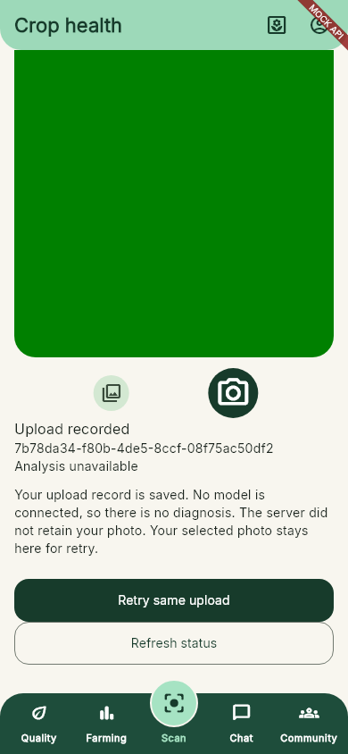

# Issue 44 — interim authenticated upload and status

Recorded 18 November 2026. Owner: Dev 1 (`Kavee-ginty`).
Requirements: REQ-1.1, REQ-1.2 and the job-persistence subset of REQ-1.3.
This is an upload/status demonstration, not completed disease inference or full
SRS acceptance. Model work remains separate in #45 / PR #98.

## Smallest slice and evidence boundary

Verified Firebase user → Scan tab → Tomato / Disease → camera or gallery leaf
photo → bounded multipart validation → persisted PostgreSQL job → `202` receipt
→ owner-only status read → terminal `failed / MODEL_UNAVAILABLE`.

No classifier is connected. The server records the upload receipt and digest,
then discards the image. It does not pretend to queue work, produce a diagnosis,
or invent a model version, confidence or abstention. Retrying unchanged content
returns the existing job; it does not rerun analysis. Re-select a photo after a
future model integration to create a new operation.

Shared contract prerequisite: [PR #101](https://github.com/Tenzrr/Elora/pull/101).
Feature draft: [PR #102](https://github.com/Tenzrr/Elora/pull/102).
It restores the agreement from `5c72db8`, which was missing from `develop`.
The feature branch starts at `fe9ce48`, with the contract as a separate commit.
Both PRs target `develop`; review/merge the contract first. No PR was merged by
this work. Review the contract with Dev 3 and Dev 2.

## Learn the files in this order

Paths below are repository-relative. Each row gives the purpose of every changed
source, test and evidence file, and the check that makes the behavior observable.

| File | What changed and what to learn | How to check |
|---|---|---|
| `docs/api-contracts.md` | Separate a receipt, a job failure and a model assessment. Specifies multipart fields, error statuses, retry identity and this interim boundary. | Compare POST/GET OpenAPI and responses with the table. |
| `shared/schemas/scan_job.json` | Machine-readable validation of this narrow terminal-failure response; it cannot accept an invented result. The assessment schema stays unchanged. | `test_scan_contract.py`. |
| `shared/fixtures/interim_scan_failed.json` | Clearly labelled contract example, not a live job. | Same schema test. |
| `backend/tests/test_scan_contract.py` | Tests the fixture and rejects fake results, false retained-image claims and unsupported combinations. | Run this file alone to learn JSON Schema. |
| `backend/app/modules/crop_health/models.py` | `ScanJob` stores owner, operation UUID, request hash, selections, timestamp and failure state. The owner/key uniqueness constraint arbitrates concurrent retries. | API retry test and PostgreSQL concurrency test. |
| `backend/migrations/versions/0002_interim_scan_jobs.py` | Adds only `scan_jobs` and its index/constraints. `SET NULL` preserves a job when its linked plant is deleted. Downgrade is test-only. | CI upgrades a disposable PostgreSQL database and tests plant deletion. |
| `backend/migrations/env.py` | Registers the feature's SQLAlchemy metadata with Alembic. | Check the single migration head is `0002`. |
| `backend/app/modules/crop_health/schemas.py` | Validates crop/task/plant input and defines receipt/failure responses. Normalizes SQLite's timezone-less UTC values for contract-valid timestamps. | Selection tests and timestamp assertion. |
| `backend/app/modules/crop_health/router.py` | Authenticates with existing `verified_actor`; bounds the request stream before multipart parsing; rejects unknown/duplicate fields; calls the shared safe decoder in a thread; checks plant ownership; hashes image bytes plus canonical selections; resolves duplicate inserts in a savepoint; reads only owned jobs. | `test_scans.py`. Submit returns only after the shared DB dependency commits successfully. |
| `backend/app/main.py` | Mounts the Scan router in the existing API. | `/openapi.json`, POST `/api/v1/scans`, GET `/api/v1/scans/{id}`. |
| `backend/requirements.txt` | Adds `python-multipart`, required to parse real file uploads. | Install the lockfile and submit a multipart request. |
| `backend/requirements.lock` | Pins the added parser and hashes; existing package pins are preserved. | CI installs with `--require-hashes`. |
| `backend/tests/test_scans.py` | Tests formats, corruption, animation, dimensions, byte and chunked-body bounds, context, verified-email/active-account gates, two-user ownership, same-key replay/conflict, and restart persistence. | Run alone, then full pytest. Identity is a fixture; DB here is SQLite. |
| `backend/tests/test_postgres.py` | Extends the existing disposable-PostgreSQL test to cover the migration, simultaneous same-key requests, plant deletion, new API instance and cross-schema isolation. | CI only; never point `TEST_DATABASE_URL` at Supabase. |
| `mobile/lib/core/network/api_client.dart` | Adds multipart construction and shares the existing token, timeout and error path. Reads can refresh/replay once; writes are never automatically replayed. | API client and scan provider tests. |
| `mobile/lib/features/crop_health/scan_provider.dart` | Keeps the selected photo, secure UUID v4, receipt and status for the current account. A changed photo gets a new key. Same-UID token refresh preserves work; account change invalidates old asynchronous responses. Polling uses 2/4/8/10-second delays and pauses outside the foreground. | `scan_provider_test.dart`. |
| `mobile/lib/features/crop_health/scan_screen.dart` | Uses the shared image picker/theme, inspected Scan-camera reference, selection guidance, preview, camera/gallery actions, progress, receipt, unavailable message, manual retry and refresh. Permission failure/cancellation preserve the photo. | `scan_screen_test.dart` and device checklist below. |
| `mobile/lib/main.dart` | Connects the existing Scan tab to the feature screen. Other module routes are unchanged. | Existing shell tests plus new route test. |
| `mobile/lib/l10n/app_en.arb` | Adds English scan labels and recovery messages. | English widget test. |
| `mobile/lib/l10n/app_si.arb` | Adds Sinhala equivalents. Human language/device-glyph review is still required. | Sinhala structural widget test. |
| `mobile/lib/l10n/app_ta.arb` | Adds Tamil equivalents, with the same human-review limitation. | Tamil structural widget test. |
| `mobile/test/foundation_shell_test.dart` | Gives the fake verified user a UID because the scan provider now scopes state by UID. | Existing navigation tests. |
| `mobile/test/scan_provider_test.dart` | Tests actual multipart construction against a mock HTTP server, loss/retry with the same key, changed-photo keys, same-UID refresh, sign-out during a pending response, and foreground polling. | Run alone to study state transitions. |
| `mobile/test/scan_screen_test.dart` | Navigates the real app route and exercises all three locales, selection/retry, route return, cancellation and denied permission. Optional screenshots visibly say MOCK API. | Flutter command below. |
| `mobile/test/fixtures/scan-synthetic.png` | Generated solid-green 32×24 PNG; no disease/leaf label or model evidence. | Used only for widget/upload testing. |
| `docs/evidence/issue-44/database-smoke.json` | Sanitized executed checks against existing Supabase `dev1`, plus a read-only Firebase connectivity check. Fixture identities are explicit. | Inspect the receipt/status and evidence labels. Synthetic rows were removed afterward. |
| `docs/evidence/issue-44/scan-failed-en.png` | Captured Flutter widget test with mock API and synthetic image, not an Android/Firebase end-to-end screenshot. | See below. |
| `docs/evidence/issue-44/README.md` | This learning guide, test record, manual demo and limitations. | Follow the commands and checklist. |

## Recorded checks

- `python -m compileall backend/app`: passed.
- `python -m pytest -q`: 41 passed, 1 skipped locally. The skipped test is the
  disposable-PostgreSQL integration test, which runs in CI.
- `flutter analyze --no-pub`: no issues.
- `flutter test --no-pub`: 19 passed, including the existing app tests.
- `flutter build apk --debug --no-pub --dart-define-from-file=config/dev.json`:
  passed. Existing Java/Kotlin/Android SDK compatibility warnings remain.
- Contract PR #101 CI: passed.
- `git diff --check`: passed.
- Existing hosted Supabase `dev1`: additive migration to `0002` succeeded;
  accepted upload `202`, identical retry returned the same ID, invalid image
  `415`, other owner `404`, and a new API instance read identical persisted
  status. Used test-only fixture identities; no production auth override was
  added. Removed only the synthetic rows created by this check.
- Existing Firebase Admin: read-only lookup reached Firebase and returned the
  expected missing synthetic UID. No Firebase users or configuration changed.
  This is **not** evidence of live mobile sign-in or revocation testing.

The actual hosted response and timestamp are in [database-smoke.json](database-smoke.json).



The green rectangle is the synthetic test image. The screen is scrolled to the
status/actions. Sinhala/Tamil widget tests check structure and overflow; their
test-runner fallback glyphs do not establish native Android typography.

## Run the checks yourself

From the issue 44 worktree, using its private environment:

```powershell
.\.venv\Scripts\python -m compileall backend/app
.\.venv\Scripts\python -m pytest backend/tests/test_scans.py -q
.\.venv\Scripts\python -m pytest -q
.\.venv\Scripts\python -c "from alembic.config import Config; from alembic.script import ScriptDirectory; print(ScriptDirectory.from_config(Config('backend/alembic.ini')).get_current_head())"
cd mobile
flutter analyze
flutter test test/scan_provider_test.dart test/scan_screen_test.dart
flutter test
flutter build apk --debug --dart-define-from-file=config/dev.json
```

To regenerate local widget captures, run
`flutter test test/scan_screen_test.dart --dart-define=RECORD_SCAN_DEMO=true`.
It writes ignored `tmp/issue44/` PNGs at the worktree root. English is the
reviewed structural capture here; native-device visual review is pending.

## Live-device demo still to record

Use the existing setup guide and the configured issue 44 worktree. Dev 1's
schema is already at `0002`. Do not run tests that provision/drop schemas against
the hosted database. Other developers should apply the reviewed migration only
to their assigned workspace through the coordinator's established process.

1. Start the API with `.\.venv\Scripts\python -m uvicorn app.main:app --app-dir backend`.
2. Connect an Android device/emulator and run Flutter with `config/dev.json`.
   The emulator URL is `http://10.0.2.2:8000`; a physical phone needs the
   configured LAN URL and Uvicorn `--host 0.0.0.0` on a trusted network.
3. Sign in through real Firebase with a verified development account. Initialize
   the normal session. Open Scan and confirm Tomato / Disease and leaf guidance.
4. Choose a real tomato leaf photo. Submit. Record the job UUID and unavailable
   message. Explain that only the receipt is persisted and no model is connected.
5. Retry unchanged: record the same UUID. Select another photo: record a new UUID.
   Restart the API and refresh status: the first job remains readable.
6. Deny camera permission or cancel selection: the prior photo remains. Turn off
   the network: failure is visible and manual retry retains the operation key.
7. Sign out/in as a second account: no prior photo or job appears. A status GET
   for the first account's UUID returns `404`. An unverified account cannot scan.
8. Check Sinhala/Tamil glyphs, wording and camera/gallery behavior on the device.
   Capture evidence without bearer tokens, personal account details or secrets.

No Android device was attached during the recorded checks; this live Firebase
sign-in/camera sequence remains pending. The configured APK is a development
artifact and contains development client configuration; it is not committed.

## Limits and follow-up

- No inference, worker, retained/private cloud image, model registry, diagnosis,
  guidance, saved results/history UI or treatment claims. #45 / PR #98 was not
  merged or changed. This does not complete full REQ-1.3.
- Only tomato disease and the agreed citrus-quality upload handoff are accepted.
  Citrus Fresh/Spoiled/abstention displays remain Dev 2 work with labelled fixtures.
- The current screen uses the platform camera/gallery, not a custom live
  viewfinder with zoom/flash/flip controls. It follows the shared theme and the
  photo/action structure, not complete final screen fidelity.
- Selected photos and operation keys survive route/background transitions in
  memory, not process death. Durable offline capture/queue and lost-activity
  recovery are later work. Foreground resume applies to the current app session.
- Job rows/digests remain until future lifecycle/deletion work; photos are never
  retained by this interim path. Do not present this as production retention,
  account deletion, rate limiting, load or release-security acceptance.
- The fixed failure response is specific to this interim version. #53/#54 must
  extend storage/contracts and add recoverable asynchronous execution before
  connecting any model. Keep the existing assessment contract and SRS's 60%
  disease cutoff/domain gates when that work is ready.

Next step: review the contract with Dev 3/Dev 2, then record the real verified-
Firebase Android demo before promoting the feature PR out of draft.
