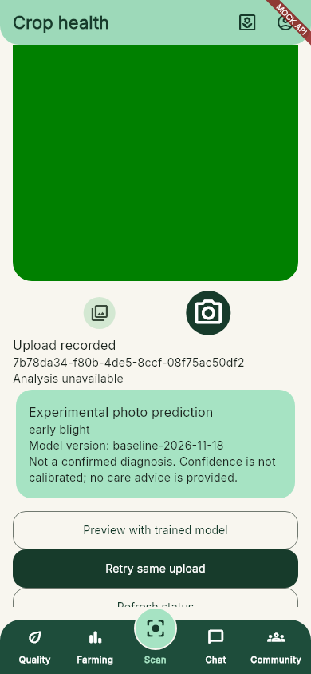
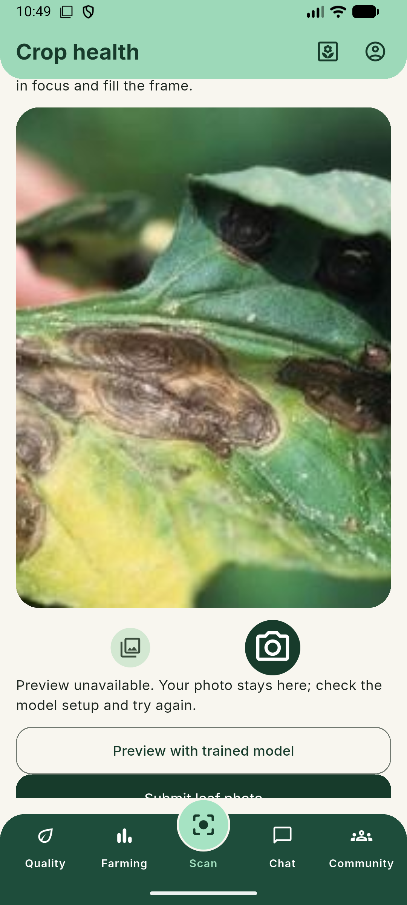
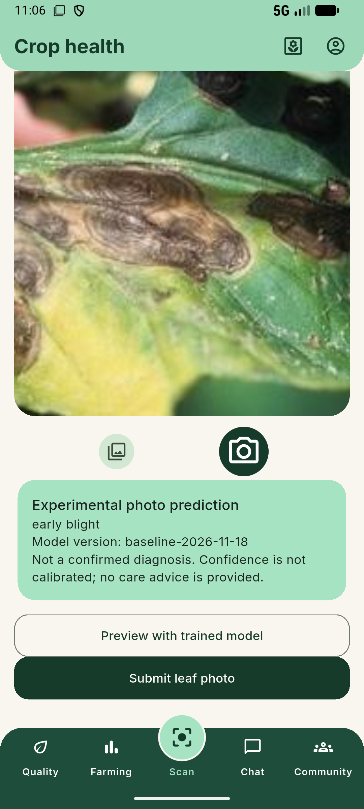

# Optional tomato CNN preview for the interim

Recorded 20 November 2026. Dev 1. This is an extra research demonstration on
top of the completed [#44 upload/status](../issue-44/README.md) and
[#45 model baseline](../../../ai/models/tomato/disease/README.md). It connects
a selected tomato leaf photo to the **real saved MobileNetV2 checkpoint** and
shows its predicted class in the app. It is not a confirmed diagnosis or a
completed REQ-1.3/REQ-1.4 assessment.

## Boundary and files

`POST /api/v1/scans/preview` is a verified-Firebase-user, development-only
multipart request. The API validates the upload with the existing safe decoder,
then decodes its original pixels with EXIF orientation applied; it avoids a
second lossy JPEG encode before inference. It checks the checkpoint SHA-256, matches the notebook's RGB
224×224 padded preprocessing, and returns a class ID, model ID/version and
experimental notice. It discards the photo after inference. It does not save
a scan or result and does not change the existing `POST /api/v1/scans` job,
which still ends `failed / MODEL_UNAVAILABLE`.

| File | Purpose |
| --- | --- |
| `backend/app/core/config.py` | Adds an optional local checkpoint path; no path or weight is committed. |
| `backend/app/modules/crop_health/preview.py` | Verifies the recorded checkpoint hash, loads Keras once and runs the notebook's input pipeline. |
| `backend/app/modules/crop_health/router.py` | Reuses bounded upload validation and verified identity; exposes the separate preview route only outside production. |
| `backend/app/modules/crop_health/schemas.py` | Types the six possible preview labels and fixed model identity without inventing calibrated confidence. |
| `backend/requirements-inference.txt` | Pins optional TensorFlow CPU; base API/CI does not need the large runtime. |
| `backend/tests/test_scans.py` | Covers auth gates, missing model, selection limits and response shape with an injected predictor. |
| `docs/api-contracts.md` | Explains why preview is separate from the persisted scan and assessment schemas. |
| `mobile/lib/features/crop_health/scan_provider.dart` | Sends the selected photo to preview and drops stale responses after an account/photo change. |
| `mobile/lib/features/crop_health/scan_screen.dart` | Shows a distinct experimental prediction card and warning. |
| `mobile/lib/l10n/app_en.arb`, `app_si.arb`, `app_ta.arb` | Localize the preview action, progress, notice and error. Fluent Sinhala/Tamil wording review remains open. |
| `mobile/test/scan_screen_test.dart` | Checks preview UI in three locales using a visibly marked mock API. |

## Recorded checks

- Checkpoint: `tomato_baseline_best.keras` SHA-256
  `97eb4c15089fdc78ef25a7512f094310bf2ff6e2bcfb56c222193f0bfd2f80c3`.
  TensorFlow CPU 2.21.0 loaded its `(224, 224, 3) → 6` model.
- A hash-verified image from the [validation manifest](../../../ai/models/tomato/disease/evidence/dataset_manifest.csv),
  `Tomato_Early_blight_leaf/1576389-early%20blight%20symptoms.jpg`, SHA-256
  `7ea3f709c470175f1f424575e3540089a38ed5a210d175c2bf3eb77c6ca26ea1`,
  returned `early_blight` through the real model and an in-process `200` API
  request. That API check used a **fixture identity and disposable SQLite**, not
  live Firebase or Supabase. One matching validation image is a pipeline check,
  not an accuracy estimate; use the [116-image evaluation](../../../ai/models/tomato/disease/evidence/evaluation.json)
  for the recorded internal metrics and their limits.
- Source photo attribution: Mohammad Naeem Malik, Syed Hashir Ali, and Hamid
  Ali, [Tomato Leaf Disease Dataset from Real-Time Field Conditions in Pakistan,
  version 2](https://data.mendeley.com/datasets/3mbnb82mxd/2), declared CC BY 4.0.
  Underlying-image rights were not independently established.
- Backend compile and pytest: 49 passed, 1 skipped locally; the skip is the
  disposable-PostgreSQL check. `pip check` and `git diff --check` passed.
- Flutter analysis clean; all 19 tests passed after the final text changes;
  configured Android debug APK built successfully. Gradle reported existing
  Kotlin plugin and SDK compatibility warnings.
  The image below is a widget
  test with a synthetic green photo and **mock API**; it does not show live model
  inference or a diagnosed leaf.



## Android Studio device check

The API ran on local port 8001 with the existing scoped Dev 1 Supabase runtime
and Firebase configuration. The Android Studio API 37 emulator installed the
configured debug APK, restored the Firebase session, and displayed the selected
validation leaf. The session reached `POST /api/v1/session` and
`GET /api/v1/plants` as `200`. On 20 November the first preview request stalled
before inference: the API logged session/database timeouts, and a direct
PostgreSQL pooler SSL probe timed out on that network. The selected photo
remained available for retry. The user switched to a hotspot; the pooler probe
returned PostgreSQL SSL response `b'S'`, and the live preview API returned
`POST /api/v1/scans/preview 200` using the signed-in Firebase account and the
configured Dev 1 database. The app displayed `early blight`, model version
`baseline-2026-11-18`, and the experimental notice. This is one known validation
photo and does not establish performance on new field photos.

During this check, the first live prediction was `late blight`, although direct
inference on the source JPEG gave `early blight`. Reproducing the mobile JPEG
quality-90 encode followed by the API's second JPEG quality-90 encode changed
this image's predicted class. The preview now validates the upload but sends
the original uploaded bytes to the predictor, which applies EXIF orientation
without another lossy encode. The live retry then displayed `early blight`.





## Run the demo

From this worktree with ignored `.secrets/dev1.json`, Firebase admin credential,
and `mobile/config/dev.json` already provisioned:

```powershell
.\.venv\Scripts\python -m pip install -r backend/requirements-dev.txt -r backend/requirements-inference.txt
.\.venv\Scripts\python backend/tools/configure_cloud.py --runtime dev1
$env:TOMATO_PREVIEW_MODEL_PATH='C:\path\to\tomato_baseline_best.keras'
.\.venv\Scripts\python -m uvicorn app.main:app --app-dir backend --port 8001
```

Set the ignored `mobile/config/dev.json` `API_BASE_URL` to
`http://10.0.2.2:8001`; run `flutter run --dart-define-from-file=config/dev.json`
from `mobile/` on the Android Studio emulator. Open Scan, select the tomato leaf
image, then tap **Preview with trained model**. Keep the saved-upload button as
a separate demonstration of the persisted `MODEL_UNAVAILABLE` job.

## Limits

The baseline has **uncalibrated** softmax outputs, no validated out-of-domain
rejection, no independent Sri Lankan field set, no agronomy label review, and no
reviewed care advice. The preview deliberately does not publish a numeric
confidence, treatment, saved diagnosis or shared `model_contract.json` result.
It is disabled in `APP_ENV=production`. The full online scan flow still needs
private image handling, model serving, calibration/abstention, durable result
persistence and the REQ-1.4 presentation checks.
