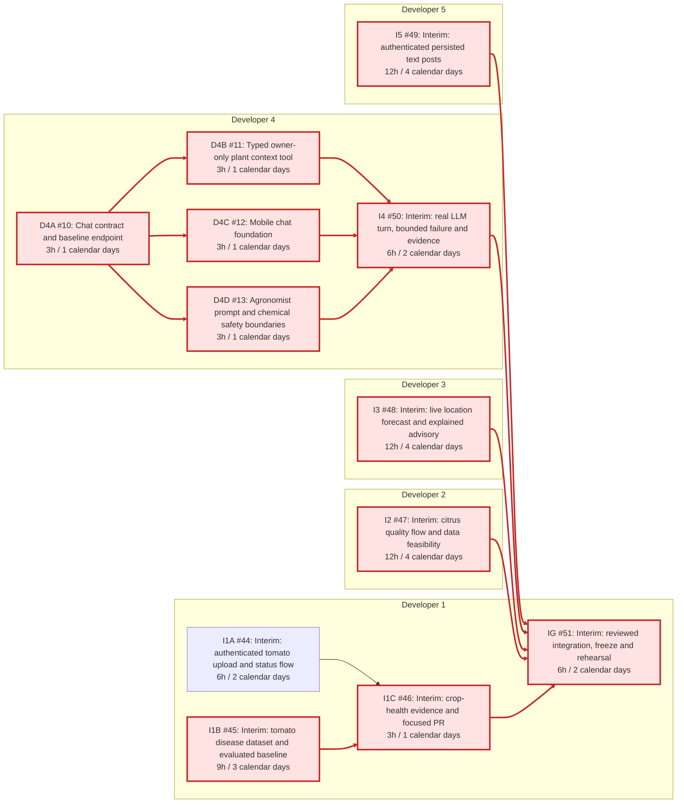
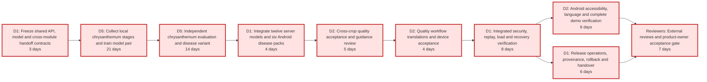

# Team dependency and CPM plan

Planning baseline: **17 November 2026**. Capacity confirmed by the project owner: **3 hours per developer every day, including weekends**. Final April date: **undecided**.

Estimates are provisional remaining effort, not developer commitments. Owners must validate them and supply completion evidence. Open PRs are in review, not complete. Foundation PRs #6/#7 are merged. No other work is credited complete.

The release scenario starts no earlier than 24 November and shifts automatically until the forecast interim integration is complete. Computed dates are planning forecasts, not approved public launch dates.

## How to use this plan

- GitHub issues hold implementation checklists, acceptance criteria and native blocking links.
- `team-plan.json` holds estimates, technical predecessors, owner and GitHub issue IDs. Update it when a handoff or estimate changes.
- Run `python docs/project-management/update_cpm.py` to regenerate both CPMs, schedule tables, developer views and traceability.
- CPM uses longest dependency path, forward/backward passes and total float in calendar days. Activity duration is max(ceil(hours/3), minimum elapsed lead time).
- The capacity schedule allows only one task per developer at a time. It selects ready tasks with the longest remaining dependency path first. This is a feasible heuristic, not a proof of the shortest possible resource schedule.
- Collection/evaluation tasks have explicit provisional elapsed floors of 14 or 21 days. The external acceptance gate allows seven days; reviewer availability is unconfirmed. Wait days do not reserve developer working time.
- Issue bodies distinguish technical blockers from developer sequencing. A developer's availability is not a technical dependency.

## Shared ownership and handoffs

| Deliverable | Accountable owner | Consumers / completion condition |
|---|---|---|
| Scan jobs, history, registry and model delivery | D1 | D2 quality; D4 scan reads; all crop owners supply versioned artifacts |
| Quality categories and result UI | D2 | Uses common scans; never duplicates the scan persistence service |
| Care tasks, schedule revisions and mutations | D3 | D4 confirmed actions; D5 diary/reward links; migration plus tested typed service required |
| Private diary/logs and reusable offline outbox | D5 | D3 task completion and D4 care logs; D1/D2 queues use the same operation/account contract |
| Devices, notification preferences and delivery interface | D5 | D3 schedules reminders; agreed occurrence IDs prevent duplicates |
| Approved embeddings, retrieval and confirmation orchestration | D4 | Providers selected before production index; actions call D3/D5 services |
| Opt-in district aggregation | D5 | D3 regional alerts consume eligible aggregates, never raw identities |

These assignments retain the SRS ownership: care-plan storage belongs to D3. Shared schema/contract changes require D3 review and affected owners; D1 coordinates integration.

## Audit of existing Developer 4 issues

| Existing issues | Required reconciliation |
|---|---|
| #10, #14, #15 | Interim `/agricultural_agent/chat` is an adapter; final thread/message routes follow the SRS. History needs explicit list/read APIs, not only SQL tables. |
| #16 | Replace fixed 1536-dimensional index with benchmark-selected embedding schema; separate experimental evaluation index from production. |
| #17 | Include typed owner-only scan/weather reads and approved source provenance. |
| #18 | Block real integration on D3 care mutation service and D5 care-log service; schedule/log fields are domain records, not arbitrary additions to plants. |
| #19–#21 | Keep owner checkpoints, actual completed-action state, redaction, file limits, speech fallback and provider minimisation. |
| #22–#24 | Preserve rose training ownership; add independent evaluation and Android disease variant; use common scan route rather than separate public crop endpoints. |
| #25 | Provider-level trilingual benchmark required; regex unit tests alone do not establish safe model behaviour. |
| New D4P / D4Q / I4 | Explicit provider-selection gate, reviewed FAQ and live interim LLM evidence were missing from the detailed issue breakdown. |

Existing issue text and history are preserved; a marked planning section records the current acceptance corrections. Existing subtask issues #26–#38 remain attached to their original work.

## Interim forecast

Scenario start: **2026-11-17**. Remaining work is estimated from the planning baseline.

Technical CPM lower bound: **6 calendar days**, completing **2026-11-22**. Capacity-constrained forecast: **8 calendar days**, completing **2026-11-24**.

Zero-total-float activities (technical CPM): D4A, I1B, I2, I3, I5, D4B, D4C, D4D, I1C, I4, IG. The diagram shows the actual dependency edges and parallel critical branches.

Rehearsal-ready target: **2026-11-22**; forecast is **2 days after that target**. Presentation is **23 November**. This is an evidence/remaining-effort scenario; existing work may reduce it once verified. Do not promise all originally planned work without that verification. Prioritise contract handoffs and small demonstrable slices; keep actual assistant tool execution stretch and trained model evidence separate if inference integration is unfinished.

[Full interim CPM source](interim-cpm.mmd) · [Download PNG](png/interim-cpm.png) · [Developer capacity Gantt source](interim-schedule.mmd)

Open exact interim dependency diagram (red = zero total float)

| ID / issue | Owner | Effort | Predecessors | ES–EF / LS–LF / float | Capacity dates |
|---|---|---:|---|---|---|
| D4A [#10](https://github.com/Tenzrr/Elora/issues/10) | D4 | 3h | F0 | 0–1 / 0–1 / 0 | 2026-11-17 to 2026-11-17 |
| I1A [#44](https://github.com/Tenzrr/Elora/issues/44) | D1 | 6h | F0 | 0–2 / 1–3 / 1 | 2026-11-20 to 2026-11-21 |
| I1B [#45](https://github.com/Tenzrr/Elora/issues/45) | D1 | 9h | F0 | 0–3 / 0–3 / 0 | 2026-11-17 to 2026-11-19 |
| I2 [#47](https://github.com/Tenzrr/Elora/issues/47) | D2 | 12h | F0 | 0–4 / 0–4 / 0 | 2026-11-17 to 2026-11-20 |
| I3 [#48](https://github.com/Tenzrr/Elora/issues/48) | D3 | 12h | F0 | 0–4 / 0–4 / 0 | 2026-11-17 to 2026-11-20 |
| I5 [#49](https://github.com/Tenzrr/Elora/issues/49) | D5 | 12h | F0 | 0–4 / 0–4 / 0 | 2026-11-17 to 2026-11-20 |
| D4B [#11](https://github.com/Tenzrr/Elora/issues/11) | D4 | 3h | D4A | 1–2 / 1–2 / 0 | 2026-11-18 to 2026-11-18 |
| D4C [#12](https://github.com/Tenzrr/Elora/issues/12) | D4 | 3h | D4A | 1–2 / 1–2 / 0 | 2026-11-19 to 2026-11-19 |
| D4D [#13](https://github.com/Tenzrr/Elora/issues/13) | D4 | 3h | D4A | 1–2 / 1–2 / 0 | 2026-11-20 to 2026-11-20 |
| I1C [#46](https://github.com/Tenzrr/Elora/issues/46) | D1 | 3h | I1A, I1B | 3–4 / 3–4 / 0 | 2026-11-22 to 2026-11-22 |
| I4 [#50](https://github.com/Tenzrr/Elora/issues/50) | D4 | 6h | D4B, D4C, D4D | 2–4 / 2–4 / 0 | 2026-11-21 to 2026-11-22 |
| IG [#51](https://github.com/Tenzrr/Elora/issues/51) | D1 | 6h | I1C, I2, I3, I4, I5 | 4–6 / 4–6 / 0 | 2026-11-23 to 2026-11-24 |

CPM offsets use exclusive finish boundaries: ES 0 / EF 2 means two full calendar days. Capacity table dates are inclusive. Detailed Gantt separates active work from remaining elapsed lead time.

## Release forecast

Scenario start: **2026-11-25**. This respects the interim integration forecast.

Technical CPM lower bound: **72 calendar days**, completing **2027-02-04**. Capacity-constrained forecast: **99 calendar days**, completing **2027-03-03**.

Zero-total-float activities (technical CPM): S1, D5J, D5K, D1I, D2E, D2F, R1, R2, R3, RG. The diagram shows the actual dependency edges and parallel critical branches.

| Owner | Release effort | Nominal days at 3h/day | Capacity through April 30 |
|---|---:|---:|---:|
| D1 | 222h | 74 | 471h |
| D2 | 114h | 38 | 471h |
| D3 | 177h | 59 | 471h |
| D4 | 201h | 67 | 471h |
| D5 | 225h | 75 | 471h |

Against April 1 the forecast buffer is **29 days**; against April 30 it is **58 days**. Neither date is an approved deadline. Unconfirmed reviewers, collection access, compute/provider availability, rework and actual completion evidence can change the forecast.

### Critical-path overview

This compact view shows only zero-float activities and their driving edges. Noncritical branches remain in the exact full network below. Durations include the declared provisional elapsed lead times.

[Download critical-path overview PNG](png/critical-path-overview.png)

[Full release CPM source](release-cpm.mmd) · [Download PNG](png/release-cpm.png) · [Developer capacity Gantt source](release-schedule.mmd)

```mermaid
flowchart LR
  classDef critical fill:#ffe2e2,stroke:#c62828,stroke-width:3px
  classDef gate fill:#fff3cd,stroke:#9a6700
  subgraph owner0["External acceptance"]
    RG["RG #96: External reviews and product-owner acceptance gate<br/>0h / 7 calendar days"]
  end
  subgraph owner1["Developer 1"]
    S1["S1 #52: Freeze shared API, model and cross-module handoff contracts<br/>9h / 3 calendar days"]
    D1B["D1B #55: Android capture, disease results and reviewed guidance<br/>15h / 5 calendar days"]
    D1D["D1D #57: Audit tomato/chilli datasets and freeze four label maps<br/>12h / 4 calendar days"]
    S2["S2 #53: Private media, durable workers and deployment preparation<br/>18h / 6 calendar days"]
    D1A["D1A #54: Durable shared scan jobs and versioned model registry<br/>18h / 6 calendar days"]
    D1E["D1E #58: Train and calibrate four tomato/chilli server models<br/>30h / 10 calendar days"]
    D1C["D1C #56: Owned scan saving, history and deletion service<br/>12h / 4 calendar days"]
    D1F["D1F #59: Independent tomato/chilli and Android variant validation<br/>18h / 14 calendar days"]
    D1G["D1G #60: Signed offline disease package delivery and local inference<br/>18h / 6 calendar days"]
    D1H["D1H #61: Offline photo queue and once-only local result sync<br/>18h / 6 calendar days"]
    D1I["D1I #62: Integrate twelve server models and six Android disease packs<br/>12h / 4 calendar days"]
    R1["R1 #93: Integrated security, replay, load and recovery verification<br/>24h / 8 calendar days"]
    R3["R3 #95: Release operations, provenance, rollback and handover<br/>18h / 6 calendar days"]
  end
  subgraph owner2["Developer 2"]
    D2A["D2A #63: Quality categories, subtype rules and consumer fixtures<br/>9h / 3 calendar days"]
    D2C["D2C #65: Audit and train citrus disease and quality models<br/>24h / 8 calendar days"]
    D2D["D2D #66: Independent citrus evaluation and Android disease variant<br/>18h / 14 calendar days"]
    D2B["D2B #64: Quality UI connected to common jobs, saving and queue<br/>18h / 6 calendar days"]
    D2E["D2E #67: Cross-crop quality acceptance and guidance review<br/>15h / 5 calendar days"]
    D2F["D2F #68: Quality workflow translations and device acceptance<br/>12h / 4 calendar days"]
    R2["R2 #94: Android accessibility, language and complete demo verification<br/>18h / 6 calendar days"]
  end
  subgraph owner3["Developer 3"]
    D3A["D3A #69: Weather/location service, freshness and typed read contract<br/>12h / 4 calendar days"]
    D3B["D3B #70: Owned care task persistence, revisions and mutation service<br/>18h / 6 calendar days"]
    D3E["D3E #73: Audit, train and calibrate banana model pair<br/>24h / 8 calendar days"]
    D3C["D3C #71: Reviewed care rules and forecast-based recommendations<br/>15h / 5 calendar days"]
    D3F["D3F #74: Independent banana evaluation and Android disease variant<br/>18h / 14 calendar days"]
    D3D["D3D #72: Care reminders integrated with notification preferences<br/>12h / 4 calendar days"]
    D3G["D3G #75: Reviewed watering, harvest-window and irrigation scenarios<br/>24h / 8 calendar days"]
    D3H["D3H #76: Private harvest observations, crop advice and market values<br/>24h / 8 calendar days"]
    D3I["D3I #77: Privacy-preserving regional risk alerts<br/>15h / 5 calendar days"]
    D3J["D3J #78: Farming methods, translations and device acceptance<br/>15h / 5 calendar days"]
  end
  subgraph owner4["Developer 4"]
    D4E["D4E #14: Chat thread/message persistence and canonical service routes<br/>12h / 4 calendar days"]
    D4M1["D4M1 #22: Rose disease dataset, training and calibration<br/>15h / 5 calendar days"]
    D4M2["D4M2 #23: Rose growth-stage dataset, training and calibration<br/>15h / 5 calendar days"]
    D4P["D4P #79: Select generation, embedding and speech providers<br/>15h / 5 calendar days"]
    D4F["D4F #15: Conversation history UI and thread switching<br/>9h / 3 calendar days"]
    D4G["D4G #16: Approved knowledge schema and ingestion pipeline<br/>12h / 4 calendar days"]
    D4I["D4I #18: Two-phase confirmed care actions<br/>18h / 6 calendar days"]
    D4K["D4K #20: Private photo/document attachments and safe extraction<br/>12h / 4 calendar days"]
    D4L["D4L #21: Three-language speech input and reply playback<br/>15h / 5 calendar days"]
    D4Q["D4Q #80: Reviewed gardening FAQ in three languages<br/>9h / 3 calendar days"]
    D4N["D4N #24: Validated rose artifacts through common inference<br/>18h / 14 calendar days"]
    D4H["D4H #17: Cited retrieval and typed plant, scan and weather reads<br/>15h / 5 calendar days"]
    D4J["D4J #19: LangGraph orchestration, checkpoints and bounded tools<br/>18h / 6 calendar days"]
    D4O["D4O #25: Assistant safety, privacy and three-language acceptance<br/>18h / 6 calendar days"]
  end
  subgraph owner5["Developer 5"]
    D5A["D5A #81: Account, garden and profile lifecycle completion<br/>15h / 5 calendar days"]
    D5B["D5B #82: Private diary, care-log service and shared offline outbox<br/>21h / 7 calendar days"]
    D5J["D5J #90: Collect local chrysanthemum stages and train model pair<br/>30h / 21 calendar days"]
    D5C["D5C #83: Notification devices, preferences and quiet-hours service<br/>12h / 4 calendar days"]
    D5D["D5D #84: Community publishing, feeds, interactions and public sharing<br/>24h / 8 calendar days"]
    D5K["D5K #91: Independent chrysanthemum evaluation and disease variant<br/>18h / 14 calendar days"]
    D5E["D5E #85: Blocking, reports and restricted review operations<br/>18h / 6 calendar days"]
    D5G["D5G #87: Idempotent care/post XP, badges and reward ledger<br/>18h / 6 calendar days"]
    D5F["D5F #86: Consent, exports, deletion and retention lifecycle<br/>24h / 8 calendar days"]
    D5H["D5H #88: Private forest and opt-in leaderboard<br/>12h / 4 calendar days"]
    D5I["D5I #89: Opt-in district observations and aggregate statistics<br/>18h / 6 calendar days"]
    D5L["D5L #92: Accounts/community/privacy translations and acceptance<br/>15h / 5 calendar days"]
  end
  click S1 "https://github.com/Tenzrr/Elora/issues/52"
  class S1 critical
  S1 --> D1B
  click D1B "https://github.com/Tenzrr/Elora/issues/55"
  S1 --> D1D
  click D1D "https://github.com/Tenzrr/Elora/issues/57"
  S1 --> D2A
  click D2A "https://github.com/Tenzrr/Elora/issues/63"
  S1 --> D3A
  click D3A "https://github.com/Tenzrr/Elora/issues/69"
  S1 --> D3B
  click D3B "https://github.com/Tenzrr/Elora/issues/70"
  S1 --> D3E
  click D3E "https://github.com/Tenzrr/Elora/issues/73"
  S1 --> D4E
  click D4E "https://github.com/Tenzrr/Elora/issues/14"
  S1 --> D4M1
  click D4M1 "https://github.com/Tenzrr/Elora/issues/22"
  S1 --> D4M2
  click D4M2 "https://github.com/Tenzrr/Elora/issues/23"
  S1 --> D4P
  click D4P "https://github.com/Tenzrr/Elora/issues/79"
  S1 --> D5A
  click D5A "https://github.com/Tenzrr/Elora/issues/81"
  S1 --> D5B
  click D5B "https://github.com/Tenzrr/Elora/issues/82"
  S1 --> D5J
  click D5J "https://github.com/Tenzrr/Elora/issues/90"
  class D5J critical
  S1 --> S2
  click S2 "https://github.com/Tenzrr/Elora/issues/53"
  S1 --> D1A
  S2 --> D1A
  click D1A "https://github.com/Tenzrr/Elora/issues/54"
  D1D --> D1E
  click D1E "https://github.com/Tenzrr/Elora/issues/58"
  D2A --> D2C
  click D2C "https://github.com/Tenzrr/Elora/issues/65"
  D3A --> D3C
  D3B --> D3C
  click D3C "https://github.com/Tenzrr/Elora/issues/71"
  D3E --> D3F
  click D3F "https://github.com/Tenzrr/Elora/issues/74"
  D4E --> D4F
  click D4F "https://github.com/Tenzrr/Elora/issues/15"
  D4P --> D4G
  S2 --> D4G
  click D4G "https://github.com/Tenzrr/Elora/issues/16"
  D4E --> D4I
  D3B --> D4I
  D5B --> D4I
  click D4I "https://github.com/Tenzrr/Elora/issues/18"
  D4E --> D4K
  S2 --> D4K
  click D4K "https://github.com/Tenzrr/Elora/issues/20"
  D4P --> D4L
  D4E --> D4L
  click D4L "https://github.com/Tenzrr/Elora/issues/21"
  D4P --> D4Q
  click D4Q "https://github.com/Tenzrr/Elora/issues/80"
  D5A --> D5C
  S2 --> D5C
  click D5C "https://github.com/Tenzrr/Elora/issues/83"
  D5A --> D5D
  S2 --> D5D
  click D5D "https://github.com/Tenzrr/Elora/issues/84"
  D5J --> D5K
  click D5K "https://github.com/Tenzrr/Elora/issues/91"
  class D5K critical
  D1A --> D1C
  click D1C "https://github.com/Tenzrr/Elora/issues/56"
  D1E --> D1F
  click D1F "https://github.com/Tenzrr/Elora/issues/59"
  D2C --> D2D
  click D2D "https://github.com/Tenzrr/Elora/issues/66"
  D3B --> D3D
  D5C --> D3D
  click D3D "https://github.com/Tenzrr/Elora/issues/72"
  D3C --> D3G
  click D3G "https://github.com/Tenzrr/Elora/issues/75"
  D3C --> D3H
  click D3H "https://github.com/Tenzrr/Elora/issues/76"
  D4M1 --> D4N
  D4M2 --> D4N
  D1A --> D4N
  click D4N "https://github.com/Tenzrr/Elora/issues/24"
  D5D --> D5E
  click D5E "https://github.com/Tenzrr/Elora/issues/85"
  D5B --> D5G
  D3B --> D5G
  D5D --> D5G
  click D5G "https://github.com/Tenzrr/Elora/issues/87"
  D1A --> D1G
  D1B --> D1G
  D1F --> D1G
  click D1G "https://github.com/Tenzrr/Elora/issues/60"
  D2A --> D2B
  D1A --> D2B
  D1C --> D2B
  D5B --> D2B
  click D2B "https://github.com/Tenzrr/Elora/issues/64"
  D4G --> D4H
  D1C --> D4H
  D3A --> D4H
  click D4H "https://github.com/Tenzrr/Elora/issues/17"
  D5A --> D5F
  S2 --> D5F
  D4E --> D5F
  D1C --> D5F
  click D5F "https://github.com/Tenzrr/Elora/issues/86"
  D5G --> D5H
  D5E --> D5H
  click D5H "https://github.com/Tenzrr/Elora/issues/88"
  D1C --> D1H
  D1G --> D1H
  D5B --> D1H
  click D1H "https://github.com/Tenzrr/Elora/issues/61"
  D1A --> D1I
  D1F --> D1I
  D1G --> D1I
  D2D --> D1I
  D3F --> D1I
  D4N --> D1I
  D5K --> D1I
  click D1I "https://github.com/Tenzrr/Elora/issues/62"
  class D1I critical
  D4E --> D4J
  D4H --> D4J
  D4I --> D4J
  click D4J "https://github.com/Tenzrr/Elora/issues/19"
  D5F --> D5I
  D5E --> D5I
  click D5I "https://github.com/Tenzrr/Elora/issues/89"
  D2B --> D2E
  D1I --> D2E
  click D2E "https://github.com/Tenzrr/Elora/issues/67"
  class D2E critical
  D3A --> D3I
  D5I --> D3I
  click D3I "https://github.com/Tenzrr/Elora/issues/77"
  D4J --> D4O
  D4K --> D4O
  D4L --> D4O
  D4Q --> D4O
  D4N --> D4O
  click D4O "https://github.com/Tenzrr/Elora/issues/25"
  D5C --> D5L
  D5D --> D5L
  D5E --> D5L
  D5F --> D5L
  D5H --> D5L
  D5I --> D5L
  D5K --> D5L
  click D5L "https://github.com/Tenzrr/Elora/issues/92"
  D2E --> D2F
  click D2F "https://github.com/Tenzrr/Elora/issues/68"
  class D2F critical
  D3D --> D3J
  D3G --> D3J
  D3H --> D3J
  D3I --> D3J
  D3F --> D3J
  click D3J "https://github.com/Tenzrr/Elora/issues/78"
  D1H --> R1
  D1I --> R1
  D2F --> R1
  D3J --> R1
  D4O --> R1
  D5L --> R1
  click R1 "https://github.com/Tenzrr/Elora/issues/93"
  class R1 critical
  R1 --> R2
  click R2 "https://github.com/Tenzrr/Elora/issues/94"
  class R2 critical
  R1 --> R3
  S2 --> R3
  D5F --> R3
  click R3 "https://github.com/Tenzrr/Elora/issues/95"
  class R3 critical
  R2 --> RG
  R3 --> RG
  click RG "https://github.com/Tenzrr/Elora/issues/96"
  class RG critical
  class RG gate
  linkStyle 12,36,76,83,98,106,110,111,114,115 stroke:#c62828,stroke-width:3px
```

Open exact release dependency diagram (red = zero total float)

| ID / issue | Owner | Effort | Predecessors | ES–EF / LS–LF / float | Capacity dates |
|---|---|---:|---|---|---|
| S1 [#52](https://github.com/Tenzrr/Elora/issues/52) | D1 | 9h | IG | 0–3 / 0–3 / 0 | 2026-11-25 to 2026-11-27 |
| D1B [#55](https://github.com/Tenzrr/Elora/issues/55) | D1 | 15h | S1 | 3–8 / 27–32 / 24 | 2027-01-03 to 2027-01-07 |
| D1D [#57](https://github.com/Tenzrr/Elora/issues/57) | D1 | 12h | I1B, S1 | 3–7 / 4–8 / 1 | 2026-11-28 to 2026-12-01 |
| D2A [#63](https://github.com/Tenzrr/Elora/issues/63) | D2 | 9h | S1, I2 | 3–6 / 13–16 / 10 | 2026-11-28 to 2026-11-30 |
| D3A [#69](https://github.com/Tenzrr/Elora/issues/69) | D3 | 12h | S1, I3 | 3–7 / 29–33 / 26 | 2026-12-18 to 2026-12-21 |
| D3B [#70](https://github.com/Tenzrr/Elora/issues/70) | D3 | 18h | S1 | 3–9 / 27–33 / 24 | 2026-12-12 to 2026-12-17 |
| D3E [#73](https://github.com/Tenzrr/Elora/issues/73) | D3 | 24h | S1 | 3–11 / 16–24 / 13 | 2026-11-28 to 2026-12-05 |
| D4E [#14](https://github.com/Tenzrr/Elora/issues/14) | D4 | 12h | S1, D4A | 3–7 / 23–27 / 20 | 2026-12-08 to 2026-12-11 |
| D4M1 [#22](https://github.com/Tenzrr/Elora/issues/22) | D4 | 15h | S1 | 3–8 / 19–24 / 16 | 2026-11-28 to 2026-12-02 |
| D4M2 [#23](https://github.com/Tenzrr/Elora/issues/23) | D4 | 15h | S1 | 3–8 / 19–24 / 16 | 2026-12-03 to 2026-12-07 |
| D4P [#79](https://github.com/Tenzrr/Elora/issues/79) | D4 | 15h | S1, D4D | 3–8 / 25–30 / 22 | 2026-12-12 to 2026-12-16 |
| D5A [#81](https://github.com/Tenzrr/Elora/issues/81) | D5 | 15h | S1, I5 | 3–8 / 16–21 / 13 | 2026-12-08 to 2026-12-12 |
| D5B [#82](https://github.com/Tenzrr/Elora/issues/82) | D5 | 21h | S1 | 3–10 / 26–33 / 23 | 2026-12-13 to 2026-12-19 |
| D5J [#90](https://github.com/Tenzrr/Elora/issues/90) | D5 | 30h | S1 | 3–24 / 3–24 / 0 | 2026-11-28 to 2026-12-18 |
| S2 [#53](https://github.com/Tenzrr/Elora/issues/53) | D1 | 18h | S1 | 3–9 / 11–17 / 8 | 2026-12-12 to 2026-12-17 |
| D1A [#54](https://github.com/Tenzrr/Elora/issues/54) | D1 | 18h | S1, S2 | 9–15 / 17–23 / 8 | 2026-12-18 to 2026-12-23 |
| D1E [#58](https://github.com/Tenzrr/Elora/issues/58) | D1 | 30h | D1D | 7–17 / 8–18 / 1 | 2026-12-02 to 2026-12-11 |
| D2C [#65](https://github.com/Tenzrr/Elora/issues/65) | D2 | 24h | D2A | 6–14 / 16–24 / 10 | 2026-12-01 to 2026-12-08 |
| D3C [#71](https://github.com/Tenzrr/Elora/issues/71) | D3 | 15h | D3A, D3B | 9–14 / 33–38 / 24 | 2026-12-22 to 2026-12-26 |
| D3F [#74](https://github.com/Tenzrr/Elora/issues/74) | D3 | 18h | D3E | 11–25 / 24–38 / 13 | 2026-12-06 to 2026-12-19 |
| D4F [#15](https://github.com/Tenzrr/Elora/issues/15) | D4 | 9h | D4E, D4C | 7–10 / 69–72 / 62 | 2027-01-31 to 2027-02-02 |
| D4G [#16](https://github.com/Tenzrr/Elora/issues/16) | D4 | 12h | D4P, S2 | 9–13 / 30–34 / 21 | 2026-12-22 to 2026-12-25 |
| D4I [#18](https://github.com/Tenzrr/Elora/issues/18) | D4 | 18h | D4E, D3B, D5B | 10–16 / 33–39 / 23 | 2027-01-01 to 2027-01-06 |
| D4K [#20](https://github.com/Tenzrr/Elora/issues/20) | D4 | 12h | D4E, S2 | 9–13 / 41–45 / 32 | 2027-01-18 to 2027-01-21 |
| D4L [#21](https://github.com/Tenzrr/Elora/issues/21) | D4 | 15h | D4P, D4C, D4E | 8–13 / 40–45 / 32 | 2026-12-17 to 2026-12-21 |
| D4Q [#80](https://github.com/Tenzrr/Elora/issues/80) | D4 | 9h | D4P | 8–11 / 42–45 / 34 | 2027-01-22 to 2027-01-24 |
| D5C [#83](https://github.com/Tenzrr/Elora/issues/83) | D5 | 12h | D5A, S2 | 9–13 / 38–42 / 29 | 2027-01-29 to 2027-02-01 |
| D5D [#84](https://github.com/Tenzrr/Elora/issues/84) | D5 | 24h | I5, D5A, S2 | 9–17 / 21–29 / 12 | 2026-12-20 to 2026-12-27 |
| D5K [#91](https://github.com/Tenzrr/Elora/issues/91) | D5 | 18h | D5J | 24–38 / 24–38 / 0 | 2026-12-28 to 2027-01-10 |
| D1C [#56](https://github.com/Tenzrr/Elora/issues/56) | D1 | 12h | D1A | 15–19 / 23–27 / 8 | 2026-12-30 to 2027-01-02 |
| D1F [#59](https://github.com/Tenzrr/Elora/issues/59) | D1 | 18h | D1E | 17–31 / 18–32 / 1 | 2026-12-24 to 2027-01-06 |
| D2D [#66](https://github.com/Tenzrr/Elora/issues/66) | D2 | 18h | D2C | 14–28 / 24–38 / 10 | 2026-12-09 to 2026-12-22 |
| D3D [#72](https://github.com/Tenzrr/Elora/issues/72) | D3 | 12h | D3B, D5C | 13–17 / 42–46 / 29 | 2027-02-02 to 2027-02-05 |
| D3G [#75](https://github.com/Tenzrr/Elora/issues/75) | D3 | 24h | D3C | 14–22 / 38–46 / 24 | 2026-12-27 to 2027-01-03 |
| D3H [#76](https://github.com/Tenzrr/Elora/issues/76) | D3 | 24h | D3C | 14–22 / 38–46 / 24 | 2027-01-04 to 2027-01-11 |
| D4N [#24](https://github.com/Tenzrr/Elora/issues/24) | D4 | 18h | D4M1, D4M2, D1A | 15–29 / 24–38 / 9 | 2026-12-26 to 2027-01-08 |
| D5E [#85](https://github.com/Tenzrr/Elora/issues/85) | D5 | 18h | D5D | 17–23 / 29–35 / 12 | 2027-01-11 to 2027-01-16 |
| D5G [#87](https://github.com/Tenzrr/Elora/issues/87) | D5 | 18h | D5B, D3B, D5D | 17–23 / 36–42 / 19 | 2027-01-23 to 2027-01-28 |
| D1G [#60](https://github.com/Tenzrr/Elora/issues/60) | D1 | 18h | D1A, D1B, D1F | 31–37 / 32–38 / 1 | 2027-01-08 to 2027-01-13 |
| D2B [#64](https://github.com/Tenzrr/Elora/issues/64) | D2 | 18h | D2A, D1A, D1C, D5B | 19–25 / 36–42 / 17 | 2027-01-03 to 2027-01-08 |
| D4H [#17](https://github.com/Tenzrr/Elora/issues/17) | D4 | 15h | D4G, D4B, D1C, D3A | 19–24 / 34–39 / 15 | 2027-01-07 to 2027-01-11 |
| D5F [#86](https://github.com/Tenzrr/Elora/issues/86) | D5 | 24h | D5A, S2, D4E, D1C | 19–27 / 27–35 / 8 | 2027-01-03 to 2027-01-10 |
| D5H [#88](https://github.com/Tenzrr/Elora/issues/88) | D5 | 12h | D5G, D5E | 23–27 / 42–46 / 19 | 2027-02-02 to 2027-02-05 |
| D1H [#61](https://github.com/Tenzrr/Elora/issues/61) | D1 | 18h | D1C, D1G, D5B | 37–43 / 45–51 / 8 | 2027-01-18 to 2027-01-23 |
| D1I [#62](https://github.com/Tenzrr/Elora/issues/62) | D1 | 12h | D1A, D1F, D1G, D2D, D3F, D4N, D5K | 38–42 / 38–42 / 0 | 2027-01-14 to 2027-01-17 |
| D4J [#19](https://github.com/Tenzrr/Elora/issues/19) | D4 | 18h | D4E, D4H, D4I, D4D | 24–30 / 39–45 / 15 | 2027-01-12 to 2027-01-17 |
| D5I [#89](https://github.com/Tenzrr/Elora/issues/89) | D5 | 18h | D5F, D5E | 27–33 / 35–41 / 8 | 2027-01-17 to 2027-01-22 |
| D2E [#67](https://github.com/Tenzrr/Elora/issues/67) | D2 | 15h | D2B, D1I | 42–47 / 42–47 / 0 | 2027-01-18 to 2027-01-22 |
| D3I [#77](https://github.com/Tenzrr/Elora/issues/77) | D3 | 15h | D3A, D5I | 33–38 / 41–46 / 8 | 2027-01-23 to 2027-01-27 |
| D4O [#25](https://github.com/Tenzrr/Elora/issues/25) | D4 | 18h | D4J, D4K, D4L, D4Q, D4N | 30–36 / 45–51 / 15 | 2027-01-25 to 2027-01-30 |
| D5L [#92](https://github.com/Tenzrr/Elora/issues/92) | D5 | 15h | D5C, D5D, D5E, D5F, D5H, D5I, D5K | 38–43 / 46–51 / 8 | 2027-02-06 to 2027-02-10 |
| D2F [#68](https://github.com/Tenzrr/Elora/issues/68) | D2 | 12h | D2E | 47–51 / 47–51 / 0 | 2027-01-23 to 2027-01-26 |
| D3J [#78](https://github.com/Tenzrr/Elora/issues/78) | D3 | 15h | D3D, D3G, D3H, D3I, D3F | 38–43 / 46–51 / 8 | 2027-02-06 to 2027-02-10 |
| R1 [#93](https://github.com/Tenzrr/Elora/issues/93) | D1 | 24h | D1H, D1I, D2F, D3J, D4O, D5L | 51–59 / 51–59 / 0 | 2027-02-11 to 2027-02-18 |
| R2 [#94](https://github.com/Tenzrr/Elora/issues/94) | D2 | 18h | R1 | 59–65 / 59–65 / 0 | 2027-02-19 to 2027-02-24 |
| R3 [#95](https://github.com/Tenzrr/Elora/issues/95) | D1 | 18h | R1, S2, D5F | 59–65 / 59–65 / 0 | 2027-02-19 to 2027-02-24 |
| RG [#96](https://github.com/Tenzrr/Elora/issues/96) | External | 0h | R2, R3 | 65–72 / 65–72 / 0 | 2027-02-25 to 2027-03-03 |

CPM offsets use exclusive finish boundaries: ES 0 / EF 2 means two full calendar days. Capacity table dates are inclusive. Detailed Gantt separates active work from remaining elapsed lead time.

## Requirement coverage and evidence

All **99 SRS requirement IDs** are assigned below. Assignment is not evidence of implementation or acceptance.

| Requirement | Activities / issues |
|---|---|
| DATA-1 | D1C [#56](https://github.com/Tenzrr/Elora/issues/56), D4E [#14](https://github.com/Tenzrr/Elora/issues/14), D5F [#86](https://github.com/Tenzrr/Elora/issues/86) |
| DATA-2 | D5F [#86](https://github.com/Tenzrr/Elora/issues/86) |
| DATA-3 | D5F [#86](https://github.com/Tenzrr/Elora/issues/86) |
| DATA-4 | D5F [#86](https://github.com/Tenzrr/Elora/issues/86) |
| DATA-5 | D1D [#57](https://github.com/Tenzrr/Elora/issues/57), D3I [#77](https://github.com/Tenzrr/Elora/issues/77), D4G [#16](https://github.com/Tenzrr/Elora/issues/16), D5F [#86](https://github.com/Tenzrr/Elora/issues/86), D5I [#89](https://github.com/Tenzrr/Elora/issues/89), RG [#96](https://github.com/Tenzrr/Elora/issues/96) |
| DATA-6 | D5F [#86](https://github.com/Tenzrr/Elora/issues/86) |
| OPS-1 | R1 [#93](https://github.com/Tenzrr/Elora/issues/93), R3 [#95](https://github.com/Tenzrr/Elora/issues/95) |
| OPS-2 | R1 [#93](https://github.com/Tenzrr/Elora/issues/93), R3 [#95](https://github.com/Tenzrr/Elora/issues/95) |
| OPS-3 | S2 [#53](https://github.com/Tenzrr/Elora/issues/53), R3 [#95](https://github.com/Tenzrr/Elora/issues/95) |
| OPS-4 | R3 [#95](https://github.com/Tenzrr/Elora/issues/95) |
| OPS-5 | RG [#96](https://github.com/Tenzrr/Elora/issues/96) |
| PERF-1 | R1 [#93](https://github.com/Tenzrr/Elora/issues/93) |
| PERF-2 | R1 [#93](https://github.com/Tenzrr/Elora/issues/93) |
| PERF-3 | D1I [#62](https://github.com/Tenzrr/Elora/issues/62), R1 [#93](https://github.com/Tenzrr/Elora/issues/93) |
| PERF-4 | D4P [#79](https://github.com/Tenzrr/Elora/issues/79), D4J [#19](https://github.com/Tenzrr/Elora/issues/19), R1 [#93](https://github.com/Tenzrr/Elora/issues/93) |
| PERF-5 | S2 [#53](https://github.com/Tenzrr/Elora/issues/53), D1A [#54](https://github.com/Tenzrr/Elora/issues/54), R1 [#93](https://github.com/Tenzrr/Elora/issues/93) |
| QUAL-1 | I1B [#45](https://github.com/Tenzrr/Elora/issues/45), D1E [#58](https://github.com/Tenzrr/Elora/issues/58), D1F [#59](https://github.com/Tenzrr/Elora/issues/59), D2C [#65](https://github.com/Tenzrr/Elora/issues/65), D2D [#66](https://github.com/Tenzrr/Elora/issues/66), D3E [#73](https://github.com/Tenzrr/Elora/issues/73), D3F [#74](https://github.com/Tenzrr/Elora/issues/74), D4M1 [#22](https://github.com/Tenzrr/Elora/issues/22), D4M2 [#23](https://github.com/Tenzrr/Elora/issues/23), D4N [#24](https://github.com/Tenzrr/Elora/issues/24), D5J [#90](https://github.com/Tenzrr/Elora/issues/90), D5K [#91](https://github.com/Tenzrr/Elora/issues/91), RG [#96](https://github.com/Tenzrr/Elora/issues/96) |
| QUAL-2 | D4C [#12](https://github.com/Tenzrr/Elora/issues/12), D1G [#60](https://github.com/Tenzrr/Elora/issues/60), D2F [#68](https://github.com/Tenzrr/Elora/issues/68), D3J [#78](https://github.com/Tenzrr/Elora/issues/78), D5L [#92](https://github.com/Tenzrr/Elora/issues/92), R2 [#94](https://github.com/Tenzrr/Elora/issues/94), RG [#96](https://github.com/Tenzrr/Elora/issues/96) |
| QUAL-3 | F0 F0, D4A [#10](https://github.com/Tenzrr/Elora/issues/10), IG [#51](https://github.com/Tenzrr/Elora/issues/51), S1 [#52](https://github.com/Tenzrr/Elora/issues/52), D1A [#54](https://github.com/Tenzrr/Elora/issues/54), R1 [#93](https://github.com/Tenzrr/Elora/issues/93) |
| QUAL-4 | IG [#51](https://github.com/Tenzrr/Elora/issues/51), D1H [#61](https://github.com/Tenzrr/Elora/issues/61), D2F [#68](https://github.com/Tenzrr/Elora/issues/68), D3J [#78](https://github.com/Tenzrr/Elora/issues/78), D4F [#15](https://github.com/Tenzrr/Elora/issues/15), D5B [#82](https://github.com/Tenzrr/Elora/issues/82), D5L [#92](https://github.com/Tenzrr/Elora/issues/92), R1 [#93](https://github.com/Tenzrr/Elora/issues/93) |
| REQ-1.1 | I1A [#44](https://github.com/Tenzrr/Elora/issues/44), D1B [#55](https://github.com/Tenzrr/Elora/issues/55) |
| REQ-1.10 | D1F [#59](https://github.com/Tenzrr/Elora/issues/59), D1G [#60](https://github.com/Tenzrr/Elora/issues/60), D1I [#62](https://github.com/Tenzrr/Elora/issues/62), D2D [#66](https://github.com/Tenzrr/Elora/issues/66), D3F [#74](https://github.com/Tenzrr/Elora/issues/74), D4N [#24](https://github.com/Tenzrr/Elora/issues/24), D5K [#91](https://github.com/Tenzrr/Elora/issues/91) |
| REQ-1.11 | D1H [#61](https://github.com/Tenzrr/Elora/issues/61) |
| REQ-1.2 | I1A [#44](https://github.com/Tenzrr/Elora/issues/44), D1B [#55](https://github.com/Tenzrr/Elora/issues/55) |
| REQ-1.3 | I1A [#44](https://github.com/Tenzrr/Elora/issues/44), I1C [#46](https://github.com/Tenzrr/Elora/issues/46), S1 [#52](https://github.com/Tenzrr/Elora/issues/52), D1A [#54](https://github.com/Tenzrr/Elora/issues/54) |
| REQ-1.4 | I1C [#46](https://github.com/Tenzrr/Elora/issues/46), D1B [#55](https://github.com/Tenzrr/Elora/issues/55) |
| REQ-1.5 | D1B [#55](https://github.com/Tenzrr/Elora/issues/55) |
| REQ-1.6 | I1B [#45](https://github.com/Tenzrr/Elora/issues/45), D1B [#55](https://github.com/Tenzrr/Elora/issues/55), D1E [#58](https://github.com/Tenzrr/Elora/issues/58), D1G [#60](https://github.com/Tenzrr/Elora/issues/60) |
| REQ-1.7 | D1C [#56](https://github.com/Tenzrr/Elora/issues/56) |
| REQ-1.8 | D1H [#61](https://github.com/Tenzrr/Elora/issues/61), D2B [#64](https://github.com/Tenzrr/Elora/issues/64) |
| REQ-1.9 | D1A [#54](https://github.com/Tenzrr/Elora/issues/54), D1D [#57](https://github.com/Tenzrr/Elora/issues/57), D1E [#58](https://github.com/Tenzrr/Elora/issues/58), D1I [#62](https://github.com/Tenzrr/Elora/issues/62), D2C [#65](https://github.com/Tenzrr/Elora/issues/65) |
| REQ-2.1 | I2 [#47](https://github.com/Tenzrr/Elora/issues/47), D2B [#64](https://github.com/Tenzrr/Elora/issues/64), D2E [#67](https://github.com/Tenzrr/Elora/issues/67) |
| REQ-2.2 | D1D [#57](https://github.com/Tenzrr/Elora/issues/57), D1E [#58](https://github.com/Tenzrr/Elora/issues/58), D2A [#63](https://github.com/Tenzrr/Elora/issues/63), D2E [#67](https://github.com/Tenzrr/Elora/issues/67), D3E [#73](https://github.com/Tenzrr/Elora/issues/73) |
| REQ-2.3 | I2 [#47](https://github.com/Tenzrr/Elora/issues/47), D2A [#63](https://github.com/Tenzrr/Elora/issues/63), D2C [#65](https://github.com/Tenzrr/Elora/issues/65), D2E [#67](https://github.com/Tenzrr/Elora/issues/67) |
| REQ-2.4 | D2A [#63](https://github.com/Tenzrr/Elora/issues/63), D2E [#67](https://github.com/Tenzrr/Elora/issues/67), D4M2 [#23](https://github.com/Tenzrr/Elora/issues/23), D5J [#90](https://github.com/Tenzrr/Elora/issues/90) |
| REQ-2.5 | I2 [#47](https://github.com/Tenzrr/Elora/issues/47), D2A [#63](https://github.com/Tenzrr/Elora/issues/63), D2B [#64](https://github.com/Tenzrr/Elora/issues/64) |
| REQ-2.6 | D2B [#64](https://github.com/Tenzrr/Elora/issues/64), D2E [#67](https://github.com/Tenzrr/Elora/issues/67) |
| REQ-2.7 | D2A [#63](https://github.com/Tenzrr/Elora/issues/63), D2B [#64](https://github.com/Tenzrr/Elora/issues/64) |
| REQ-2.8 | D2A [#63](https://github.com/Tenzrr/Elora/issues/63) |
| REQ-3.1 | I3 [#48](https://github.com/Tenzrr/Elora/issues/48), D3A [#69](https://github.com/Tenzrr/Elora/issues/69) |
| REQ-3.10 | D3G [#75](https://github.com/Tenzrr/Elora/issues/75) |
| REQ-3.11 | D3G [#75](https://github.com/Tenzrr/Elora/issues/75) |
| REQ-3.12 | D3G [#75](https://github.com/Tenzrr/Elora/issues/75) |
| REQ-3.13 | D3H [#76](https://github.com/Tenzrr/Elora/issues/76) |
| REQ-3.14 | D3H [#76](https://github.com/Tenzrr/Elora/issues/76) |
| REQ-3.15 | D3H [#76](https://github.com/Tenzrr/Elora/issues/76) |
| REQ-3.2 | I3 [#48](https://github.com/Tenzrr/Elora/issues/48), D3A [#69](https://github.com/Tenzrr/Elora/issues/69) |
| REQ-3.3 | D3B [#70](https://github.com/Tenzrr/Elora/issues/70), D3C [#71](https://github.com/Tenzrr/Elora/issues/71) |
| REQ-3.4 | I3 [#48](https://github.com/Tenzrr/Elora/issues/48), D3C [#71](https://github.com/Tenzrr/Elora/issues/71) |
| REQ-3.5 | D3B [#70](https://github.com/Tenzrr/Elora/issues/70) |
| REQ-3.6 | I3 [#48](https://github.com/Tenzrr/Elora/issues/48), D3A [#69](https://github.com/Tenzrr/Elora/issues/69) |
| REQ-3.7 | D3D [#72](https://github.com/Tenzrr/Elora/issues/72) |
| REQ-3.8 | D3E [#73](https://github.com/Tenzrr/Elora/issues/73), D3F [#74](https://github.com/Tenzrr/Elora/issues/74) |
| REQ-3.9 | D3I [#77](https://github.com/Tenzrr/Elora/issues/77) |
| REQ-4.1 | D4A [#10](https://github.com/Tenzrr/Elora/issues/10), D4C [#12](https://github.com/Tenzrr/Elora/issues/12), I4 [#50](https://github.com/Tenzrr/Elora/issues/50), D4E [#14](https://github.com/Tenzrr/Elora/issues/14), D4F [#15](https://github.com/Tenzrr/Elora/issues/15), D4O [#25](https://github.com/Tenzrr/Elora/issues/25) |
| REQ-4.10 | D4M1 [#22](https://github.com/Tenzrr/Elora/issues/22), D4M2 [#23](https://github.com/Tenzrr/Elora/issues/23), D4N [#24](https://github.com/Tenzrr/Elora/issues/24), D4O [#25](https://github.com/Tenzrr/Elora/issues/25) |
| REQ-4.11 | D4P [#79](https://github.com/Tenzrr/Elora/issues/79), D4G [#16](https://github.com/Tenzrr/Elora/issues/16), D4O [#25](https://github.com/Tenzrr/Elora/issues/25) |
| REQ-4.12 | D4L [#21](https://github.com/Tenzrr/Elora/issues/21), D4O [#25](https://github.com/Tenzrr/Elora/issues/25) |
| REQ-4.13 | D4K [#20](https://github.com/Tenzrr/Elora/issues/20), D4O [#25](https://github.com/Tenzrr/Elora/issues/25) |
| REQ-4.14 | D4Q [#80](https://github.com/Tenzrr/Elora/issues/80), D4O [#25](https://github.com/Tenzrr/Elora/issues/25) |
| REQ-4.2 | D4B [#11](https://github.com/Tenzrr/Elora/issues/11), S1 [#52](https://github.com/Tenzrr/Elora/issues/52), D4G [#16](https://github.com/Tenzrr/Elora/issues/16), D4H [#17](https://github.com/Tenzrr/Elora/issues/17), D4O [#25](https://github.com/Tenzrr/Elora/issues/25) |
| REQ-4.3 | D4D [#13](https://github.com/Tenzrr/Elora/issues/13), D4H [#17](https://github.com/Tenzrr/Elora/issues/17), D4O [#25](https://github.com/Tenzrr/Elora/issues/25) |
| REQ-4.4 | D4D [#13](https://github.com/Tenzrr/Elora/issues/13), D4O [#25](https://github.com/Tenzrr/Elora/issues/25) |
| REQ-4.5 | D4P [#79](https://github.com/Tenzrr/Elora/issues/79), D4K [#20](https://github.com/Tenzrr/Elora/issues/20), D4L [#21](https://github.com/Tenzrr/Elora/issues/21), D4O [#25](https://github.com/Tenzrr/Elora/issues/25) |
| REQ-4.6 | D4I [#18](https://github.com/Tenzrr/Elora/issues/18), D4O [#25](https://github.com/Tenzrr/Elora/issues/25) |
| REQ-4.7 | D4I [#18](https://github.com/Tenzrr/Elora/issues/18), D4O [#25](https://github.com/Tenzrr/Elora/issues/25) |
| REQ-4.8 | D4A [#10](https://github.com/Tenzrr/Elora/issues/10), I4 [#50](https://github.com/Tenzrr/Elora/issues/50), D4J [#19](https://github.com/Tenzrr/Elora/issues/19), D4O [#25](https://github.com/Tenzrr/Elora/issues/25) |
| REQ-4.9 | D4J [#19](https://github.com/Tenzrr/Elora/issues/19), D4O [#25](https://github.com/Tenzrr/Elora/issues/25) |
| REQ-5.1 | D5A [#81](https://github.com/Tenzrr/Elora/issues/81) |
| REQ-5.10 | D5E [#85](https://github.com/Tenzrr/Elora/issues/85) |
| REQ-5.11 | D5E [#85](https://github.com/Tenzrr/Elora/issues/85) |
| REQ-5.12 | D5D [#84](https://github.com/Tenzrr/Elora/issues/84), D5E [#85](https://github.com/Tenzrr/Elora/issues/85) |
| REQ-5.13 | D5G [#87](https://github.com/Tenzrr/Elora/issues/87) |
| REQ-5.14 | D3D [#72](https://github.com/Tenzrr/Elora/issues/72), D5C [#83](https://github.com/Tenzrr/Elora/issues/83) |
| REQ-5.15 | D2F [#68](https://github.com/Tenzrr/Elora/issues/68), D3J [#78](https://github.com/Tenzrr/Elora/issues/78), D4Q [#80](https://github.com/Tenzrr/Elora/issues/80), D5L [#92](https://github.com/Tenzrr/Elora/issues/92), R2 [#94](https://github.com/Tenzrr/Elora/issues/94) |
| REQ-5.16 | D5F [#86](https://github.com/Tenzrr/Elora/issues/86) |
| REQ-5.17 | D1C [#56](https://github.com/Tenzrr/Elora/issues/56), D5F [#86](https://github.com/Tenzrr/Elora/issues/86) |
| REQ-5.18 | D5F [#86](https://github.com/Tenzrr/Elora/issues/86) |
| REQ-5.19 | D5J [#90](https://github.com/Tenzrr/Elora/issues/90), D5K [#91](https://github.com/Tenzrr/Elora/issues/91) |
| REQ-5.2 | D5A [#81](https://github.com/Tenzrr/Elora/issues/81) |
| REQ-5.20 | D5G [#87](https://github.com/Tenzrr/Elora/issues/87) |
| REQ-5.21 | D5H [#88](https://github.com/Tenzrr/Elora/issues/88) |
| REQ-5.22 | D5I [#89](https://github.com/Tenzrr/Elora/issues/89) |
| REQ-5.3 | D5A [#81](https://github.com/Tenzrr/Elora/issues/81), D5B [#82](https://github.com/Tenzrr/Elora/issues/82) |
| REQ-5.4 | D1H [#61](https://github.com/Tenzrr/Elora/issues/61), D5B [#82](https://github.com/Tenzrr/Elora/issues/82) |
| REQ-5.5 | I5 [#49](https://github.com/Tenzrr/Elora/issues/49), D5D [#84](https://github.com/Tenzrr/Elora/issues/84) |
| REQ-5.6 | D5D [#84](https://github.com/Tenzrr/Elora/issues/84) |
| REQ-5.7 | D5D [#84](https://github.com/Tenzrr/Elora/issues/84) |
| REQ-5.8 | D5D [#84](https://github.com/Tenzrr/Elora/issues/84) |
| REQ-5.9 | D5E [#85](https://github.com/Tenzrr/Elora/issues/85) |
| SAFE-1 | D1B [#55](https://github.com/Tenzrr/Elora/issues/55), D3C [#71](https://github.com/Tenzrr/Elora/issues/71), D3I [#77](https://github.com/Tenzrr/Elora/issues/77), R2 [#94](https://github.com/Tenzrr/Elora/issues/94) |
| SAFE-2 | D4D [#13](https://github.com/Tenzrr/Elora/issues/13), D4O [#25](https://github.com/Tenzrr/Elora/issues/25) |
| SAFE-3 | D2A [#63](https://github.com/Tenzrr/Elora/issues/63), D2E [#67](https://github.com/Tenzrr/Elora/issues/67), R2 [#94](https://github.com/Tenzrr/Elora/issues/94) |
| SAFE-4 | D1D [#57](https://github.com/Tenzrr/Elora/issues/57), D1F [#59](https://github.com/Tenzrr/Elora/issues/59), D2D [#66](https://github.com/Tenzrr/Elora/issues/66), D3F [#74](https://github.com/Tenzrr/Elora/issues/74), D4N [#24](https://github.com/Tenzrr/Elora/issues/24), D5K [#91](https://github.com/Tenzrr/Elora/issues/91) |
| SAFE-5 | D1H [#61](https://github.com/Tenzrr/Elora/issues/61), D3B [#70](https://github.com/Tenzrr/Elora/issues/70), D3D [#72](https://github.com/Tenzrr/Elora/issues/72), D4I [#18](https://github.com/Tenzrr/Elora/issues/18), D5B [#82](https://github.com/Tenzrr/Elora/issues/82), D5G [#87](https://github.com/Tenzrr/Elora/issues/87), R1 [#93](https://github.com/Tenzrr/Elora/issues/93) |
| SEC-1 | F0 F0, I5 [#49](https://github.com/Tenzrr/Elora/issues/49), D4B [#11](https://github.com/Tenzrr/Elora/issues/11), D4E [#14](https://github.com/Tenzrr/Elora/issues/14), D4O [#25](https://github.com/Tenzrr/Elora/issues/25), D5A [#81](https://github.com/Tenzrr/Elora/issues/81), R1 [#93](https://github.com/Tenzrr/Elora/issues/93) |
| SEC-2 | S2 [#53](https://github.com/Tenzrr/Elora/issues/53), D5C [#83](https://github.com/Tenzrr/Elora/issues/83), R1 [#93](https://github.com/Tenzrr/Elora/issues/93), R3 [#95](https://github.com/Tenzrr/Elora/issues/95) |
| SEC-3 | S2 [#53](https://github.com/Tenzrr/Elora/issues/53), D4H [#17](https://github.com/Tenzrr/Elora/issues/17), D4K [#20](https://github.com/Tenzrr/Elora/issues/20), R1 [#93](https://github.com/Tenzrr/Elora/issues/93) |
| SEC-4 | D5A [#81](https://github.com/Tenzrr/Elora/issues/81), D5E [#85](https://github.com/Tenzrr/Elora/issues/85), R1 [#93](https://github.com/Tenzrr/Elora/issues/93) |
