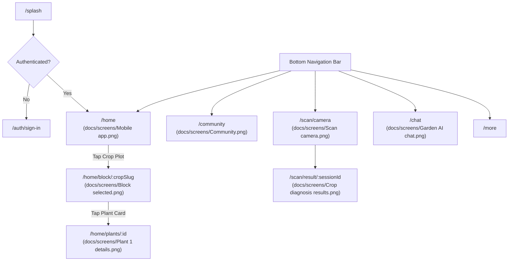
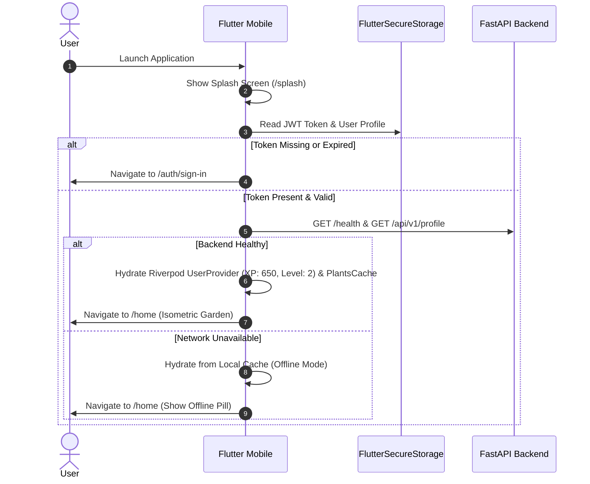
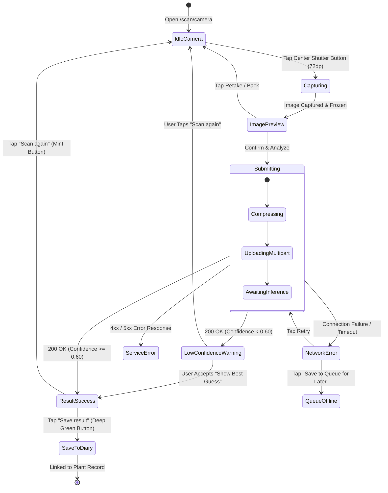
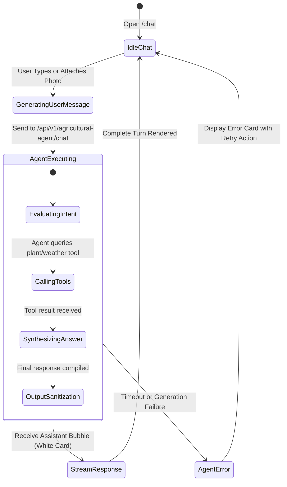

> HISTORICAL DESIGN REFERENCE ONLY. The [finalized SRS](Elora_SRS.md) overrides this document. Do not implement conflicting auth, platform, API, model-count or output requirements below.

# Garden App Flow and Screen State Specification

> **Legacy supporting specification.** [Elora SRS v1.0](Elora_SRS.md) and [implementation decisions](Elora_Implementation_Decisions.md) supersede conflicting content here. In particular, use Firebase identity, the consolidated scan job/abstention contract, twelve dataset-backed models, 768-dimensional embeddings and the newly confirmed reporting/owner review scope. Reconcile affected schemas/contracts before dependent implementation; this notice does not migrate code.

**Navigation Architecture, State Machines, and Offline Resilience**

Version 1.1  
Prepared: 27 October 2026  
Status: Approved  

This document specifies the client navigation architecture, GoRouter route inventory, state machines, transition guards, error handling, and offline synchronization rules for the **Garden** Flutter mobile client, anchored to the authoritative UI screens in `docs/screens/`.

Primary Readers: Flutter Mobile Engineers, QA Automation Engineers.

---

## 1 Purpose and authority

This specification establishes how the mobile app manages route transitions, view states, network failures, and data caching. Flutter developers must adhere to the route inventory and state machine lifecycles defined herein.

---

## 2 Flow principles

- **FLOW-001: Navigation Follows Confirmed State**: Destructive actions or network submissions must not navigate prematurely before backend confirmation or explicit optimistic state transitions are recorded.
- **FLOW-002: Interruption Resilience**: If the app is minimized or the network drops during an active camera capture or chat session, the user's progress must be preserved upon return.
- **FLOW-003: Loading Never Hides Context**: Full-screen blocking spinners are prohibited; loading transitions must utilize shimmer skeletons or inline progress indicators that retain the existing screen structure.
- **FLOW-004: Explicit Offline Grace**: When the device lacks connectivity, the app must clearly indicate offline status via an ambient banner while enabling local viewing of cached plants, previous diagnoses, and saved care guides.
- **FLOW-005: Screen Fidelity**: Every route transition must match the layout, header styling, and navigation bars depicted in the canonical screens under `docs/screens/`.

---

## 3 Navigation architecture and route inventory

Navigation is implemented using `go_router` (v14.6.2+). The primary interface utilizes a `StatefulShellRoute` to maintain independent navigation stacks across the five bottom navigation destinations shown in `docs/screens/Mobile app.png`:

```text
/
|-- /splash
|-- /auth
|   |-- /auth/sign-in
|   `-- /auth/sign-up
|-- /shell (Bottom Navigation)
|   |-- /home (Branch 0: "My garden")
|   |   |-- /home (Isometric 3D Garden Canvas)
|   |   |-- /home/block/:cropSlug (Selected Crop Block & Plant Drawer)
|   |   `-- /home/plants/:id (Plant Details & Care Schedule)
|   |-- /community (Branch 1: "Community")
|   |   |-- /community/feed (For You & Following tabs)
|   |   |-- /community/posts/new (Create Post)
|   |   `-- /community/posts/:postId (Post Details & Comments)
|   |-- /scan (Branch 2: "Scan" - Center Action FAB)
|   |   |-- /scan/camera (Viewfinder & Reticle)
|   |   |-- /scan/analyzing (Inference Progress Shimmer)
|   |   `-- /scan/result/:sessionId (Diagnosis & Treatment Results)
|   |-- /chat (Branch 3: "Chat" - Garden Assistant)
|   |   |-- /chat (Active Agricultural Conversation)
|   |   `-- /chat/history (Past Conversation Threads)
|   `-- /more (Branch 4: "More")
|       |-- /more/analytics (Predictive Farming & Weather Analytics)
|       |-- /more/profile (User Profile, Level, XP & Badges)
|       `-- /more/settings (Notifications, Account & Offline Cache)
```

### 3.1 Visual navigation mapping



---

## 4 Bootstrap and initialization sequence



---

## 5 Screen state machines

### 5.1 Computer Vision Diagnosis Lifecycle

*Reference Screens: `docs/screens/Scan camera.png` and `docs/screens/Crop diagnosis results.png`*



### 5.2 Conversational Agent Lifecycle

*Reference Screen: `docs/screens/Garden AI chat.png`*



---

## 6 Offline resilience and background sync

1. **Local Caching Protocol**:
   - `plants`, `plant_logs`, and past `assessments` records are stored in local SQLite / Hive storage upon retrieval.
   - When offline, navigating to `/home` renders the cached 3D isometric plots and plant drawer seamlessly.
2. **Queued Scans and Offline Diary**:
   - If a user captures an image while offline, the image is compressed and stored in application sandbox storage with a pending synchronization record.
   - A connectivity listener automatically triggers an asynchronous background sync when cellular or Wi-Fi connectivity is restored.
3. **Optimistic Updates**:
   - Community post likes and plant watering logs update the UI immediately; if the background HTTP call fails, the client rolls back the state and displays a non-blocking toast.

---

## 7 Acceptance scenarios and critical UI test matrix

| Scenario ID | Test Flow | Expected Behavior |
|---|---|---|
| **SCN-FLOW-01** | User selects center Tomato block on home screen. | Block illuminates with a green glow, and plant drawer smoothly slides up displaying Plant 1..N with condition chips (`docs/screens/Block selected.png`). |
| **SCN-FLOW-02** | User taps "Plant 1" in plant drawer. | Navigates to `/home/plants/1` displaying hero image, healthy condition card, and horizontal watering/fertilizer care schedule cards (`docs/screens/Plant 1 details.png`). |
| **SCN-FLOW-03** | User taps center Scan FAB, captures leaf photo, and submits. | Transition from viewfinder (`docs/screens/Scan camera.png`) to analyzing shimmer, then to scan results displaying diagnosis, symptom chips, 3 recovery steps, and dual action buttons (`docs/screens/Crop diagnosis results.png`). |
| **SCN-FLOW-04** | User asks AI assistant a question and attaches a photo via camera icon. | Chat renders image in user leaf-green bubble, shows typing indicator, and delivers assistant advice in white card (`docs/screens/Garden AI chat.png`). |
| **SCN-FLOW-05** | User navigates to Community tab. | Displays "For You / Following" segmented control and social feed cards with "+ Follow", likes, comments, and share actions (`docs/screens/Community.png`). |
