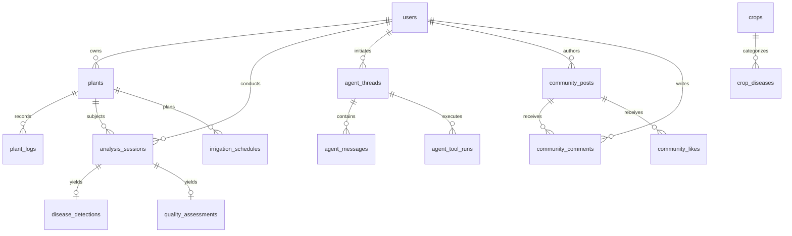

# Garden Backend Schema and Data Model

**Relational and Vector Persistence Specification**

Version 1.0  
Prepared: 27 October 2026  
Status: Approved  

This document defines the relational database schemas, pgvector embedding storage, constraints, index topologies, and migration rules for the **Garden** platform. All persistent storage runs on PostgreSQL 16 with the `pgvector` extension.

Primary Readers: Backend Engineers, Database Administrators, AI/ML Engineers.

---

## 1 Purpose and authority

### 1.1 Database boundary
This specification governs the authoritative database schema deployed via Docker Compose (`pgvector/pgvector:pg16`) and initialized via `backend/app/db/init.sql` and Alembic migrations.

### 1.2 Non-goals
- Multi-region geo-replicated active-active clustering.
- Direct external read access for AI agents or client applications (all operations must execute through the authenticated FastAPI service layer).

---

## 2 Schema principles

- **DBS-001: Explicit Entity Ownership**: Every user-generated record (`plants`, `analysis_sessions`, `community_posts`, `agent_threads`) must possess a non-null `user_id` foreign key referencing `users(id)` with cascading delete where appropriate.
- **DBS-002: Append-Only Analysis History**: Diagnostic scans and quality assessments are historical evidence; they are append-only and cannot be mutated after creation.
- **DBS-003: Co-located Vector Search**: Agronomic document chunks and agent semantic memories are stored directly in PostgreSQL using `vector(1536)` with HNSW indexing to eliminate external vector database overhead.
- **DBS-004: Strict Constraint Integrity**: Enforce foreign keys, unique constraints, and check constraints at the database level rather than relying solely on application logic.
- **DBS-005: Time and Version Clarity**: All timestamps must be `TIMESTAMPTZ` recorded in UTC (`now()`). Schema migrations must be version-tracked via Alembic.

---

## 3 Domain inventory and Entity-Relationship diagram



---

## 4 Core identity and garden assets

### 4.1 `users`
Represents registered platform accounts.
```sql
CREATE TABLE IF NOT EXISTS users (
    id UUID PRIMARY KEY DEFAULT gen_random_uuid(),
    email TEXT UNIQUE NOT NULL,
    hashed_password TEXT NOT NULL,
    display_name TEXT NOT NULL,
    avatar_url TEXT,
    created_at TIMESTAMPTZ NOT NULL DEFAULT now(),
    updated_at TIMESTAMPTZ NOT NULL DEFAULT now()
);
```

### 4.2 `plants`
Represents individual plants or crop batches managed by a user.
```sql
CREATE TABLE IF NOT EXISTS plants (
    id UUID PRIMARY KEY DEFAULT gen_random_uuid(),
    user_id UUID NOT NULL REFERENCES users(id) ON DELETE CASCADE,
    crop_slug TEXT NOT NULL CHECK (crop_slug IN ('tomato', 'chilli', 'citrus', 'banana', 'roses', 'chrysanthemum')),
    nickname TEXT NOT NULL,
    variety TEXT,
    location_description TEXT,
    planted_at DATE,
    created_at TIMESTAMPTZ NOT NULL DEFAULT now(),
    updated_at TIMESTAMPTZ NOT NULL DEFAULT now()
);

CREATE INDEX IF NOT EXISTS idx_plants_user_id ON plants(user_id);
CREATE INDEX IF NOT EXISTS idx_plants_crop_slug ON plants(crop_slug);
```

### 4.3 `plant_logs`
Chronological activity and photo diary for a specific plant.
```sql
CREATE TABLE IF NOT EXISTS plant_logs (
    id UUID PRIMARY KEY DEFAULT gen_random_uuid(),
    plant_id UUID NOT NULL REFERENCES plants(id) ON DELETE CASCADE,
    log_type TEXT NOT NULL CHECK (log_type IN ('photo', 'watering', 'fertilizer', 'pruning', 'note')),
    content TEXT,
    image_url TEXT,
    logged_at TIMESTAMPTZ NOT NULL DEFAULT now()
);

CREATE INDEX IF NOT EXISTS idx_plant_logs_plant_id ON plant_logs(plant_id);
```

---

## 5 Crop Health & Produce Quality (Dev 1 & Dev 2)

### 5.1 `analysis_sessions`
Master record for every computer vision scan submitted by a user.
```sql
CREATE TABLE IF NOT EXISTS analysis_sessions (
    id UUID PRIMARY KEY DEFAULT gen_random_uuid(),
    user_id UUID NOT NULL REFERENCES users(id) ON DELETE CASCADE,
    plant_id UUID REFERENCES plants(id) ON DELETE SET NULL,
    crop_slug TEXT NOT NULL,
    model_task TEXT NOT NULL CHECK (model_task IN ('disease', 'quality')),
    image_url TEXT NOT NULL,
    model_version TEXT NOT NULL,
    execution_time_ms INTEGER NOT NULL,
    created_at TIMESTAMPTZ NOT NULL DEFAULT now()
);

CREATE INDEX IF NOT EXISTS idx_analysis_user_crop ON analysis_sessions(user_id, crop_slug);
```

### 5.2 `disease_detections` (Dev 1)
Inference output details for disease classification scans.
```sql
CREATE TABLE IF NOT EXISTS disease_detections (
    id UUID PRIMARY KEY DEFAULT gen_random_uuid(),
    session_id UUID UNIQUE NOT NULL REFERENCES analysis_sessions(id) ON DELETE CASCADE,
    disease_label TEXT NOT NULL,
    botanical_pathogen TEXT,
    confidence NUMERIC(5,4) NOT NULL CHECK (confidence >= 0 AND confidence <= 1),
    top_predictions JSONB NOT NULL,
    severity_level TEXT CHECK (severity_level IN ('low', 'moderate', 'severe', 'healthy')),
    organic_remedy TEXT,
    chemical_remedy TEXT,
    preventive_measures TEXT
);
```

### 5.3 `quality_assessments` (Dev 2)
Inference output details for produce quality grading.
```sql
CREATE TABLE IF NOT EXISTS quality_assessments (
    id UUID PRIMARY KEY DEFAULT gen_random_uuid(),
    session_id UUID UNIQUE NOT NULL REFERENCES analysis_sessions(id) ON DELETE CASCADE,
    quality_grade TEXT NOT NULL CHECK (quality_grade IN ('Grade A', 'Grade B', 'Grade C', 'Reject')),
    ripeness_index NUMERIC(5,4) NOT NULL CHECK (ripeness_index >= 0 AND ripeness_index <= 1),
    defect_percentage NUMERIC(5,2) NOT NULL DEFAULT 0.0,
    confidence NUMERIC(5,4) NOT NULL CHECK (confidence >= 0 AND confidence <= 1),
    top_predictions JSONB NOT NULL,
    shelf_life_days INTEGER,
    harvest_recommendation TEXT
);
```

---

## 6 Predictive Farming and Weather (Dev 3)

### 6.1 `weather_snapshots`
Cached Open-Meteo micro-climate readings.
```sql
CREATE TABLE IF NOT EXISTS weather_snapshots (
    id UUID PRIMARY KEY DEFAULT gen_random_uuid(),
    latitude NUMERIC(8,5) NOT NULL,
    longitude NUMERIC(8,5) NOT NULL,
    temperature_c NUMERIC(4,2) NOT NULL,
    relative_humidity NUMERIC(5,2) NOT NULL,
    precipitation_mm NUMERIC(6,2) NOT NULL,
    weather_code INTEGER NOT NULL,
    forecast_7d JSONB NOT NULL,
    fetched_at TIMESTAMPTZ NOT NULL DEFAULT now()
);

CREATE INDEX IF NOT EXISTS idx_weather_lat_lon_time ON weather_snapshots(latitude, longitude, fetched_at DESC);
```

### 6.2 `irrigation_schedules`
Calculated watering and soil advisory plans.
```sql
CREATE TABLE IF NOT EXISTS irrigation_schedules (
    id UUID PRIMARY KEY DEFAULT gen_random_uuid(),
    plant_id UUID NOT NULL REFERENCES plants(id) ON DELETE CASCADE,
    recommended_time TIMESTAMPTZ NOT NULL,
    recommended_volume_ml INTEGER NOT NULL,
    soil_moisture_estimate NUMERIC(5,2),
    status TEXT NOT NULL DEFAULT 'pending' CHECK (status IN ('pending', 'completed', 'skipped')),
    rationale TEXT NOT NULL,
    created_at TIMESTAMPTZ NOT NULL DEFAULT now()
);
```

---

## 7 Personalized Agricultural Agent and Vector Store (Dev 4)

### 7.1 `agent_threads`
Chat sessions initiated with the LangGraph Agronomist.
```sql
CREATE TABLE IF NOT EXISTS agent_threads (
    id UUID PRIMARY KEY DEFAULT gen_random_uuid(),
    user_id UUID NOT NULL REFERENCES users(id) ON DELETE CASCADE,
    plant_context_id UUID REFERENCES plants(id) ON DELETE SET NULL,
    title TEXT NOT NULL,
    created_at TIMESTAMPTZ NOT NULL DEFAULT now(),
    updated_at TIMESTAMPTZ NOT NULL DEFAULT now()
);

CREATE INDEX IF NOT EXISTS idx_agent_threads_user ON agent_threads(user_id, updated_at DESC);
```

### 7.2 `agent_messages`
Individual conversational turns in a thread.
```sql
CREATE TABLE IF NOT EXISTS agent_messages (
    id UUID PRIMARY KEY DEFAULT gen_random_uuid(),
    thread_id UUID NOT NULL REFERENCES agent_threads(id) ON DELETE CASCADE,
    sender TEXT NOT NULL CHECK (sender IN ('user', 'assistant', 'system')),
    content TEXT NOT NULL,
    tool_calls JSONB,
    created_at TIMESTAMPTZ NOT NULL DEFAULT now()
);

CREATE INDEX IF NOT EXISTS idx_agent_messages_thread ON agent_messages(thread_id, created_at ASC);
```

### 7.3 `agent_memories` (pgvector 1536-dim)
Agronomic reference manuals, extension guides, and long-term user memories.
```sql
CREATE TABLE IF NOT EXISTS agent_memories (
    id UUID PRIMARY KEY DEFAULT gen_random_uuid(),
    user_id UUID REFERENCES users(id) ON DELETE CASCADE, -- NULL for public agronomy manual chunks
    category TEXT NOT NULL CHECK (category IN ('manual', 'diagnosis_summary', 'user_preference', 'crop_guide')),
    crop_slug TEXT,
    content TEXT NOT NULL,
    embedding vector(1536) NOT NULL,
    metadata JSONB NOT NULL DEFAULT '{}'::jsonb,
    created_at TIMESTAMPTZ NOT NULL DEFAULT now()
);

-- Cosine similarity HNSW index for high-speed retrieval
CREATE INDEX IF NOT EXISTS idx_agent_memories_embedding 
ON agent_memories USING hnsw (embedding vector_cosine_ops);
```

### 7.4 `agent_tool_runs`
Audit and telemetry logs of backend tool executions invoked by LangGraph.
```sql
CREATE TABLE IF NOT EXISTS agent_tool_runs (
    id UUID PRIMARY KEY DEFAULT gen_random_uuid(),
    thread_id UUID NOT NULL REFERENCES agent_threads(id) ON DELETE CASCADE,
    tool_name TEXT NOT NULL,
    tool_input JSONB NOT NULL,
    tool_output JSONB NOT NULL,
    duration_ms INTEGER NOT NULL,
    created_at TIMESTAMPTZ NOT NULL DEFAULT now()
);
```

---

## 8 Community and Social Hub (Dev 5)

### 8.1 `community_posts`
Public user posts and plant updates.
```sql
CREATE TABLE IF NOT EXISTS community_posts (
    id UUID PRIMARY KEY DEFAULT gen_random_uuid(),
    user_id UUID NOT NULL REFERENCES users(id) ON DELETE CASCADE,
    crop_slug TEXT CHECK (crop_slug IN ('tomato', 'chilli', 'citrus', 'banana', 'roses', 'chrysanthemum', 'general')),
    title TEXT NOT NULL,
    content TEXT NOT NULL,
    image_url TEXT,
    likes_count INTEGER NOT NULL DEFAULT 0,
    comments_count INTEGER NOT NULL DEFAULT 0,
    created_at TIMESTAMPTZ NOT NULL DEFAULT now(),
    updated_at TIMESTAMPTZ NOT NULL DEFAULT now()
);

CREATE INDEX IF NOT EXISTS idx_community_posts_created ON community_posts(created_at DESC);
CREATE INDEX IF NOT EXISTS idx_community_posts_crop ON community_posts(crop_slug);
```

### 8.2 `community_comments`
Discussion comments on posts.
```sql
CREATE TABLE IF NOT EXISTS community_comments (
    id UUID PRIMARY KEY DEFAULT gen_random_uuid(),
    post_id UUID NOT NULL REFERENCES community_posts(id) ON DELETE CASCADE,
    user_id UUID NOT NULL REFERENCES users(id) ON DELETE CASCADE,
    content TEXT NOT NULL,
    created_at TIMESTAMPTZ NOT NULL DEFAULT now()
);

CREATE INDEX IF NOT EXISTS idx_community_comments_post ON community_comments(post_id, created_at ASC);
```

### 8.3 `community_likes`
Like reactions ensuring one like per user per post.
```sql
CREATE TABLE IF NOT EXISTS community_likes (
    post_id UUID NOT NULL REFERENCES community_posts(id) ON DELETE CASCADE,
    user_id UUID NOT NULL REFERENCES users(id) ON DELETE CASCADE,
    created_at TIMESTAMPTZ NOT NULL DEFAULT now(),
    PRIMARY KEY (post_id, user_id)
);
```

---

## 9 Alembic migrations and database initialization

1. **Bootstrap Script**: `backend/app/db/init.sql` serves as the initial container entrypoint (`/docker-entrypoint-initdb.d/001-init.sql`).
2. **Alembic Evolution**: All ongoing modifications to tables, columns, or indexes must be scripted through Alembic revisions in `backend/alembic/versions/`.
3. **No Raw Schema Alterations**: Engineers are strictly prohibited from manually running `ALTER TABLE` commands on shared databases without committing a matching Alembic migration.
