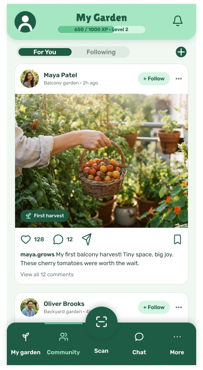

# Garden Product Requirements Document

**Crop Intelligence and Personalized Agricultural Assistant Platform**

Version 1.0  
Prepared: 27 October 2026  
Status: Approved  

This document defines the product problem, target users, business goals, scope boundaries, user journeys, functional requirements, and launch release criteria for the **Garden** platform. 

Product Owner: Garden Platform Team  
Primary Readers: Product Managers, Mobile Engineers (Flutter), Backend Engineers (FastAPI), AI/ML Engineers (CNN & Agents), UI/UX Designers, Agronomy Domain Advisors.

---

## Executive summary

Garden is an integrated mobile crop intelligence application and service ecosystem designed to empower smallholder farmers, domestic growers, and gardening enthusiasts with actionable, localized, and verifiable agronomic insights. By combining real-time computer vision (convolutional neural networks for leaf disease diagnosis and produce quality grading), predictive micro-climate analytics, a personalized LangGraph-powered agricultural assistant, and a collaborative community plant diary, Garden bridges the gap between complex agricultural science and daily garden care.

The platform is structured into five cohesive vertical slices developed in parallel by dedicated engineers, bound together by shared mobile design tokens, REST integration contracts, and a unified CNN model inference specification.

### Confirmed product decisions

| Area | Decision | Reference / Impact |
|---|---|---|
| **Client Platform** | Flutter / Dart mobile client targeting iOS and Android with Material 3 | `mobile/lib/` |
| **Backend Service** | FastAPI (Python 3.12) with asynchronous SQLAlchemy 2.0 | `backend/app/` |
| **Database & Vector Store** | PostgreSQL 16 with `pgvector` extension for structured data and semantic retrieval | `backend/app/db/` |
| **Crop AI Coverage** | 5 targeted crops: Tomato, Chilli, Citrus, Banana, Roses, Chrysanthemum | 10 CNN models total (5 disease + 5 quality) |
| **AI Agent Stack** | LangChain for typed tools, LangGraph for stateful agent workflows, LangSmith for tracing/evaluation | `ai/agent/` |
| **Weather Engine** | Open-Meteo API for real-time and forecasted agricultural weather | `OPEN_METEO_BASE_URL` |
| **Design Language** | Material 3 foundation with Cream (`#F8F6EF`), Leaf Green (`#4F8A5B`), Deep Green (`#173B2B`) visual language | Figma: *My-Garden* |
| **Model Boundary** | Strict JSON contract adherence for all CNN inference tasks | `shared/schemas/model_contract.json` |
| **Public API Prefix** | All public API routes served strictly under `/api/v1` | `docs/specifications/Garden_API_and_Integration_Contract.md` |

*Figure 1: The Gamified Living Garden Experience (`docs/screens/Mobile app.png`)*

---

## 1 Product problem

### 1.1 Current pain points
1. **Delayed Disease Diagnosis**: Smallholder and urban gardeners frequently identify plant pathogens (e.g., late blight, bacterial spot, powdery mildew) only when visual destruction is irreversible, resulting in heavy crop loss.
2. **Subjective Quality Assessment**: Assessing fruit and flower ripeness, defect levels, and market readiness is traditionally subjective, resulting in harvest errors and economic depreciation.
3. **Disconnected Weather and Soil Guidance**: Generic weather forecasts fail to provide localized, actionable advice on irrigation timing, frost prevention, or heat stress mitigation.
4. **Generic AI Hallucinations**: Standard LLM chat tools produce unsafe agronomic advice (e.g., prescribing improper pesticide concentrations or toxic chemical cocktails) because they lack grounding in validated plant knowledge bases and real-time garden context.
5. **Isolation and Lack of Peer Validation**: Growers lack a structured log of plant progress and an engaged community where localized pest outbreaks and successes can be shared.

### 1.2 Product response
Garden delivers a localized, multi-modal crop intelligence platform:
- Instant point-and-shoot leaf disease classification and severity scoring via on-device/cloud CNNs.
- Automated produce maturity and physical quality grading for targeted crops.
- Hyper-local predictive farming schedules matching crop developmental stages with micro-climate precipitation and evapotranspiration data.
- A grounded, stateful AI Agronomist using LangGraph that retrieves the user's personal plant diary, recent CNN diagnoses, and validated extension guidance before issuing advice.
- A community diary and knowledge hub for peer verification, plant tracking, and localized alerts.

### 1.3 Product promise
A grower can photograph any supported plant, receive an authoritative diagnosis or quality grading within seconds, understand the exact biological rationale, view forecasted weather risks, and ask an AI agricultural assistant for safe, grounded treatment instructions.

---

## 2 Target users

### 2.1 Primary personas

#### Persona A: The Urban & Home Gardener (Leisure & Food Security)
- **Profile**: Maintains 5–30 potted or backyard plants (tomatoes, chillies, potted citrus, ornamental roses, chrysanthemums).
- **Goals**: Keep plants vibrant, detect leaf yellowing/spots early, learn proper watering schedules, harvest healthy produce.
- **Frustrations**: Unsure whether yellowing leaves mean overwatering, fungal infection, or nutrient deficiency; easily confused by dense agronomy manuals.

#### Persona B: The Smallholder Cash-Crop Farmer
- **Profile**: Manages 0.5–2 acres of cash crops (bananas, tomatoes, citrus orchards).
- **Goals**: Maximize marketable yield, prevent pathogen contagion across beds, schedule irrigation around rainfall, grade produce before wholesale.
- **Frustrations**: Extension officers visit rarely; chemical treatments are expensive; poor grading reduces selling price at local markets.

### 2.2 Secondary users (Post-MVP)
- **Agricultural Extension Agents**: Field officers monitoring regional pest outbreaks and issuing bulk advisory alerts.
- **Community Garden Coordinators**: Administrators managing collective urban allotment gardens.

---

## 3 Goals and success measures

### 3.1 Business and product goals
1. **Diagnosis Accuracy & Trust**: Achieve $\ge 90\%$ Top-1 accuracy across all supported disease detection classes on validation datasets, with an uncalibrated confidence warning mechanism.
2. **Rapid Actionability**: Provide diagnosis results, quality grades, and immediate mitigation steps in $< 2.5\text{ seconds}$ over mobile networks.
3. **High Agent Grounding**: Maintain $0\%$ severe hallucinations on pesticide and dosage recommendations by routing all chemical and biological controls through validated tool retrievals.
4. **Sustained Engagement**: Increase 30-day user retention through proactive weather-driven plant care reminders and community interaction.

### 3.2 Guardrail measures
- **Zero Critical Agronomic Violations**: Under no circumstance may the agent recommend restricted or banned toxic chemicals for domestic consumption crops.
- **Graceful Failure**: If a CNN inference yields confidence $< 0.60$, the system must explicitly warn the user and recommend re-taking the photo under proper lighting rather than presenting a false positive.

---

## 4 Product scope

### 4.1 Included in MVP

Garden is organized into five developer-owned vertical modules:

#### Module 1: Crop Health Analysis (Dev 1)
- **Target Crops**: Tomato and Chilli.
- **CNN Models (4 total)**:
  - Tomato Leaf Disease Classifier.
  - Tomato Produce Quality / Ripeness Assessor.
  - Chilli Leaf Disease Classifier.
  - Chilli Produce Quality / Defect Assessor.
- **Key Capabilities**: Camera capture, bounding-box leaf focus, diagnosis result breakdown with treatment advice (organic + chemical), and scan history.

#### Module 2: Produce Quality Assessment (Dev 2)
- **Target Crop**: Citrus (Orange, Lemon, Lime).
- **CNN Models (2 total)**:
  - Citrus Leaf & Fruit Disease Classifier (e.g., citrus canker, black spot, greening).
  - Citrus Ripeness and Surface Quality Grading Model.
- **Key Capabilities**: Quality score breakdown (0–100 scale), defect percentage estimation, harvest recommendation, shelf-life estimation.

#### Module 3: Predictive Farming Analytics (Dev 3)
- **Target Crop**: Banana.
- **CNN Models (2 total)**:
  - Banana Leaf Disease Classifier (e.g., Sigatoka, Panama wilt, bunchy top).
  - Banana Bunch Maturity and Quality Assessor.
- **Key Capabilities**: Open-Meteo weather integration (7-day forecast, hourly precipitation, UV index, humidity), dynamic evapotranspiration-based irrigation advisories, fertilization schedules.

#### Module 4: Personalized Agricultural Agent (Dev 4)
- **Target Crop**: Roses (Floriculture).
- **CNN Models (2 total)**:
  - Rose Foliage Disease Classifier (e.g., black spot, powdery mildew, rust).
  - Rose Bloom Quality and Vigour Evaluator.
- **Key Capabilities**: Interactive multi-turn conversational AI built on LangGraph, tool execution (weather lookup, diagnosis history fetch, plant profile query), semantic memory retrieval over `pgvector`, LangSmith telemetry.

#### Module 5: Community and User Accounts (Dev 5)
- **Target Crop**: Chrysanthemum (Floriculture & Ornamental).
- **CNN Models (2 total)**:
  - Chrysanthemum Disease Classifier (e.g., white rust, septoria spot).
  - Chrysanthemum Floral Quality Assessor.
- **Key Capabilities**: User authentication (JWT), plant profile registration (crop type, nickname, planting date), plant journal/diary with photos, community feed with post creation, comments, and disease alerts.

### 4.2 Excluded from MVP
- Commercial drone multispectral imagery processing.
- Direct e-commerce marketplace for fertilizer/pesticide checkout.
- Automated IoT hardware sensor pairing (e.g., BLE soil moisture probes).
- Multi-tenant enterprise farm management.

---

## 5 Product principles

1. **Grower-First Clarity**: Complex agronomic findings (e.g., *Xanthomonas perforans*) must always be accompanied by plain-language terminology ("Bacterial Spot") and immediate, practical steps.
2. **Zero Unverifiable AI Claims**: Every chemical or cultural recommendation provided by the AI Assistant must cite its agronomic source or state that it is a general best practice.
3. **Speed in the Field**: Mobile interactions must work smoothly in direct sunlight, with high contrast, large touch targets, and resilient handling of poor rural cellular connections.
4. **Data Ownership & Privacy**: Garden photos and location coordinates are used solely for weather forecasting, diagnostic inference, and community sharing upon explicit opt-in.
5. **Architectural Isolation**: Modules maintain strict encapsulation. Dev 1 does not access Dev 2's internal tables; integration occurs via `/api/v1` and shared schemas.

---

## 6 Core user journeys

### Journey 1: Identifying a Diseased Tomato Leaf (Dev 1)
1. Grower notices brown spots on tomato leaves.
2. Opens Garden mobile app and selects the raised **Scan** action from the bottom navigation.
3. Aligns the camera viewfinder with the affected leaf using the reticle guide (`docs/screens/Scan camera.png`).
4. App submits image to `/api/v1/crop-health/analyze`.
5. Screen displays diagnosis: "Possible powdery mildew", confidence $94\%$, severity: Moderate (`docs/screens/Crop diagnosis results.png`).
6. Grower reviews the 3-step action plan: prune badly affected leaves, keep leaves dry & improve airflow, and confirm before treating.
7. Grower taps **Save result**, linking the diagnosis to their backyard "Plant 1" tomato entry (`docs/screens/Plant 1 details.png`).

| Step 1: Camera Scanner | Step 2: Diagnosis & Recovery | Step 3: Plant Diary & Care |
|---|---|---|
|  |  |  |

### Journey 2: Citrus Harvesting Quality Check (Dev 2)
1. Grower examines a citrus crop to determine picking readiness.
2. Selects **Quality Assessment**, snaps a photo of several citrus fruits on the tree.
3. System invokes the Citrus Quality model via `/api/v1/produce-quality/analyze`.
4. Returns: Grade A ($88\%$ harvest readiness), estimated 4 days to optimal sugar-acid ratio, zero fungal blemish detected.

### Journey 3: Banana Irrigation Planning via Micro-Climate (Dev 3)
1. Banana grower checks the **Farming Analytics** tab.
2. App queries Open-Meteo for local coordinates and computes soil moisture deficit.
3. Dashboard advises: "Rainfall expected in 36 hours (18mm). Delay scheduled deep drip irrigation by 2 days to prevent root rot."

### Journey 4: Seeking Care Instructions from the AI Agronomist (Dev 4)
1. Grower observes yellowing leaves and asks the AI chat: "My tomato leaves are turning yellow. What should I do?" (`docs/screens/Garden AI chat.png`).
2. LangGraph agent triggers the `get_user_plant_history` tool, noticing a recent watering checkup recorded 2 days prior.
3. Agent replies conversationally: "Let's figure it out! Yellow leaves can mean too much water. Is the soil still wet, and are the lower leaves turning yellow?"
4. User confirms: "Yes, the soil is still quite wet."
5. Agent delivers grounded guidance: "Let the top 2-3 cm of soil dry before watering again. Good drainage will help those roots breathe!"

  
*Figure 2: Conversational Guidance with the Garden Assistant (`docs/screens/Garden AI chat.png`)*

### Journey 5: Community Sharing & Chrysanthemum Showcase (Dev 5)
1. Grower creates an account, registers their potted "Autumn Chrysanthemum", and takes a weekly photo log.
2. Shares a photo to the community feed: "My first balcony harvest! Tiny space, big joy. These cherry tomatoes were worth the wait." (`docs/screens/Community.png`).
3. Nearby growers view the post under the "For You" tab, follow the creator, and leave comments and likes.

  
*Figure 3: Community Feed and Social Journal (`docs/screens/Community.png`)*

---

## 7 Functional requirements

### 7.1 Shared Core & Authentication
- **FR-CORE-01**: The system must allow users to register and sign in with email and password, receiving a standard JWT bearer token.
- **FR-CORE-02**: The system must allow users to create and manage plant profiles (id, crop slug, nickname, planted date, notes).
- **FR-CORE-03**: All public API endpoints must be exposed under `/api/v1` and document errors via a unified error object `{ "error": { "code": string, "message": string, "details": any } }`.

### 7.2 Crop Health Analysis (Dev 1)
- **FR-HEALTH-01**: Provide leaf disease classification for Tomato and Chilli crops via `POST /api/v1/crop-health/analyze`.
- **FR-HEALTH-02**: Return predicted disease label, botanical pathogen name, calibrated confidence, top-3 alternate predictions, and organic/chemical remedy recommendations.
- **FR-HEALTH-03**: Support historical review of all past health scans via `GET /api/v1/crop-health/history`.

### 7.3 Produce Quality Assessment (Dev 2)
- **FR-QUAL-01**: Provide fruit quality and ripeness grading for Citrus crops via `POST /api/v1/produce-quality/analyze`.
- **FR-QUAL-02**: Calculate overall quality grade (Grade A, B, C, Reject), ripeness index ($0..1$), and visual defect breakdown (scabs, discoloration, sunburn).
- **FR-QUAL-03**: Return recommended picking window and estimated storage shelf-life.

### 7.4 Predictive Farming Analytics (Dev 3)
- **FR-PRED-01**: Ingest real-time and 7-day predictive weather data from Open-Meteo based on latitude/longitude coordinates via `GET /api/v1/predictive-farming/weather`.
- **FR-PRED-02**: Deliver crop-specific irrigation and spray window advisories for Banana crops via `GET /api/v1/predictive-farming/recommendations`.
- **FR-PRED-03**: Support Banana leaf disease classification and bunch quality assessment matching the shared CNN model contract.

### 7.5 Personalized Agricultural Agent (Dev 4)
- **FR-AGNT-01**: Provide a multi-turn conversational AI interface via `POST /api/v1/agricultural-agent/chat`.
- **FR-AGNT-02**: Orchestrate agent steps using LangGraph with state persistence across conversational turns.
- **FR-AGNT-03**: Equip agent with typed LangChain tools: weather forecast retrieval, user plant profile query, past diagnosis lookup, and agronomic knowledge retrieval.
- **FR-AGNT-04**: Index agronomic reference documents using PostgreSQL `pgvector` embeddings to ensure grounded, verifiable responses.
- **FR-AGNT-05**: Support Rose disease detection and bloom quality assessment matching the shared CNN model contract.

### 7.6 Community and User Accounts (Dev 5)
- **FR-COMM-01**: Enable users to post updates, photos, and questions to a public community feed via `POST /api/v1/community/posts`.
- **FR-COMM-02**: Allow users to like, comment on, and filter feed posts by crop category (Tomato, Chilli, Citrus, Banana, Roses, Chrysanthemum).
- **FR-COMM-03**: Support Chrysanthemum disease detection and bloom quality assessment matching the shared CNN model contract.

---

## 8 AI and CNN model inventory

All 10 CNN models adhere to the inference schema defined in `shared/schemas/model_contract.json`:

| Model ID | Module Owner | Target Crop | Task | Target Classes / Metrics |
|---|---|---|---|---|
| `CNN-TOM-DIS` | Dev 1 | Tomato | Disease | Early Blight, Late Blight, Septoria, Yellow Leaf Curl, Healthy |
| `CNN-TOM-QLT` | Dev 1 | Tomato | Quality | Green, Breaker, Turning, Pink, Light Red, Red, Defective |
| `CNN-CHL-DIS` | Dev 1 | Chilli | Disease | Anthracnose, Bacterial Leaf Spot, Leaf Curl, Phytophthora, Healthy |
| `CNN-CHL-QLT` | Dev 1 | Chilli | Quality | Export Quality, Domestic Grade A, Grade B, Damaged/Diseased |
| `CNN-CTR-DIS` | Dev 2 | Citrus | Disease | Citrus Canker, Black Spot, Greening (HLB), Melanose, Healthy |
| `CNN-CTR-QLT` | Dev 2 | Citrus | Quality | Premium Grade A, Standard Grade B, Processing Grade C, Cull |
| `CNN-BAN-DIS` | Dev 3 | Banana | Disease | Black Sigatoka, Panama Disease (Fusarium), Banana Bunchy Top, Healthy |
| `CNN-BAN-QLT` | Dev 3 | Banana | Quality | Stage 1 (Green) through Stage 7 (Overripe), Export vs Local Grade |
| `CNN-ROS-DIS` | Dev 4 | Roses | Disease | Black Spot, Powdery Mildew, Rust, Downy Mildew, Healthy |
| `CNN-ROS-QLT` | Dev 4 | Roses | Quality | Show Grade (Pristine), Garden Grade, Pest Damaged, Spent Bloom |
| `CNN-CHR-DIS` | Dev 5 | Chrysanthemum | Disease | White Rust, Septoria Leaf Spot, Ray Blight, Healthy |
| `CNN-CHR-QLT` | Dev 5 | Chrysanthemum | Quality | Fully Formed Exhibition, Commercial Cut, Bud Stage, Imperfect |

---

## 9 Experience and accessibility requirements

1. **Visual Foundation**: Cream background (`#F8F6EF`), Leaf Green brand actions (`#4F8A5B`), Deep Green headings (`#173B2B`), and Ink body text (`#1B241E`).
2. **Readability & Contrast**: Strict adherence to WCAG 2.1 AA contrast ratios ($\ge 4.5:1$ for normal body text, $\ge 3:1$ for large text and key UI components).
3. **Responsive Mobile Ergonomics**: Primary action buttons (e.g., Shutter, Submit, Send) positioned in the lower third of the screen for single-handed thumb operation.
4. **Field Lighting Support**: Viewfinder overlay must maintain clear framing guidelines in direct sunlight.

---

## 10 Trust, safety and agronomic disclaimers

1. **Chemical Treatment Safeguards**: Every chemical remedy displayed must include standard PPE (personal protective equipment) notices and a recommendation to consult local agricultural extension specialists.
2. **Pesticide Regulatory Notice**: "Always check local environmental regulations before applying synthetic chemical compounds."
3. **Medical & Toxicity Disclaimers**: Clarify that plant disease diagnoses are for horticultural management and do not guarantee safety for human ingestion if contaminated by severe mycotoxins.

---

## 11 Release criteria and launch gates

### 11.1 Functional launch gates
- [ ] All 10 CNN models produce responses matching `shared/schemas/model_contract.json` with inference latency $< 1.5\text{ s}$ on standard test images.
- [ ] All module API routes are operational under `/api/v1` and pass `pytest` automated test suites.
- [ ] Flutter app builds cleanly for iOS and Android with zero critical analyzer warnings.
- [ ] Database migrations execute idempotently from empty PostgreSQL instance to latest schema.
- [ ] LangGraph agent completes 10 standard multi-turn agricultural scenarios with accurate tool calls and zero critical hallucinations.

### 11.2 Reliability & security gates
- [ ] Health check endpoint `GET /health` returns `{"status": "ok", "service": "garden-api"}` with response time $< 50\text{ ms}$.
- [ ] No unhashed passwords or raw secrets stored in database or source code.
- [ ] `docker compose up -d` boots cleanly and connects database with `pgvector` enabled.
