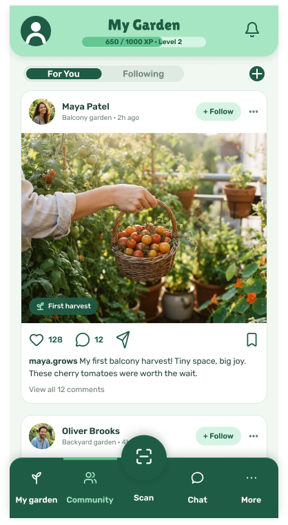

> HISTORICAL DESIGN REFERENCE ONLY. The [finalized SRS](Elora_SRS.md) overrides this document. Do not implement conflicting auth, platform, API, model-count or output requirements below.

# Garden UI/UX Design Specification

> **Legacy supporting specification.** [Elora SRS v1.0](Elora_SRS.md) and [implementation decisions](Elora_Implementation_Decisions.md) supersede conflicting content here. In particular, use Firebase identity, the consolidated scan job/abstention contract, twelve dataset-backed models, 768-dimensional embeddings and the newly confirmed reporting/owner review scope. Reconcile affected schemas/contracts before dependent implementation; this notice does not migrate code.

**Visual System, Component Hierarchy, and Screen Specifications**

Version 1.1  
Prepared: 27 October 2026  
Status: Approved  

This document defines the visual tokens, design principles, component library, and screen layout specifications for the **Garden** Flutter mobile client. It enforces design fidelity with the **My-Garden** Figma foundation and the canonical screen references located in `docs/screens/`.

Primary Readers: Flutter Mobile Engineers, UI/UX Designers, QA Engineers.

---

## 1 Purpose and authority

### 1.1 Implementation authority
The mobile user interface is built strictly with Flutter using Material 3. The authoritative visual composition of each primary screen is defined by the exported screen PNGs in `docs/screens/` and the official Figma project.

When visual discrepancies arise between raw code and design assets, the PNGs and this specification govern implementation.

### 1.2 Design foundation link
- **Figma Reference (Dev Mode)**: [My Garden Design System & Screens](https://www.figma.com/design/i3Jq3mO3o724r7J8JjkKLv/My-Garden?m=dev)
- **Local Screen Exports**: Located under [`docs/screens/`](../screens/)

---

## 2 Experience principles

- **UIX-001: Immediate Actionability**: When a disease or defect is detected, the primary remedy must be visible above the scroll fold.
- **UIX-002: Field-Ready High Contrast**: Critical indicators (disease severity, quality grade, watering alerts) must remain legible in harsh, direct outdoor sunlight.
- **UIX-003: Single-Handed Thumb Reach**: Primary interactions (camera shutter, chat input, action buttons) are anchored in the lower 35% of the viewport.
- **UIX-004: Graceful Degradation**: Offline states, slow network inferences, and low-confidence predictions must always provide clear recovery pathways without blocking app navigation.
- **UIX-005: Gamified Living Garden**: The home experience visualizes the user's garden as a living, 3D isometric ecosystem with XP progression, giving rewarding visual feedback for consistent plant care.

---

## 3 Visual system and tokens

### 3.1 Color tokens

Defined in `mobile/lib/core/theme/app_theme.dart` and derived from Figma screen exports:

| Token Name | Hex Code | Flutter Color Constant | Usage / Semantics |
|---|---|---|---|
| **Cream** | `#F8F6EF` | `GardenColors.cream` | Global scaffold background, card surfaces, app bars |
| **Deep Green** | `#173B2B` | `GardenColors.deepGreen` | Primary typography, active icons, navigation bar fill (`#1E4D3B`), primary CTAs |
| **Leaf Green** | `#4F8A5B` | `GardenColors.leafGreen` | User chat bubbles (`#52B788`), secondary progress highlights |
| **Mint Header** | `#A6E3C3` | `GardenColors.mint` | Top header bar background, action badge fills, back button circles |
| **Field Green** | `#52B788` | `Color(0xFF52B788)` | Isometric garden canvas background |
| **Ink** | `#1B241E` | `GardenColors.ink` | High-contrast body text, form input text, card headers |
| **Muted** | `#6C766E` | `GardenColors.muted` | Secondary captions, timestamps, placeholder text, borders |
| **Danger** | `#B34D45` | `GardenColors.danger` | Disease warnings, critical checkup alerts, error toasts |
| **Card White** | `#FFFFFF` | `Colors.white` | Elevated card surfaces, chat assistant bubbles, text input fields |

### 3.2 Typography

Font Family: `Inter` across all platforms.

| Style Name | Size | Weight | Line Height | Color Token |
|---|---|---|---|---|
| **Display Title** | 28sp | Semi-Bold (w600) | 34sp | `deepGreen` |
| **Screen Title** | 22sp | Semi-Bold (w600) | 28sp | `deepGreen` |
| **Section Header** | 18sp | Semi-Bold (w600) | 24sp | `deepGreen` |
| **Card Header** | 16sp | Semi-Bold (w600) | 22sp | `ink` |
| **Body Regular** | 14sp | Regular (w400) | 20sp | `ink` |
| **Body Medium** | 14sp | Medium (w500) | 20sp | `ink` |
| **Caption / Label** | 12sp | Regular (w400) | 16sp | `muted` |
| **Badge Label** | 11sp | Semi-Bold (w600) | 14sp | `deepGreen` or `white` |

### 3.3 Shape and elevation
- **Input Fields**: Corner radius `32.0px` for pill search/chat bars, `16.0px` for standard form fields, filled with `Colors.white`.
- **Cards**: Corner radius `20.0px` (`BorderRadius.circular(20)`), zero elevation (`elevation: 0`), subtle surface differentiation against `cream` background.
- **Buttons**: Full pill (`BorderRadius.circular(28)`) or `16.0px` rounded rectangles for dual CTA rows.
- **Top Header Bar**: Curved bottom edges (`BorderRadius.vertical(bottom: Radius.circular(24))`).

---

## 4 Global component library

### 4.1 Top App Bar ("My Garden" Header)
- Background: Mint (`#A6E3C3`) with curved bottom border.
- Left: User profile circular avatar button.
- Center: Screen title ("My Garden") with an inline XP / Level progression pill (`650 / 1000 XP • Level 2`).
- Right: Notification bell icon button.

### 4.2 Bottom Navigation Bar
Persistent across main tabs with curved deep-green container (`#1E4D3B`):
1. **My garden**: Icon `Icons.yard_outlined` / Sprout icon.
2. **Community**: Icon `Icons.people_outline`.
3. **Scan (Center FAB)**: Elevated circular Leaf Green button with scanner/reticle icon.
4. **Chat**: Icon `Icons.chat_bubble_outline`.
5. **More**: Icon `Icons.more_horiz`.

### 4.3 Circular Action Controls
- Back button: `44x44 dp` circular button with light mint background and dark green arrow (`#173B2B`).
- Help button: `44x44 dp` circular button with light mint background and dark green `?` icon.
- Camera Shutter: `72x72 dp` double-ring circular button with deep green center.

---

## 5 Screen specifications and authoritative screen references

### 5.1 Home Dashboard — Isometric Living Garden

*Figure 1: Home Dashboard (`docs/screens/Mobile app.png`)*

- **Top Bar**: Mint header with User Profile, "My Garden" title, Level/XP progress bar (`650 / 1000 XP • Level 2`), and notification bell.
- **Main Viewport**: Field Green background displaying 5 3D isometric garden plots:
  - **Top-Left Plot**: Citrus orchard (Dev 2).
  - **Top-Right Plot**: Rose flower bed (Dev 4).
  - **Center Plot**: Tomato patch with staking and fruits (Dev 1).
  - **Bottom-Left Plot**: Banana grove (Dev 3).
  - **Bottom-Right Plot**: Chilli crop beds (Dev 1 / Dev 5 Chrysanthemum).
- **Interactivity**: Tapping any isometric plot illuminates it with a glowing green selection boundary and slides up the Plant Drawer.
- **Bottom Navigation**: Persistent deep-green bar with raised center Scan button.

---

### 5.2 Selected Garden Block & Plant Drawer

*Figure 2: Selected Crop Block & Plant Drawer (`docs/screens/Block selected.png`)*

- **Selection State**: Center block displays a radiant green outline glow; title changes to "[Crop Name] - [N] Plants" (e.g., "Tomato • 10 Plants").
- **Slide-Up Sheet**: Rounded bottom sheet presenting scrollable plant checkup cards:
  - **Thumbnail**: Left-aligned rounded photo thumbnail.
  - **Title**: Plant identifier (e.g., "Plant 1", "Plant 2").
  - **Checkup Timestamp**: "Last checkup: Oct 7, 2026".
  - **Condition Badge**: "Condition: Healthy" (in green) or "Condition: Early blight" / "Condition: Septoria leaf spot" (in red/danger text).
- **Navigation**: Tapping a card opens the detailed Plant Profile.

---

### 5.3 Plant Details & Care Schedule

*Figure 3: Plant Details Screen (`docs/screens/Plant 1 details.png`)*

- **Subheader**: Mint circular back button with "Plant details" title.
- **Hero Image Card**: Full-width rounded card showing plant photography with crop category tag pill ("Tomato" with sprout icon).
- **Condition Card**: Light mint/cream card displaying plant title ("Plant 1"), last checkup date, and current health status ("Condition: Healthy").
- **Section: "A little care, next"**:
  - Horizontal scroll row of actionable care cards:
    - **Watering Card**: Water droplet icon in mint circle, "Next watering", "Saturday, Oct 10, 2026", frequency: "Every 3 days".
    - **Fertilizer Card**: Sprout icon in mint circle, "Next fertilizer", "Wednesday, Oct 14, 2026", frequency: "Every 14 days".

---

### 5.4 Scan Camera Viewfinder

*Figure 4: Scan Camera Viewfinder (`docs/screens/Scan camera.png`)*

- **Header**: Mint top bar with back button, "Scan plant" title, "My Garden" subtitle, and help `?` button.
- **Viewfinder**: Centered $280 \times 280\text{ dp}$ white corner reticle framing guidelines.
- **In-Camera Controls**:
  - Top-left: Flash toggle pill ("Off" / "On").
  - Center bottom: Zoom toggle badge ("1x").
- **Bottom Shutter Bar**:
  - Left: Gallery picker button ("Gallery" with image icon).
  - Center: Dual-ring circular shutter button ($72\text{ dp}$ deep green).
  - Right: Camera flip button ("Flip" with cycle camera icon).

---

### 5.5 Crop Diagnosis Results

*Figure 5: Crop Diagnosis Results Screen (`docs/screens/Crop diagnosis results.png`)*

- **Header**: Mint top bar with back button, "Scan results" title, "My Garden" subtitle, and help `?` button.
- **Hero Image**: Captured plant photo with top-left pill: "Sample result".
- **Diagnosis Card**:
  - Left: Leaf thumbnail with detected pathogen spot.
  - Title: Bold primary diagnosis (e.g., "Possible powdery mildew").
  - Subtitle: Crop slug and scan type ("Basil • illustrative scan").
  - Disclaimer Tag: "Not a confirmed diagnosis" in warm amber.
- **Symptom Tags ("Visible in this sample")**:
  - Horizontal wrap of mint pill chips: e.g. "White powdery patches", "Pale leaf edges".
- **Recovery Action Plan ("Help your [crop] recover")**:
  - White card container with 3 icon-guided steps:
    1. **Scissors Icon**: "Remove badly affected leaves" — Bag them and clean your pruning tools.
    2. **Airflow Icon**: "Keep leaves dry & improve airflow" — Water at the soil; give plants some space.
    3. **Chat Icon**: "Confirm before treating" — If it spreads, ask a local plant expert.
- **Advisory Footnote**: `(i) Demo only. Other issues can look similar; a photo alone cannot confirm a disease.`
- **Bottom Dual CTAs**:
  - Left Button: "Scan again" with reticle icon (Mint background, deep green text).
  - Right Button: "Save result" with bookmark icon (Deep green background, white text).

---

### 5.6 Garden Assistant AI Chat

*Figure 6: Garden Assistant AI Chat (`docs/screens/Garden AI chat.png`)*

- **Top Bar**: Mint header with Level/XP progression bar.
- **Subheader**: Sprout avatar, "Garden assistant", "• AI-powered • Here to help you grow", and `...` options menu.
- **Chat Feed**:
  - **Timestamp**: Centered subtle timestamp ("Today, 9:41 AM").
  - **Assistant Bubbles**: White/off-white cards (`#FFFFFF`), rounded corners ($20\text{ px}$), Ink typography.
  - **User Bubbles**: Leaf Green containers (`#52B788`), rounded corners ($20\text{ px}$), dark text (`#1B241E`).
- **Input Area**:
  - Full-width pill container with white fill.
  - Left: Camera icon button to attach leaf/plant photo directly into chat.
  - Center: Text input field: "Ask your garden assistant...".
  - Right: Deep green circular send button with white upward arrow.
  - Footer Caption: "A little AI help for a happier garden."

---

### 5.7 Community Feed & Social Journal

*Figure 7: Community Feed Screen (`docs/screens/Community.png`)*

- **Top Bar**: Mint header with Level/XP bar.
- **Segmented Filter Bar**:
  - Dual pill toggle: "For You" (active deep-green pill with white text) vs "Following" (inactive mint pill).
  - Right: Floating circular "+" button in deep green to create new post.
- **Feed Card**:
  - White container with $20\text{ px}$ radius.
  - **Author Header**: Circular user avatar, Display name ("Maya Patel"), location/time metadata ("Balcony garden • 2h ago"), "+ Follow" button in light mint, and options menu (`...`).
  - **Post Media**: Full-width rounded image with bottom-left category tag pill ("First harvest" with sprout icon).
  - **Engagement Bar**: Heart icon + like count (128), comment icon + comment count (12), share paper-plane icon, and right-aligned bookmark icon.
  - **Caption**: Username in bold, user description, and "View all 12 comments" link.
- **Bottom Navigation**: Persistent deep-green bar.

---

## 6 Screen-to-source mapping

| Canonical PNG | Primary Route | Owning Feature Path |
|---|---|---|
| `docs/screens/Mobile app.png` | `/home` | `mobile/lib/features/home/` & `mobile/lib/core/` |
| `docs/screens/Block selected.png` | `/home/block/:cropSlug` | `mobile/lib/features/home/widgets/` |
| `docs/screens/Plant 1 details.png` | `/plants/:id` | `mobile/lib/features/plants/screens/` |
| `docs/screens/Scan camera.png` | `/crop-health/camera` | `mobile/lib/features/crop_health/screens/` |
| `docs/screens/Crop diagnosis results.png` | `/crop-health/result/:sessionId` | `mobile/lib/features/crop_health/screens/` |
| `docs/screens/Garden AI chat.png` | `/agent/chat/:threadId` | `mobile/lib/features/agricultural_agent/screens/` |
| `docs/screens/Community.png` | `/community/feed` | `mobile/lib/features/community/screens/` |

---

## 7 Component acceptance checklist for engineers

Before submitting a pull request touching any mobile screen, engineers must verify:
- [ ] Top App Bar includes the mint background (`#A6E3C3`) and Level/XP progress pill where required.
- [ ] Bottom Navigation Bar conforms to the deep green (`#1E4D3B`) style with the raised center Scan button.
- [ ] Camera scanner displays the $280 \times 280\text{ dp}$ rounded reticle framing guide.
- [ ] Diagnosis result screen includes symptom tags, 3 recovery steps, and dual "Scan again" / "Save result" action buttons.
- [ ] AI Chat matches the white/leaf-green bubble scheme and pill input bar with camera upload.
- [ ] Community feed cards include the author header with "+ Follow", category image tag, and four-icon engagement row.
